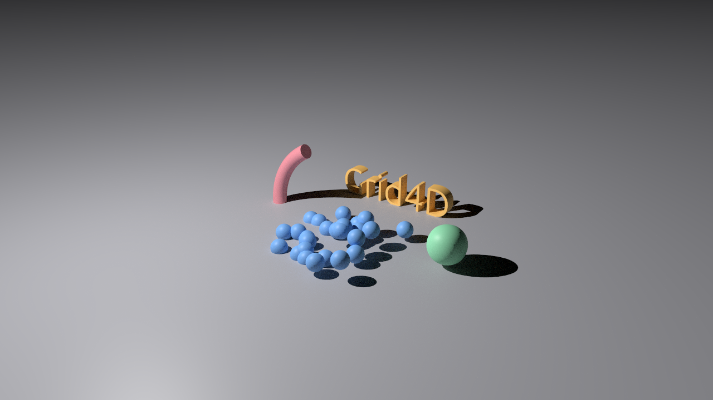

# Grid4D

A free, open-source 3D content creation suite for Windows, macOS and Linux:
model, animate, simulate and render in a calm, familiar layout — one viewport,
an Object Manager, an Attribute Manager and a timeline. Written in Rust.

<a href="https://buymeacoffee.com/mitsislav"></a>


## Download

Get the package for your system from the
[latest release](../../releases/latest):

| System | Package |
|--------|---------|
| Windows 10 or later | `…-windows-x64.msi` (installer) or `…-windows-x64.zip` (unpack and run `grid4d.exe`) |
| macOS 11 or later (Apple silicon and Intel) | `…-macos-universal.dmg` — drag Grid4D into *Applications* |
| Linux (64-bit) | `…-linux-x64.AppImage` (make it executable and run it) or `…-linux-x64.tar.gz` |

The packages are not code-signed yet. On Windows, if SmartScreen warns, choose
**More info ▸ Run anyway**; on macOS, right-click Grid4D in *Applications* and
choose **Open** the first time. You need a graphics card with Vulkan,
Direct3D 12 or Metal (any from the last decade).

## What it does

- **Modelling** — parametric primitives; polygon modelling in Points, Edges
  and Polygons modes (extrude, inset, bevel, bridge, loop and line cuts,
  weld, melt, dissolve, optimize) with snapping; Subdivision Surfaces.
- **Splines** — spline shapes, the Pen, point and handle editing; surfaces
  from splines: Extrude, Lathe, Sweep, Loft; 3D text.
- **Deformers and clones** — Bend, Twist, Taper, Bulge and FFD; a Cloner
  (linear, radial, grid, on a surface) with Plain and Random effectors — all
  live and non-destructive.
- **Animation** — keys on positions and on object parameters, Autokeying,
  the timeline and an F-Curve editor.
- **Simulation** — rigid and collider bodies on objects and on clones,
  cached and saved with the document.
- **Materials and UVs** — one principled material with pictures on every
  channel (colour, roughness, metallic, normal and bump, emission, cut-outs,
  glass, clear coat), layered Material tags with projections, a Texture
  Manager, and a UV Editor with unwrapping, relaxing and packing.
- **Rendering** — a viewport with textures, shading modes, shadows, ambient
  occlusion, up to four views and scene cameras; a built-in path tracer with
  an interactive Render View, a Picture Viewer, and stills and animations to
  PNG or OpenEXR.
- **Workspace** — dockable layouts, Layers, Takes, Preferences, Dark /
  Darker / Light themes, English and Greek.
- **Files** — the documented `.g4d` format; glTF 2.0 and OBJ import and
  export, with materials and pictures.
- **Extending** — scripts in [Rhai](https://rhai.rs) with a Script Manager;
  plugins written in Rust.
- **Peace of mind** — undo for every change, autosave with recovery after a
  crash, local crash reports (never sent anywhere).



## Documentation

- [User manual](docs/manual.md) — every tool and command, with pictures.
- [Scripting](docs/scripting.md) and [writing plugins](docs/plugins.md).
- [The `.g4d` file format](docs/FILE_FORMAT.md), so other programs can read
  and write it.
- [Changelog](CHANGELOG.md) and the [plan](docs/IMPLEMENTATION_PLAN.md),
  including what comes after 1.1.
- [Architecture](docs/ARCHITECTURE.md) — how the code is organised, for
  contributors; [performance](docs/performance.md) — what is measured.

## Building from source

You need Rust **1.95 or newer** (`rustup update stable`); on Windows also the
MSVC build tools, on Linux the usual X11 / Wayland development packages
(`libxkbcommon-dev`, `libwayland-dev`, `libx11-dev` …). Then:

```bash
cargo run --release
```

The first build takes a few minutes. `cargo test --workspace` runs the tests;
[CONTRIBUTING.md](CONTRIBUTING.md) explains the rest.

## Reporting problems

If something goes wrong or could be better, please
[open an issue](../../issues/new/choose) with your system, graphics card,
the version from **Help ▸ Keyboard Shortcuts & About**, and what you did. If
Grid4D stopped unexpectedly, it wrote a crash report on your computer and
points to it on the next start — attaching it helps a lot.

## Support

Grid4D is free and developed in spare time. If you find it useful, you can
[buy me a coffee](https://buymeacoffee.com/mitsislav) — thank you! Trying it
and reporting what goes wrong helps just as much.

## Legal

Grid4D is an independent open-source project whose workflow is inspired by
Cinema 4D. It is not affiliated with or endorsed by Maxon. Cinema 4D is a
trademark of Maxon Computer GmbH. All icons and artwork in this repository
are original.

Licensed under either of the [Apache License, Version 2.0](LICENSE-APACHE) or
the [MIT license](LICENSE-MIT), at your option. The third-party software
Grid4D contains is listed in
[`assets/THIRD_PARTY_LICENSES.txt`](assets/THIRD_PARTY_LICENSES.txt).
