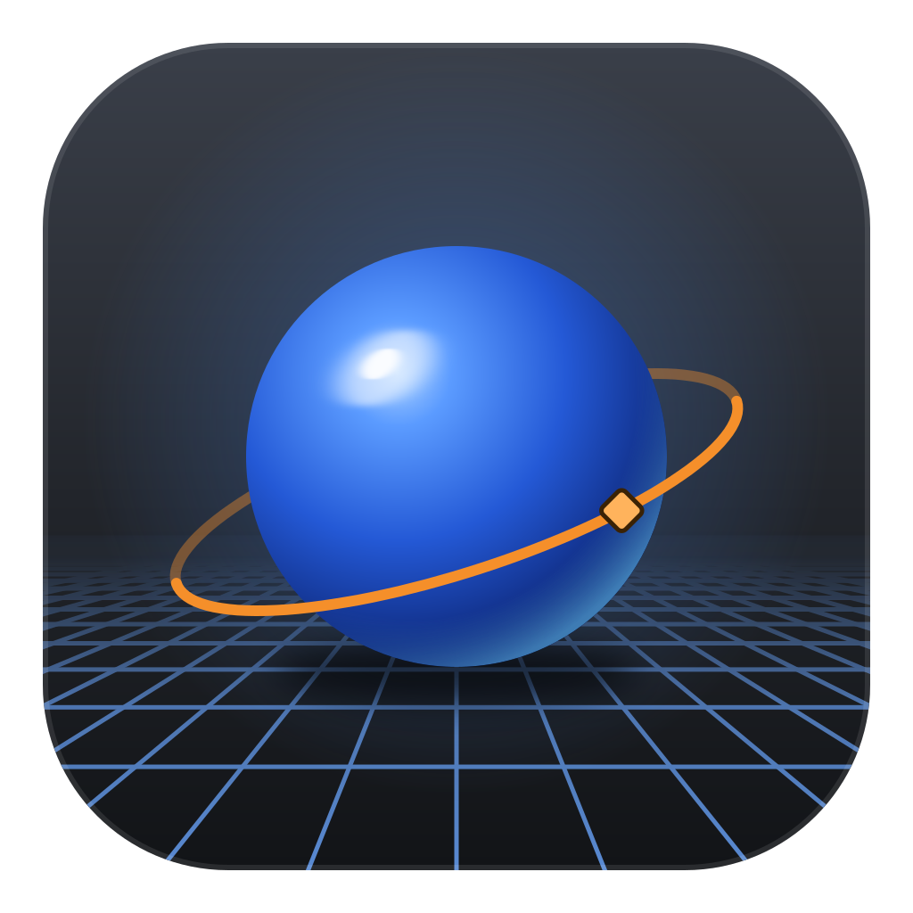
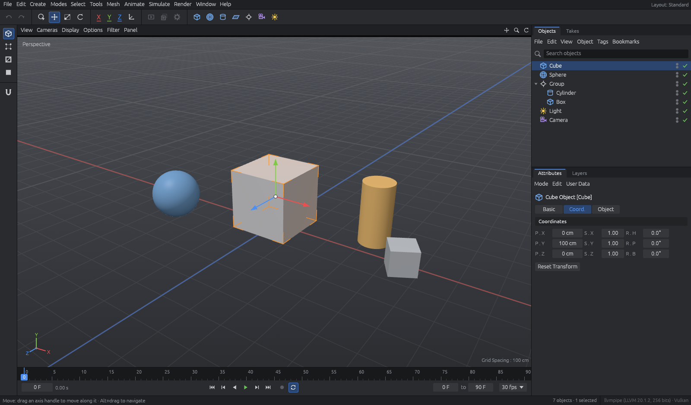

# Grid4D

An open-source, modular 3D content creation suite written in Rust, with a
workflow and layout inspired by Cinema 4D.



**Status: v0.1 — editor shell, with undo/redo and files.** The workspace, scene
graph, GPU viewport, selection and transform tools work, every edit can be undone,
and documents are saved as `.g4d` files; modelling, keyframes, glTF and rendering
are on the roadmap (see [`docs/IMPLEMENTATION_PLAN.md`](docs/IMPLEMENTATION_PLAN.md)).

## What works today

- C4D-style **Standard layout**: menu bar, command palette, mode palette,
  3D viewport, Object Manager, Attribute Manager, timeline, status bar — all
  panels resize with the window and the right-hand managers can be dragged wider.
- **Parametric primitives** with Cinema 4D-style parameters and segment counts:
  cube, sphere, cylinder, plane, cone, torus, disc and capsule, plus nulls, cameras
  and lights.
- **Make Editable** (`C`, Mesh ▸ Conversion, or the top of the left palette): turns
  primitives into polygon objects (triangles, quads and n-gons) that look the same,
  in one undo step; polygon objects are picked by their actual triangles.
- **Component modes** (Points / Edges / Polygons, left palette) on the active
  polygon object: points, edges and selected polygons drawn over the surface (hidden
  ones stay hidden), the component under the cursor highlighted; click selects, Shift
  adds, Ctrl removes, empty space deselects (each an undo step, saved with the file);
  Shift/Ctrl+click on another mode converts the selection; Select All / Deselect All
  work on components.
- **wgpu viewport**: renders into its own offscreen target (4× MSAA, depth) shown as
  an image; generated meshes cached per shape and drawn instanced, Phong-angle
  smoothing, anti-aliased adaptive grid, orange selection rim, axis triad and
  "Grid Spacing" HUD.
- **Navigation**: Alt+LMB orbit · Alt+MMB / MMB pan · Alt+RMB / wheel zoom ·
  `H` frame scene · `O` frame selection. Drag the icons at the top-right of the
  viewport header to orbit / zoom / pan with one button.
- **Selection & tools**: click to pick (Shift adds, Ctrl toggles), Move (`E`),
  Scale (`T`) and Rotate (`R`) gizmos with X/Y/Z axis locks and World/Object
  coordinates.
- **Object Manager**: hierarchy tree, fold arrows, editor/render visibility dots,
  enable check mark, double-click rename, drag-and-drop re-parenting (keeps the
  world position), search.
- **Attribute Manager**: Basic / Coord. / Object tabs (P/S/R in cm and degrees),
  primitive parameters, and project settings when nothing is selected.
- **Timeline**: ruler with scrubbable playhead, play/pause/step/loop
  (`F8`, `F6`, `F7`, `F`, `G`), preview range and fps.
- **Files**: New / Open / Save / Save As (`Ctrl+N`, `Ctrl+O`, `Ctrl+S`,
  `Ctrl+Shift+S`) with native dialogs; `.g4d` is a versioned zip archive (JSON plus
  binary meshes), and `.oc4d` files from before the rename (the project was called
  OpenC4D) open too. The title shows the file name and `*` for unsaved changes, and
  New, Open, Quit and the window's close button ask "Save changes?" first. File ▸
  Open Recent remembers the last ten documents, a `.g4d` dropped onto the window (or
  given on the command line:
  `grid4d scene.g4d`) opens it, and the window size and panel layout are
  restored on the next start.
- **Undo / redo** (`Ctrl+Z`, `Ctrl+Y` / `Ctrl+Shift+Z`, toolbar, Edit menu): create,
  delete, re-parent, gizmo drags, attribute and project-setting edits, renames and
  visibility toggles — one step per interaction, restoring the selection too.

## Build & run

Requires Rust **1.95+** (`rustup update stable`).
On Windows you also need the *MSVC build tools* (installed by `rustup` / Visual Studio Installer).

```bash
cargo run --release
```

The first build compiles egui and wgpu and takes a few minutes; later builds are
incremental. On Linux you may need the usual X11/Wayland development packages
(`libxkbcommon-dev`, `libwayland-dev`, `libx11-dev` …).

```bash
cargo test --workspace                                  # unit tests + WGSL validation
cargo clippy --workspace --all-targets -- -D warnings   # lints
```

## Architecture

```
grid4d-geom  ◀──  grid4d-scene  ◀──  grid4d-eval  ◀──  grid4d-render  ◀──  grid4d-ui  ◀──  grid4d (binary)
(geometry)        (data)             (evaluation)      (wgpu)              (egui)          (composition root)
                        ▲                                                      │
                        └────────────────────  grid4d-io  ◀────────────────────┘
                                               (.g4d files)
```

| Crate            | Responsibility                                                      |
|------------------|---------------------------------------------------------------------|
| `grid4d-geom`    | Polygon meshes with n-gons, topology, vertex normals (Phong angle), triangulation for the GPU. glam only. |
| `grid4d-scene`   | Scene graph (slotmap arena, generational `NodeId`), transforms (HPB), bounds, document time. No GPU, no UI. |
| `grid4d-eval`    | Evaluated scene: visible nodes with world matrices, drawables (unit mesh keys) and pick shapes; skipped when nothing changed. No GPU, no UI. |
| `grid4d-render`  | Orbit camera, per-frame `FrameData` extraction, generated-mesh cache, wgpu pipelines + WGSL shaders, picking. No UI. |
| `grid4d-io`      | `.g4d` document files: versioned zip archive (JSON + binary meshes), atomic save, load with clear errors. No GPU, no UI. |
| `grid4d-ui`      | Theme, painted vector icons, panels, gizmo, shortcuts, command queue, undo history. |
| `grid4d`         | Window / GPU surface setup and panel layout.                         |

The rules (dependency direction, command queue, allocation-free render loop,
module layout) are in [`ARCHITECTURE.md`](docs/ARCHITECTURE.md).

## Legal

Grid4D is an independent open-source project inspired by the Cinema 4D
workflow. It is not affiliated with or endorsed by Maxon. Cinema 4D is a
trademark of Maxon Computer GmbH. All icons and artwork in this repository are
original.

Licensed under either of [Apache License, Version 2.0](LICENSE-APACHE) or
[MIT license](LICENSE-MIT) at your option. See [CONTRIBUTING.md](CONTRIBUTING.md)
for how to contribute.
