# Grid4D User Manual

How to use Grid4D, feature by feature. This manual describes what the current build
does; features that are planned but not there yet are marked *planned*. The
screenshots come from the application itself.

> Grid4D follows the workflow of Cinema 4D's Standard layout, so the names of tools
> and shortcuts will feel familiar to Cinema 4D users. It is an independent project,
> not affiliated with Maxon.

**Contents**

1. [Getting started](#1-getting-started)
2. [The workspace](#2-the-workspace)
3. [Navigating the viewport](#3-navigating-the-viewport)
4. [Creating objects](#4-creating-objects)
5. [Selecting and transforming objects](#5-selecting-and-transforming-objects)
6. [The Object Manager](#6-the-object-manager)
7. [The Attribute Manager](#7-the-attribute-manager)
8. [Undo and redo](#8-undo-and-redo)
9. [Files](#9-files)
10. [Timeline and playback](#10-timeline-and-playback)
11. [Polygon modelling](#11-polygon-modelling)
12. [Generators: Subdivision Surface](#12-generators-subdivision-surface)
13. [Snapping](#13-snapping)
14. [Keyboard shortcuts](#14-keyboard-shortcuts)
15. [Limitations and what is planned](#15-limitations-and-what-is-planned)

---

## 1. Getting started

**Requirements:** a graphics card with Vulkan, Direct3D 12 or Metal support (any GPU
from the last decade). Grid4D runs on Windows, Linux and macOS.

**Running from source** (needs the Rust toolchain, 1.95 or newer):

```bash
cargo run --release
```

**Opening a document directly:** pass its path, e.g. `grid4d scene.g4d`. This is
also what "Open with" and file associations use.

Grid4D starts maximized with a small demo scene (a cube, a sphere, a group with a
cylinder and a box, a light and a camera), so there is something to try right away.
Window size, panel sizes and the list of recent files are remembered between
sessions.

## 2. The workspace


| # | Area | What it is for |
|---|------|----------------|
| 1 | **Menu bar** | Every command: File, Edit, Create, Modes, Select, Tools, Mesh, Animate, Window, Help. |
| 2 | **Command palette** | Undo/redo, the selection tools, Move/Scale/Rotate, axis locks, World/Object coordinates, render buttons (*planned*) and buttons that create objects. |
| 3 | **Mode palette** | Make Editable, then the four modes: Model, Points, Edges, Polygons; the snapping toggle ([§13](#13-snapping)). |
| 4 | **Viewport** | The 3D view of the scene. Its header has the View, Cameras, Display, Options, Filter and Panel menus and three navigation icons. |
| 5 | **Object Manager** | The scene's objects as a hierarchy. |
| 6 | **Attribute Manager** | The parameters of the selected object, or the options of the current tool. |
| 7 | **Timeline** | The current frame, playback and the frame range. |
| 8 | **Status bar** | A hint for whatever is under the cursor, the object count and the graphics adapter. |

The panels resize with the window. Drag the border between the viewport and the
managers to make them wider.


**Hover any button or menu entry**: its tooltip and the status bar explain it.

## 3. Navigating the viewport

| Action | Mouse | Alternative |
|--------|-------|-------------|
| Orbit around the scene | **Alt + left drag** | Drag the circular-arrow icon at the top right of the viewport header |
| Pan | **Alt + middle drag** or **middle drag** | Drag the cross icon in the header |
| Zoom | **Alt + right drag** or **mouse wheel** | Drag the magnifier icon in the header |
| Frame the whole scene | **H** | View ▸ Frame Scene |
| Frame the selected objects | **O** | View ▸ Frame Selected Objects |
| Back to the default view | | View ▸ Reset View |

- **Options** (viewport header) turns the grid, the axis triad (bottom left) and the
  HUD on or off. The HUD shows the grid spacing, which adapts to the zoom (1, 10,
  100 cm …).
- Units are centimetres; Y points up.

## 4. Creating objects

Click a button on the right side of the command palette, or use **Create ▸ Object**:

| Object | Parameters (Attribute Manager ▸ Object) |
|--------|-------------------------------------------|
| Cube | Size X/Y/Z, Segments X/Y/Z |
| Sphere | Radius, Segments |
| Cylinder | Radius, Height, Rotation and Height segments |
| Plane | Width, Height, Width and Height segments |
| Cone | Top and Bottom radius, Height, segments |
| Torus | Ring radius, Pipe radius, Ring and Pipe segments |
| Disc | Inner and Outer radius, Disc and Rotation segments |
| Capsule | Radius, Height, Height, Cap and Rotation segments |
| Null | An empty object used to group others |
| Camera | Field of view; **created at the current view**, so it frames what you see |
| Light | Colour, Intensity |

New objects are named like Cinema 4D's (`Cube`, `Cube.1`, `Cube.2` …) and become
the selected object. These are **parametric** objects: change their parameters at
any time. To edit their points and polygons, make them editable
([§11.1](#111-make-editable)).

**Generators** (Create ▸ Generator, or the green button at the right end of the
command palette) build their shape from their children. The Subdivision Surface
smooths a polygon mesh ([§12](#12-generators-subdivision-surface)).

## 5. Selecting and transforming objects

**Selecting** (in Model mode):

- Click an object in the viewport or in the Object Manager.
- **Shift + click** adds to the selection, **Ctrl + click** toggles.
- Click empty space to deselect; **Ctrl+A** selects everything, **Ctrl+Shift+A**
  nothing.
- With the **Rectangle Selection** tool (**0**), drag a frame: objects whose origin
  is inside are selected.

The last object you selected is the **active** one: the gizmo and the Attribute
Manager work on it. Selected objects get orange corner brackets.

**Transforming:** pick **Move** (**E**), **Scale** (**T**) or **Rotate** (**R**),
then drag a handle of the gizmo.


- **Move**: drag an arrow to move along that axis. **Scale**: drag a handle with a
  square end. **Rotate**: drag a ring.
- The **X / Y / Z** buttons in the command palette lock axes. A disabled axis
  ignores the drag.
- The **World/Object** button next to them switches the gizmo between the world's
  axes and the object's own axes. Scale always uses the object's axes.
- **Alt + drag** always navigates, even over the gizmo.
- For exact values, type them in the Attribute Manager ([§7](#7-the-attribute-manager)).
- To place objects exactly on other objects or on the grid, turn on snapping
  (**Shift+S**, [§13](#13-snapping)).

Every drag is one undo step.

## 6. The Object Manager


- **Hierarchy**: click the fold arrow to open or close a group.
- **Rename**: double-click the name, type, then press Enter (Esc cancels). Or
  right-click ▸ Rename.
- **Visibility dots** (two small dots on the right): the upper one hides the object
  in the viewport, the lower one hides it in renders. A hidden parent hides its
  children.
- **Enable check mark**: turns an object off entirely (it shows a red cross).
- **Re-parent**: drag a row onto another row. The object keeps its position in the
  world. Right-click ▸ *Move to Top Level* takes it out of its group.
- **Search**: type in the search field to show only matching objects.
- Right-click a row for Rename, Frame Object, Move to Top Level and Delete.

## 7. The Attribute Manager


With an object selected it shows three tabs:

- **Basic**: name, editor and render visibility, enabled.
- **Coord.**: position (P), scale (S) and rotation (R, as H/P/B angles in degrees),
  plus *Reset Transform*.
- **Object**: the object's own parameters (sizes, segments, field of view …).

Drag a value left or right to change it, or click it and type a number. A change
from one drag or one typing session is one undo step.

**With nothing selected** it shows the project settings: the name, the frame rate and
the frame range.

**Tool mode:** when you pick a tool that has options (the selection tools,
Extrude, Inset, Bevel, Bridge, Loop/Path Cut, Line Cut), the Attribute Manager switches to that
tool's options. Its **Mode** menu switches between *Objects* and *Tool* by hand.

## 8. Undo and redo

- **Ctrl+Z** undoes, **Ctrl+Y** or **Ctrl+Shift+Z** redoes. The arrows at the left
  of the command palette do the same, and their tooltips name the step ("Undo Move").
- Everything that changes the document can be undone: creating, deleting and
  re-parenting objects, every drag and typed value, renames, selections of points,
  edges and polygons, and every modelling operation.
- Up to 100 steps are kept.

## 9. Files

| Command | Shortcut | Notes |
|---------|----------|-------|
| File ▸ New | Ctrl+N | An empty document. |
| File ▸ Open… | Ctrl+O | Opens `.g4d` documents (and older `.oc4d` ones), and glTF models (`.gltf`, `.glb`) as new documents. |
| File ▸ Open Recent | | The last ten files. |
| File ▸ Merge… | Ctrl+Shift+O | Adds the objects of a `.g4d`, `.gltf` or `.glb` file to the current document. |
| File ▸ Export… | | Writes the scene as a glTF model (`.glb`, or `.gltf` + `.bin`) for other applications. |
| File ▸ Save | Ctrl+S | Asks for a name the first time. |
| File ▸ Save As… | Ctrl+Shift+S | |
| File ▸ Quit | | |

- **Drag a `.g4d` file onto the window** to open it; **drag a `.gltf` or `.glb`
  file** onto it to merge the model into the current document.
- The window title shows the document name and an asterisk (`*`) while there are
  unsaved changes. Undoing back to the saved state clears it again.
- Before anything would discard unsaved changes (New, Open, Quit, closing the
  window), Grid4D asks: **Save**, **Don't Save** or **Cancel**.
- Saving writes a temporary file first and then replaces the old one, so a failed
  save never leaves a broken document behind.
- `.g4d` files keep everything in the document: objects, hierarchy, parameters, the
  meshes of polygon objects, and their selected and hidden points, edges and
  polygons. Editor state (tool, mode, camera) is not saved.

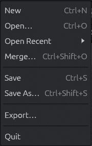

### 9.1 glTF models

glTF 2.0 is the common format for exchanging 3D models (`.gltf` with its `.bin`
file, or a single `.glb`). Most 3D applications can export it.

- **Open** a glTF file to start a new document from it. The document is named after
  the file; **Save** then asks where to put the `.g4d`.
- **Merge** one (File ▸ Merge… or drag and drop) to add it to the scene you are
  working on. The merged objects are added at the top of the hierarchy and selected,
  and one **Undo** removes all of them.

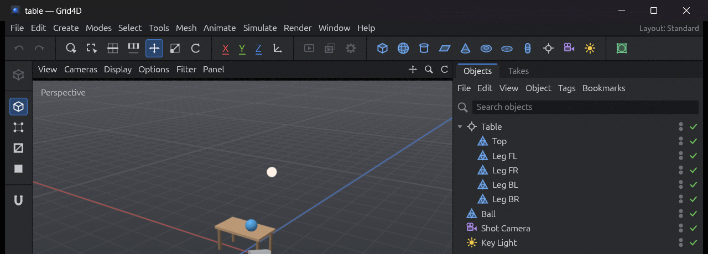

What comes in:

| glTF | Grid4D |
|------|--------|
| Node hierarchy, names, position / rotation / scale | The same hierarchy of objects. Metres become centimetres (× 100). |
| Meshes | Polygon objects, ready for modelling. Points that the file repeats at seams are merged, so the mesh is connected. Texture coordinates are kept. |
| Material base colour | The object's display colour. |
| Cameras | Camera objects (field of view). |
| Lights (`KHR_lights_punctual`) | Light objects (colour, intensity). |
| Empty nodes | Nulls. |

Not yet: materials and textures, animation, skinning, morph targets and compressed
meshes (Draco). Shading comes from Grid4D's own smoothing, not from the file's
normals. Points the file has at *almost* the same place (not exactly) stay separate;
run **Optimize** (U~O) on such an object to merge them.

### 9.2 Exporting glTF

**File ▸ Export…** writes the whole scene as a glTF model that other applications
(Blender, game engines, web viewers, …) can read. Pick the file type in the dialog:

- **glTF Binary (`.glb`)**: one file with everything in it (the default).
- **glTF (`.gltf` + `.bin`)**: a text file plus a `.bin` file of the same name next
  to it. Keep the two together.

What goes out:

- Every object in its hierarchy, with names and positions (centimetres become
  metres).
- Polygon objects as meshes, split into triangles, with the smoothing you see in
  the viewport and their UVs. **Primitives** are written in their current shape.
  A **Subdivision Surface** is written as its smooth result at the viewport level,
  without its cage. A switched-off one is written as an empty object with its
  children as they are.
- Display colours as simple materials, cameras, and lights.

Exporting does not change the document: there is nothing to undo, and the title's
`*` stays as it was.

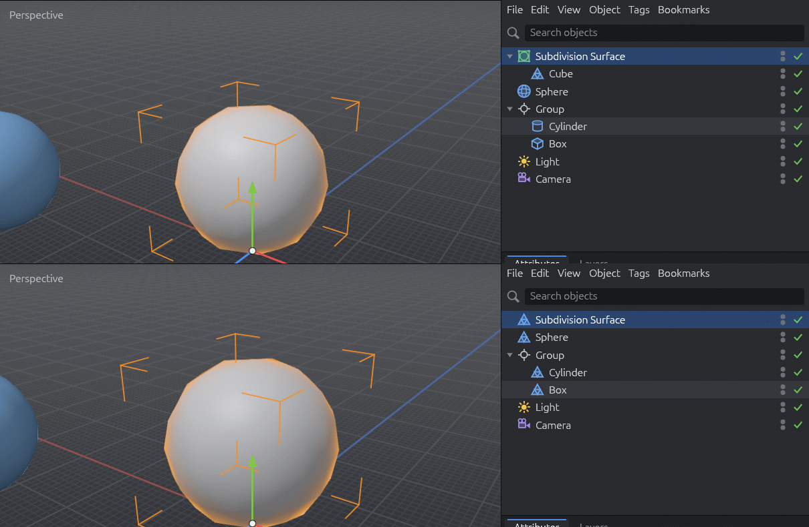

Opening an exported file brings back the hierarchy, names, positions, cameras and
lights. Every mesh comes back as a triangulated polygon object, since glTF stores
only triangles.

## 10. Timeline and playback


| Action | Shortcut |
|--------|----------|
| Play forwards / backwards | F8 / F6 |
| Stop | F7 |
| Previous / next frame | F / G |
| Go to start / end | the outer transport buttons |

- Drag the blue marker on the ruler to scrub, or type a frame number.
- The two fields on the right set the frame range; the drop-down sets the frame
  rate. The loop button (also Animate ▸ Loop Playback) makes playback start over at
  the end.
- Keyframes are *planned*: playback moves the time, nothing is animated yet.

## 11. Polygon modelling

Modelling works on **polygon objects**: meshes of points, edges and polygons that
you shape directly.

### 11.1 Make Editable

Select a primitive and press **C** (or click the top button of the mode palette, or
Mesh ▸ Conversion ▸ Make Editable). It becomes a polygon object that looks exactly
the same: same name, position and place in the hierarchy. Its icon changes to a
triangle. One undo step turns it back into the parametric object. On a Subdivision
Surface, Make Editable keeps the smooth result
([§12.4](#124-switching-it-off-and-baking-it)).

### 11.2 Component modes

The mode palette switches between **Model** (whole objects) and the three component
modes: **Points**, **Edges** and **Polygons** (Modes menu too). In a component
mode the **active polygon object** shows its components: blue points or edges, and
selected ones in orange. A click selects what is under the cursor. Components
hidden by surfaces in front are not picked.

| Click | Effect |
|-------|--------|
| Click | Select that point / edge / polygon |
| Shift + click | Add it |
| Ctrl + click | Remove it |
| Click on empty space | Deselect all |

Each mode keeps its own selection. **Convert a selection** to another mode: Shift +
click that mode's button (tolerant, everything touched), or Ctrl + click it (strict:
only what is fully selected).

### 11.3 Selection tools and commands


| Tool | Shortcut | How |
|------|----------|-----|
| Live Selection | 9 | Paint over components. **Middle drag** changes the brush size. Esc cancels the stroke. |
| Rectangle Selection | 0 | Drag a frame. Esc cancels. |
| Loop Selection | U~L | The loop under the cursor is highlighted; click to select it. |
| Ring Selection | U~B | The same for rings (the parallel edges across a strip). |

Options (Attribute Manager, Tool mode):

- **Only Select Visible Elements**: ignore what lies behind the surface.
- **Tolerant Selection**: anything the brush or frame touches counts.
- **Stop at Selections / Non-Quads / Poles**: where loops and rings end.

**Double-click** with the Move tool: on an edge it selects its loop, on a polygon
all connected polygons.


The **Select** menu also has:

- **Invert** (U~I), **Select Connected** (U~W), **Grow** (U~Y) and **Shrink** (U~K)
  Selection, and *Grow Using Edges Only*.
- **Hide Selected / Hide Unselected / Unhide All**. Hidden polygons disappear from
  the viewport and cannot be picked or changed until you unhide them; use this to
  work on one part of a mesh.


### 11.4 Transforming components

In a component mode the Move, Scale and Rotate gizmo appears at the centre of the
selection. Drag it to move, scale or rotate the selected points, edges or polygons
together. Each drag is one undo step, and the selection stays as it was.

**Tweak Mode** (option of the Move tool): with nothing selected, drag any point,
edge or polygon to move just that one, without selecting it.

### 11.5 Extrude and Inset


- **Extrude** (**D**) pushes the selected polygons out of the surface and builds
  walls around them. In Edges mode it grows new polygons from selected **border**
  edges.
- **Inset** (**I**) shrinks the selected polygons inside their outline and fills the
  gap with a ring of polygons (Polygons mode).

**Using them:**

1. Select what to work on. With nothing selected, the tool works on everything
   visible.
2. Press D or I (or pick it from the Mesh menu).
3. **Drag left or right anywhere in the viewport.** Right is outwards (Extrude) or
   inwards (Inset). The model follows live; release to finish, Esc to cancel.

Or set the options and click **Apply** in the Attribute Manager. Every drag or Apply
is a new operation, so dragging again extrudes again. The moved polygons stay
selected.

| Option | Meaning |
|--------|---------|
| Offset | Distance (negative goes the other way). A drag writes it here. |
| Subdivision | Extra rows of polygons along the walls (Extrude) or rings (Inset). |
| Create N-gons | One polygon per wall or ring side instead of rows. |
| Create Caps | (Extrude) keeps a copy at the start, so the result encloses a volume. |
| Preserve Groups | Neighbouring polygons move as one piece. Off: each polygon on its own. |
| Maximum Angle | With Preserve Groups: neighbours bent more than this are split. |
| Rotation (Edges) | (Extrude) tilts the new edge polygons around their edge. |

Typical box modelling: select the top polygon, **I** (inset), **D** (extrude),
repeat.

### 11.6 Loop/Path Cut and Line Cut


**Loop/Path Cut** (**K~L**) adds an edge loop all the way round:

1. Pick a component mode and press K, then L.
2. Hover an edge: an orange preview shows the loop that would be cut, at the
   cursor's position along the edge.
3. Click to cut.

| Option | Meaning |
|--------|---------|
| Offset | Where the cut crosses the edge, in percent. The click sets it. |
| Number of Cuts | Several loops, evenly spaced. |
| Select Cuts | The new edges become the edge selection. |

The loop runs through quads and stops at borders and at polygons that are not quads.

**Line Cut** (**K~K**), the knife: drag a line across the object. When you release,
every polygon it crosses is cut. Esc cancels.


| Option | Meaning |
|--------|---------|
| Visible Only | Cut only what you can see, not the back of the object. |
| Infinite Cut | The cut continues beyond the line's ends. |
| Connect Cut Edges | Split the polygons. Off: only add points on the cut edges. |
| Select Cuts | The new edges become the edge selection. |

### 11.7 Connect, Melt, Dissolve and Delete

These commands work on the selection of the current mode (Mesh menu, or the
shortcuts). Each is one undo step.


| Command | Shortcut | Points | Edges | Polygons |
|---------|----------|--------|-------|----------|
| **Connect Points/Edges** | M~M | Joins selected points that share a polygon with new edges | Puts a point in the middle of each selected edge and joins them (on an edge ring: a loop through the middle) | — |
| **Melt** | U~Z, Alt+Backspace | Removes the points, merging their polygons | Merges the two polygons of each edge (points stay) | Merges each connected group into one polygon |
| **Dissolve** | M~N, Ctrl+Backspace | As Melt | As Melt, and removes the points left over in the middle of a merged side | As Melt |
| **Delete** | Delete, Backspace | Removes the points and the polygons using them | Removes the polygons using the edges | Removes the polygons |


- A merged region must have a single outline: a ring of polygons around a hole
  cannot become one polygon, so Melt leaves it alone.
- Points that no polygon uses any more are removed automatically.
- In Model mode, Delete removes the selected objects instead.

### 11.8 Bevel, Bridge, Weld and Optimize

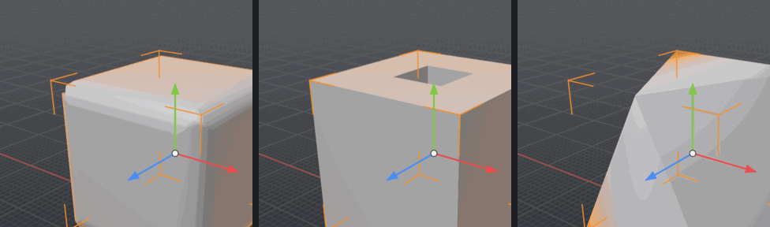

**Bevel** (**M~S**) rounds or chamfers the selected **edges** (Edges mode), or cuts
off the selected **points** (Points mode):

1. Select the edges or points to bevel.
2. Press M, then S (or Mesh ▸ Bevel).
3. Drag left or right in the viewport (Esc cancels), or click **Apply** in the
   Attribute Manager.

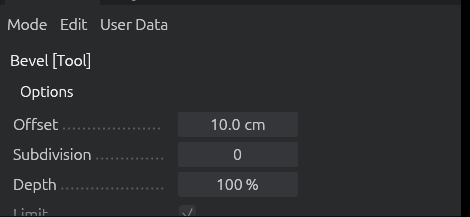

| Option | Meaning |
|--------|---------|
| Offset | Width of the bevel. A drag writes it here. |
| Subdivision | 0 gives a flat chamfer; more gives rows across the bevel, along a rounded profile. |
| Depth | How round the profile is: 100 % round, 0 % flat, negative hollow. |
| Limit | Keeps the new points from passing each other (no overlapping polygons). |

- Where three bevelled edges meet (a cube's corner) a small polygon closes the
  corner.
- Border edges (edges with a single polygon) are not bevelled.
- The long edges of the new strips become the selection, so another bevel can round
  them further.

**Bridge** (**B**, or M~B) joins two components with new polygons:

- **Polygons mode**: drag from one polygon to another. A band of polygons joins
  their outlines, and the two polygons are removed, so the bridge opens through them
  (a hole through an object, a handle between two parts). They need the same number
  of points.
- **Edges mode**: drag from one border edge to another. One polygon fills the gap.
- Or select the two polygons or edges and click **Apply**.
- Options: **Subdivision** (rows along the bridge), **Spin Steps** (turns the band
  if it comes out twisted), **Delete Original Polygons**.

**Weld** (Mesh ▸ Weld) merges points:

1. Select the points (in Edges or Polygons mode, the points of the selection count).
2. With the Weld tool, **click one of the selected points** to weld everything onto
   it, or **click anywhere else** to weld at their centre.

Polygons that collapse are removed.

**Optimize** (**U~O**, Mesh ▸ Optimize…) cleans up a mesh:

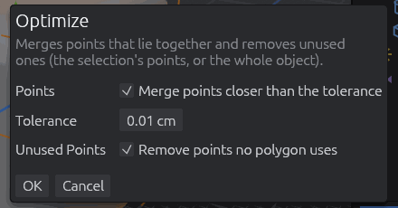

- **Points** merges points closer than **Tolerance**. Use it after modelling steps
  that leave points on top of each other, or to close an editable cylinder's
  separate caps.
- **Unused Points** removes points that no polygon uses.
- It works on the selected points (or those of the selected edges or polygons), or
  on the whole object when nothing is selected.

## 12. Generators: Subdivision Surface

A **generator** is an object that builds its shape from its children. The first
one is the **Subdivision Surface**. It turns a coarse polygon mesh, the **cage**,
into a smooth, rounded surface. The result updates live while you keep modelling
the few points of the cage.

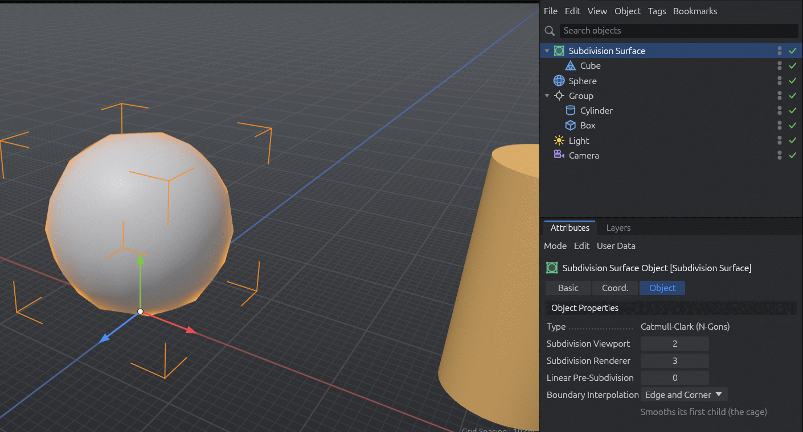

### 12.1 Creating one

- Select the object to smooth, then **Alt + click** the Subdivision Surface button
  (the green button at the right end of the command palette), or hold Alt while you
  choose **Create ▸ Generator ▸ Subdivision Surface**. The generator takes the
  object's place in the hierarchy and the object becomes its child. The object
  stays where it was. This is one undo step.
- Without Alt you get an empty generator at the top of the Object Manager. To give
  it a cage, drag an object onto it in the Object Manager.

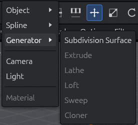

What gets smoothed:

- The generator smooths its **first child**, the cage. The cage can be a polygon
  object or a primitive (a Cube works without Make Editable).
- If the cage has children of its own, they are merged with it and smoothed as one
  mesh.
- Further children of the generator are drawn as they are.
- Pieces of the cage that are not joined are smoothed separately, for example the
  caps of an editable cylinder. Run **Optimize** (U~O) on the cage first to merge
  them.

### 12.2 Working with the cage

- In Model mode, clicking the smooth surface selects the **generator**: move it, or
  change its parameters.
- To reshape the result, select the **cage** in the Object Manager and switch to
  Points, Edges or Polygons mode. The cage's points and edges are drawn over the
  smooth surface, every modelling tool works on them, and the surface follows each
  change at once.

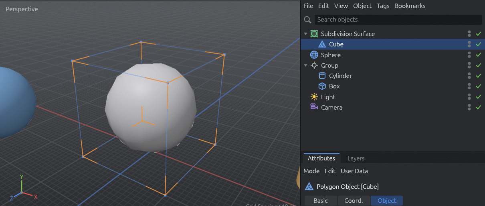

### 12.3 Parameters

Select the generator and open **Attribute Manager ▸ Object**:

| Parameter | Meaning |
|-----------|---------|
| Type | **Catmull-Clark (N-Gons)**: every polygon with *n* corners becomes *n* quads, then the surface is smoothed. It is the only type for now. |
| Subdivision Viewport | How many times the viewport subdivides (0 shows the cage itself, 6 at most). Each level multiplies the polygons by about four, so keep it low (2) while modelling. |
| Subdivision Renderer | The level for final renders. It will be used by the offline renderer (*planned*). |
| Linear Pre-Subdivision | Splits the cage this many times *without* smoothing before the smoothing levels, which keeps the result closer to the cage. |
| Boundary Interpolation | How open borders (the edge of a plane) are smoothed. **Edge and Corner** keeps a border's corners in place; **Edge** rounds them off as well. |

### 12.4 Switching it off and baking it

- **Q** switches the generator off and on, and so does its check mark in the Object
  Manager. While it is off, the cage shows as a normal object. If the cage (or
  anything else inside the generator) is selected, Q switches the generator above
  it.

  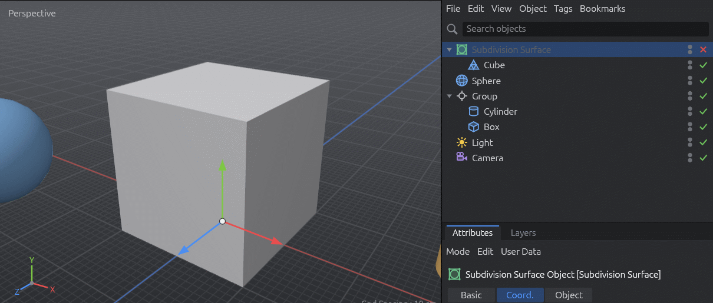

- **Make Editable** (C) on the generator replaces it with one polygon object holding
  the smooth mesh, at the **Subdivision Viewport** level. The cage is removed. One
  undo step brings both back. A generator that is switched off is left as it is.

## 13. Snapping

With snapping on, a moved object or selection jumps onto nearby geometry or onto
the floor grid, so you can place things exactly: an object's axis level with a
corner, a point onto another point, a selection onto a grid crossing.

**Switching it on:** press **Shift+S**, or click the magnet button at the bottom of
the mode palette (it stays highlighted while snapping is on).

**Using it:**

1. Drag a **Move** handle (an arrow of the gizmo), or with **Tweak Mode** drag a
   point, edge or polygon directly ([§11.4](#114-transforming-components)).
2. Move the **cursor** over what you want to snap to: a corner, an edge, the middle
   of an edge, the centre of a polygon, an object's axis or a grid crossing. The
   target is highlighted with its name next to it.
3. Release the mouse button. The move is one undo step, as always.

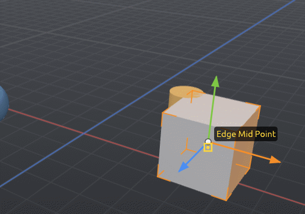

How the element is placed:

- **Along a gizmo arrow** the move stays on that axis. The object (or the centre of
  the selection) lines up with the target along the axis.
- **With Tweak** the move is free: the grabbed element lands right on the target.
- Nothing that moves with the drag is a target: the moved object and its children,
  or the moved points and the edges and polygons that use them. So you can put a
  point onto another point of the same object.
- Scale and Rotate do not snap.

**Settings:** right-click the magnet button, open **Tools ▸ Snap**, or select the
Move tool and look at the **Snap** group in the Attribute Manager's Tool mode
(Attribute Manager ▸ Mode ▸ Tool). All three show the same settings.

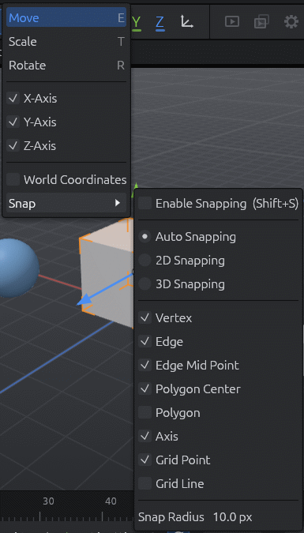 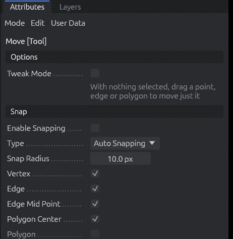

| Setting | Meaning |
|---------|---------|
| Auto / 2D / 3D Snapping | **3D** moves the element onto the target in space. **2D** only lines it up on screen and keeps its depth. **Auto** is 3D in the perspective view, the only view so far. |
| Vertex, Edge, Edge Mid Point, Polygon Center, Polygon | Points, the nearest point along an edge, the middle of an edge, a polygon's centre, the surface under the cursor. All but Polygon are on at first. |
| Axis | Objects' origins (on at first). |
| Grid Point, Grid Line | Crossings or lines of the floor grid, at the spacing shown in the corner of the view. Grid Point is on at first. |
| Snap Radius | How close the cursor must be to a target, in screen points (10 at first). |

Within the radius, points win over edges and grid lines, which win over surfaces,
so a corner can be caught right next to its edges.

## 14. Keyboard shortcuts

Shortcuts follow Cinema 4D. **Chords** like `U~L` mean: press U, release it, then
press L. The status bar shows the pending first key and its choices. Any other key or
Esc cancels a chord.

| Keys | Action |
|------|--------|
| Alt + left / middle / right drag, wheel | Orbit / pan / zoom |
| H / O | Frame scene / frame selected objects |
| E / T / R | Move / Scale / Rotate tool |
| 9 / 0 | Live / Rectangle Selection tool |
| U~L / U~B | Loop / Ring Selection tool |
| U~I / U~W / U~Y / U~K | Invert / Select Connected / Grow / Shrink selection |
| C | Make Editable |
| Q | Switch the selected generator (or the one above the selection) off / on |
| Shift+S | Snapping on / off |
| Alt + click a generator button | Create the generator around the selected object |
| D / I | Extrude / Inset tool |
| M~T / M~W | Extrude / Inset tool (alternatives) |
| K~L (M~L) / K~K (M~K) | Loop/Path Cut / Line Cut tool |
| M~S | Bevel tool |
| B (M~B) | Bridge tool |
| M~M | Connect Points/Edges |
| M~N or Ctrl+Backspace | Dissolve |
| U~Z or Alt+Backspace | Melt |
| U~O | Optimize… |
| Delete / Backspace | Delete (objects in Model mode, components otherwise) |
| Ctrl+A / Ctrl+Shift+A | Select all / deselect all |
| Ctrl+Z / Ctrl+Y (Ctrl+Shift+Z) | Undo / redo |
| Ctrl+N / Ctrl+O / Ctrl+S / Ctrl+Shift+S | New / open / save / save as |
| Ctrl+Shift+O | Merge a file into the document |
| F8 / F6 / F7 | Play / play backwards / stop |
| F / G | Previous / next frame |

**Help ▸ Keyboard Shortcuts & About** shows this list inside the application.


## 15. Limitations and what is planned

The roadmap is in [`IMPLEMENTATION_PLAN.md`](IMPLEMENTATION_PLAN.md). Not there yet:

- **Snapping**: Quantize (stepped moves, Shift+Q), per-tool settings, the workplane,
  guides and snapping for tools other than Move.
- **Modelling**:
  Extrude on points; Path mode for Loop/Path Cut; Bevel in Polygons mode and its
  Solid, Proportional and Radial modes; Bridge point by point.
- **Generators**: only the Subdivision Surface, with one type (Catmull-Clark) and
  without edge weights (creases) or UV options. Extrude, Lathe, Loft, Sweep and
  Cloner are planned.
- **Animation**: keyframes, F-curves, the Coordinate and Material managers.
- **Viewport**: scene cameras, the 4-view layout, wireframe and other display modes;
  lights do not light the viewport yet.
- **Interchange and rendering**: OBJ import and export, glTF materials, textures and
  animation, an export dialog (scale, visible or selected objects only), the
  offline renderer (the Render menu is disabled).
- The Takes, Layers and Filter panels are placeholders.

See [`progress.md`](progress.md) for what changed in each step.
