# Grid4D User Manual

How to use Grid4D, feature by feature. This manual describes what the current build
does; features that are planned but not there yet are marked *planned*. The
screenshots come from the application itself.

> Grid4D follows the workflow of Cinema 4D's Standard layout, so the names of tools
> and shortcuts will feel familiar to Cinema 4D users. It is an independent project,
> not affiliated with Maxon.

**Contents**

1. [Getting started](#1-getting-started)
2. [The workspace](#2-the-workspace)
3. [Navigating the viewport](#3-navigating-the-viewport)
4. [Creating objects](#4-creating-objects)
5. [Selecting and transforming objects](#5-selecting-and-transforming-objects)
6. [The Object Manager](#6-the-object-manager)
7. [The Attribute Manager](#7-the-attribute-manager)
8. [Undo and redo](#8-undo-and-redo)
9. [Files](#9-files)
10. [Timeline and playback](#10-timeline-and-playback)
11. [Polygon modelling](#11-polygon-modelling)
12. [Keyboard shortcuts](#12-keyboard-shortcuts)
13. [Limitations and what is planned](#13-limitations-and-what-is-planned)

---

## 1. Getting started

**Requirements:** a graphics card with Vulkan, Direct3D 12 or Metal support (any GPU
from the last decade). Grid4D runs on Windows, Linux and macOS.

**Running from source** (needs the Rust toolchain, 1.95 or newer):

```bash
cargo run --release
```

**Opening a document directly:** pass its path, e.g. `grid4d scene.g4d`. This is
also what "Open with" and file associations use.

Grid4D starts maximized with a small demo scene (a cube, a sphere, a group with a
cylinder and a box, a light and a camera), so there is something to try right away.
Window size, panel sizes and the list of recent files are remembered between
sessions.

## 2. The workspace

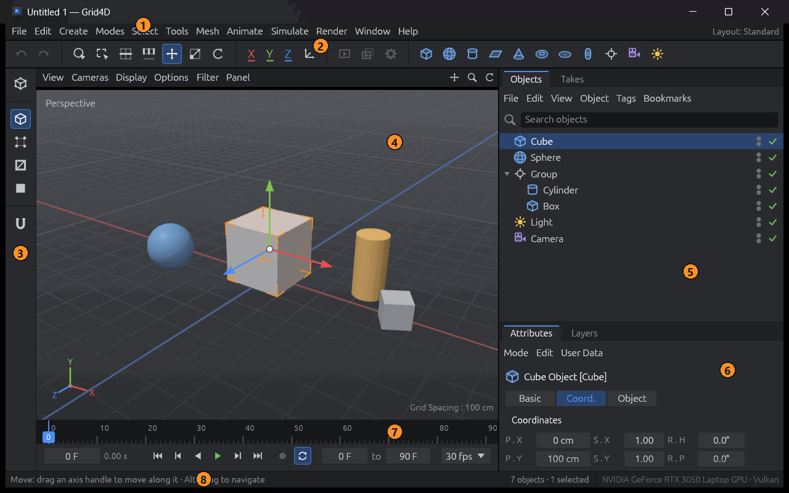

| # | Area | What it is for |
|---|------|----------------|
| 1 | **Menu bar** | Every command: File, Edit, Create, Modes, Select, Tools, Mesh, Animate, Window, Help. |
| 2 | **Command palette** | Undo/redo, the selection tools, Move/Scale/Rotate, axis locks, World/Object coordinates, render buttons (*planned*) and buttons that create objects. |
| 3 | **Mode palette** | Make Editable, then the four modes: Model, Points, Edges, Polygons; the snapping toggle (*planned*). |
| 4 | **Viewport** | The 3D view of the scene. Its header has the View, Cameras, Display, Options, Filter and Panel menus and three navigation icons. |
| 5 | **Object Manager** | The scene's objects as a hierarchy. |
| 6 | **Attribute Manager** | The parameters of the selected object, or the options of the current tool. |
| 7 | **Timeline** | The current frame, playback and the frame range. |
| 8 | **Status bar** | A hint for whatever is under the cursor, the object count and the graphics adapter. |

The panels resize with the window. Drag the border between the viewport and the
managers to make them wider.


**Hover any button or menu entry**: its tooltip and the status bar explain it.

## 3. Navigating the viewport

| Action | Mouse | Alternative |
|--------|-------|-------------|
| Orbit around the scene | **Alt + left drag** | Drag the circular-arrow icon at the top right of the viewport header |
| Pan | **Alt + middle drag** or **middle drag** | Drag the cross icon in the header |
| Zoom | **Alt + right drag** or **mouse wheel** | Drag the magnifier icon in the header |
| Frame the whole scene | **H** | View ▸ Frame Scene |
| Frame the selected objects | **O** | View ▸ Frame Selected Objects |
| Back to the default view | | View ▸ Reset View |

- **Options** (viewport header) turns the grid, the axis triad (bottom left) and the
  HUD on or off. The HUD shows the grid spacing, which adapts to the zoom (1, 10,
  100 cm …).
- Units are centimetres; Y points up.

## 4. Creating objects

Click a button on the right side of the command palette, or use **Create ▸ Object**:

| Object | Parameters (Attribute Manager ▸ Object) |
|--------|-------------------------------------------|
| Cube | Size X/Y/Z, Segments X/Y/Z |
| Sphere | Radius, Segments |
| Cylinder | Radius, Height, Rotation and Height segments |
| Plane | Width, Height, Width and Height segments |
| Cone | Top and Bottom radius, Height, segments |
| Torus | Ring radius, Pipe radius, Ring and Pipe segments |
| Disc | Inner and Outer radius, Disc and Rotation segments |
| Capsule | Radius, Height, Height, Cap and Rotation segments |
| Null | An empty object used to group others |
| Camera | Field of view; **created at the current view**, so it frames what you see |
| Light | Colour, Intensity |

New objects are named like Cinema 4D's (`Cube`, `Cube.1`, `Cube.2` …) and become
the selected object. These are **parametric** objects: change their parameters at
any time. To edit their points and polygons, make them editable
([§11.1](#111-make-editable)).

## 5. Selecting and transforming objects

**Selecting** (in Model mode):

- Click an object in the viewport or in the Object Manager.
- **Shift + click** adds to the selection, **Ctrl + click** toggles.
- Click empty space to deselect; **Ctrl+A** selects everything, **Ctrl+Shift+A**
  nothing.
- With the **Rectangle Selection** tool (**0**), drag a frame: objects whose origin
  is inside are selected.

The last object you selected is the **active** one: the gizmo and the Attribute
Manager work on it. Selected objects get orange corner brackets.

**Transforming:** pick **Move** (**E**), **Scale** (**T**) or **Rotate** (**R**),
then drag a handle of the gizmo.

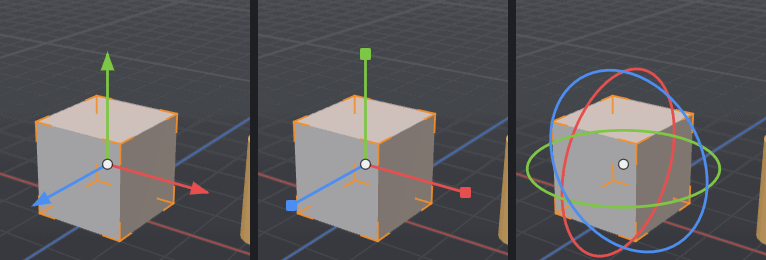

- **Move**: drag an arrow to move along that axis. **Scale**: drag a handle with a
  square end. **Rotate**: drag a ring.
- The **X / Y / Z** buttons in the command palette lock axes. A disabled axis
  ignores the drag.
- The **World/Object** button next to them switches the gizmo between the world's
  axes and the object's own axes. Scale always uses the object's axes.
- **Alt + drag** always navigates, even over the gizmo.
- For exact values, type them in the Attribute Manager ([§7](#7-the-attribute-manager)).

Every drag is one undo step.

## 6. The Object Manager

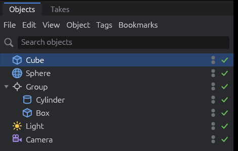

- **Hierarchy**: click the fold arrow to open or close a group.
- **Rename**: double-click the name, type, then press Enter (Esc cancels). Or
  right-click ▸ Rename.
- **Visibility dots** (two small dots on the right): the upper one hides the object
  in the viewport, the lower one hides it in renders. A hidden parent hides its
  children.
- **Enable check mark**: turns an object off entirely (it shows a red cross).
- **Re-parent**: drag a row onto another row. The object keeps its position in the
  world. Right-click ▸ *Move to Top Level* takes it out of its group.
- **Search**: type in the search field to show only matching objects.
- Right-click a row for Rename, Frame Object, Move to Top Level and Delete.

## 7. The Attribute Manager

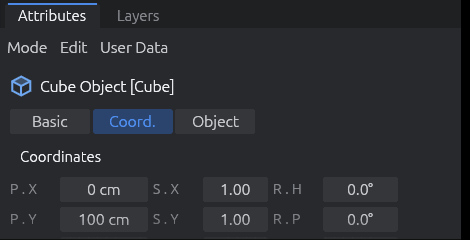

With an object selected it shows three tabs:

- **Basic**: name, editor and render visibility, enabled.
- **Coord.**: position (P), scale (S) and rotation (R, as H/P/B angles in degrees),
  plus *Reset Transform*.
- **Object**: the object's own parameters (sizes, segments, field of view …).

Drag a value left or right to change it, or click it and type a number. A change
from one drag or one typing session is one undo step.

**With nothing selected** it shows the project settings: the name, the frame rate and
the frame range.

**Tool mode:** when you pick a tool that has options (the selection tools,
Extrude, Inset, Loop/Path Cut, Line Cut), the Attribute Manager switches to that
tool's options. Its **Mode** menu switches between *Objects* and *Tool* by hand.

## 8. Undo and redo

- **Ctrl+Z** undoes, **Ctrl+Y** or **Ctrl+Shift+Z** redoes. The arrows at the left
  of the command palette do the same, and their tooltips name the step ("Undo Move").
- Everything that changes the document can be undone: creating, deleting and
  re-parenting objects, every drag and typed value, renames, selections of points,
  edges and polygons, and every modelling operation.
- Up to 100 steps are kept.

## 9. Files

| Command | Shortcut | Notes |
|---------|----------|-------|
| File ▸ New | Ctrl+N | An empty document. |
| File ▸ Open… | Ctrl+O | Opens `.g4d` documents (and older `.oc4d` ones). |
| File ▸ Open Recent | | The last ten documents. |
| File ▸ Save | Ctrl+S | Asks for a name the first time. |
| File ▸ Save As… | Ctrl+Shift+S | |
| File ▸ Quit | | |

- **Drag a `.g4d` file onto the window** to open it.
- The window title shows the document name and an asterisk (`*`) while there are
  unsaved changes. Undoing back to the saved state clears it again.
- Before anything would discard unsaved changes (New, Open, Quit, closing the
  window), Grid4D asks: **Save**, **Don't Save** or **Cancel**.
- Saving writes a temporary file first and then replaces the old one, so a failed
  save never leaves a broken document behind.
- `.g4d` files keep everything in the document: objects, hierarchy, parameters, the
  meshes of polygon objects, and their selected and hidden points, edges and
  polygons. Editor state (tool, mode, camera) is not saved.

## 10. Timeline and playback

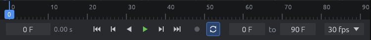

| Action | Shortcut |
|--------|----------|
| Play forwards / backwards | F8 / F6 |
| Stop | F7 |
| Previous / next frame | F / G |
| Go to start / end | the outer transport buttons |

- Drag the blue marker on the ruler to scrub, or type a frame number.
- The two fields on the right set the frame range; the drop-down sets the frame
  rate. The loop button (also Animate ▸ Loop Playback) makes playback start over at
  the end.
- Keyframes are *planned*: playback moves the time, nothing is animated yet.

## 11. Polygon modelling

Modelling works on **polygon objects**: meshes of points, edges and polygons that
you shape directly.

### 11.1 Make Editable

Select a primitive and press **C** (or click the top button of the mode palette, or
Mesh ▸ Conversion ▸ Make Editable). It becomes a polygon object that looks exactly
the same: same name, position and place in the hierarchy. Its icon changes to a
triangle. One undo step turns it back into the parametric object.

### 11.2 Component modes

The mode palette switches between **Model** (whole objects) and the three component
modes: **Points**, **Edges** and **Polygons** (Modes menu too). In a component
mode the **active polygon object** shows its components: blue points or edges, and
selected ones in orange. A click selects what is under the cursor. Components
hidden by surfaces in front are not picked.

| Click | Effect |
|-------|--------|
| Click | Select that point / edge / polygon |
| Shift + click | Add it |
| Ctrl + click | Remove it |
| Click on empty space | Deselect all |

Each mode keeps its own selection. **Convert a selection** to another mode: Shift +
click that mode's button (tolerant, everything touched), or Ctrl + click it (strict:
only what is fully selected).

### 11.3 Selection tools and commands

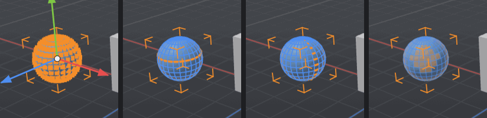

| Tool | Shortcut | How |
|------|----------|-----|
| Live Selection | 9 | Paint over components. **Middle drag** changes the brush size. Esc cancels the stroke. |
| Rectangle Selection | 0 | Drag a frame. Esc cancels. |
| Loop Selection | U~L | The loop under the cursor is highlighted; click to select it. |
| Ring Selection | U~B | The same for rings (the parallel edges across a strip). |

Options (Attribute Manager, Tool mode):

- **Only Select Visible Elements**: ignore what lies behind the surface.
- **Tolerant Selection**: anything the brush or frame touches counts.
- **Stop at Selections / Non-Quads / Poles**: where loops and rings end.

**Double-click** with the Move tool: on an edge it selects its loop, on a polygon
all connected polygons.

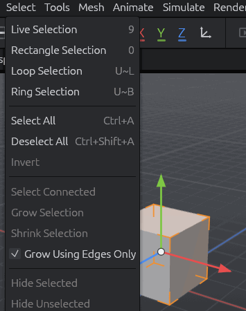

The **Select** menu also has:

- **Invert** (U~I), **Select Connected** (U~W), **Grow** (U~Y) and **Shrink** (U~K)
  Selection, and *Grow Using Edges Only*.
- **Hide Selected / Hide Unselected / Unhide All**. Hidden polygons disappear from
  the viewport and cannot be picked or changed until you unhide them; use this to
  work on one part of a mesh.

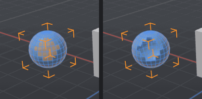

### 11.4 Transforming components

In a component mode the Move, Scale and Rotate gizmo appears at the centre of the
selection. Drag it to move, scale or rotate the selected points, edges or polygons
together. Each drag is one undo step, and the selection stays as it was.

**Tweak Mode** (option of the Move tool): with nothing selected, drag any point,
edge or polygon to move just that one, without selecting it.

### 11.5 Extrude and Inset

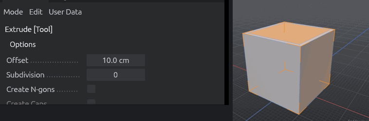

- **Extrude** (**D**) pushes the selected polygons out of the surface and builds
  walls around them. In Edges mode it grows new polygons from selected **border**
  edges.
- **Inset** (**I**) shrinks the selected polygons inside their outline and fills the
  gap with a ring of polygons (Polygons mode).

**Using them:**

1. Select what to work on. With nothing selected, the tool works on everything
   visible.
2. Press D or I (or pick it from the Mesh menu).
3. **Drag left or right anywhere in the viewport.** Right is outwards (Extrude) or
   inwards (Inset). The model follows live; release to finish, Esc to cancel.

Or set the options and click **Apply** in the Attribute Manager. Every drag or Apply
is a new operation, so dragging again extrudes again. The moved polygons stay
selected.

| Option | Meaning |
|--------|---------|
| Offset | Distance (negative goes the other way). A drag writes it here. |
| Subdivision | Extra rows of polygons along the walls (Extrude) or rings (Inset). |
| Create N-gons | One polygon per wall or ring side instead of rows. |
| Create Caps | (Extrude) keeps a copy at the start, so the result encloses a volume. |
| Preserve Groups | Neighbouring polygons move as one piece. Off: each polygon on its own. |
| Maximum Angle | With Preserve Groups: neighbours bent more than this are split. |
| Rotation (Edges) | (Extrude) tilts the new edge polygons around their edge. |

Typical box modelling: select the top polygon, **I** (inset), **D** (extrude),
repeat.

### 11.6 Loop/Path Cut and Line Cut

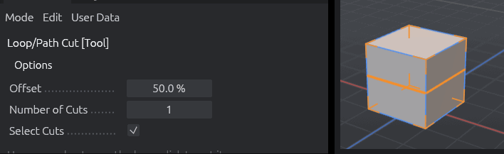

**Loop/Path Cut** (**K~L**) adds an edge loop all the way round:

1. Pick a component mode and press K, then L.
2. Hover an edge: an orange preview shows the loop that would be cut, at the
   cursor's position along the edge.
3. Click to cut.

| Option | Meaning |
|--------|---------|
| Offset | Where the cut crosses the edge, in percent. The click sets it. |
| Number of Cuts | Several loops, evenly spaced. |
| Select Cuts | The new edges become the edge selection. |

The loop runs through quads and stops at borders and at polygons that are not quads.

**Line Cut** (**K~K**), the knife: drag a line across the object. When you release,
every polygon it crosses is cut. Esc cancels.

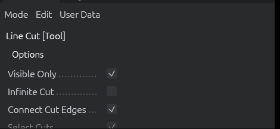

| Option | Meaning |
|--------|---------|
| Visible Only | Cut only what you can see, not the back of the object. |
| Infinite Cut | The cut continues beyond the line's ends. |
| Connect Cut Edges | Split the polygons. Off: only add points on the cut edges. |
| Select Cuts | The new edges become the edge selection. |

### 11.7 Connect, Melt, Dissolve and Delete

These commands work on the selection of the current mode (Mesh menu, or the
shortcuts). Each is one undo step.

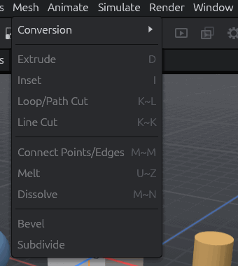

| Command | Shortcut | Points | Edges | Polygons |
|---------|----------|--------|-------|----------|
| **Connect Points/Edges** | M~M | Joins selected points that share a polygon with new edges | Puts a point in the middle of each selected edge and joins them (on an edge ring: a loop through the middle) | — |
| **Melt** | U~Z, Alt+Backspace | Removes the points, merging their polygons | Merges the two polygons of each edge (points stay) | Merges each connected group into one polygon |
| **Dissolve** | M~N, Ctrl+Backspace | As Melt | As Melt, and removes the points left over in the middle of a merged side | As Melt |
| **Delete** | Delete, Backspace | Removes the points and the polygons using them | Removes the polygons using the edges | Removes the polygons |

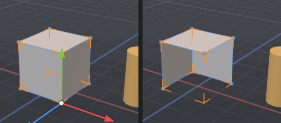

- A merged region must have a single outline: a ring of polygons around a hole
  cannot become one polygon, so Melt leaves it alone.
- Points that no polygon uses any more are removed automatically.
- In Model mode, Delete removes the selected objects instead.

## 12. Keyboard shortcuts

Shortcuts follow Cinema 4D. **Chords** like `U~L` mean: press U, release it, then
press L. The status bar shows the pending first key and its choices. Any other key or
Esc cancels a chord.

| Keys | Action |
|------|--------|
| Alt + left / middle / right drag, wheel | Orbit / pan / zoom |
| H / O | Frame scene / frame selected objects |
| E / T / R | Move / Scale / Rotate tool |
| 9 / 0 | Live / Rectangle Selection tool |
| U~L / U~B | Loop / Ring Selection tool |
| U~I / U~W / U~Y / U~K | Invert / Select Connected / Grow / Shrink selection |
| C | Make Editable |
| D / I | Extrude / Inset tool |
| M~T / M~W | Extrude / Inset tool (alternatives) |
| K~L (M~L) / K~K (M~K) | Loop/Path Cut / Line Cut tool |
| M~M | Connect Points/Edges |
| M~N or Ctrl+Backspace | Dissolve |
| U~Z or Alt+Backspace | Melt |
| Delete / Backspace | Delete (objects in Model mode, components otherwise) |
| Ctrl+A / Ctrl+Shift+A | Select all / deselect all |
| Ctrl+Z / Ctrl+Y (Ctrl+Shift+Z) | Undo / redo |
| Ctrl+N / Ctrl+O / Ctrl+S / Ctrl+Shift+S | New / open / save / save as |
| F8 / F6 / F7 | Play / play backwards / stop |
| F / G | Previous / next frame |

**Help ▸ Keyboard Shortcuts & About** shows this list inside the application.

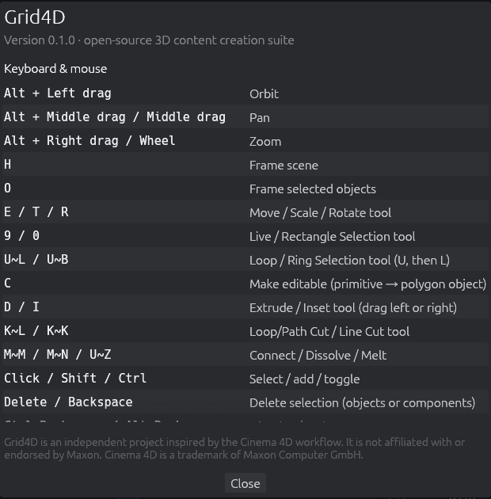

## 13. Limitations and what is planned

The roadmap is in [`IMPLEMENTATION_PLAN.md`](IMPLEMENTATION_PLAN.md). Not there yet:

- **Modelling**: Bevel, Bridge, Weld, Optimize; Subdivision Surface; snapping (the
  toggle exists, without effect); Extrude on points; Path mode for Loop/Path Cut.
- **Animation**: keyframes, F-curves, the Coordinate and Material managers.
- **Viewport**: scene cameras, the 4-view layout, wireframe and other display modes;
  lights do not light the viewport yet.
- **Interchange and rendering**: glTF/OBJ import and export, the offline renderer
  (the Render menu is disabled).
- The Takes, Layers and Filter panels are placeholders.

See [`progress.md`](progress.md) for what changed in each step.
