# Grid4D User Manual

How to use Grid4D, feature by feature. This manual describes what the current build
does; features that are planned but not there yet are marked *planned*. The
screenshots come from the application itself.

> Grid4D follows the workflow of Cinema 4D's Standard layout, so the names of tools
> and shortcuts will feel familiar to Cinema 4D users. It is an independent project,
> not affiliated with or endorsed by Maxon; Cinema 4D is a trademark of Maxon
> Computer GmbH.

**Contents**

1. [Getting started](#1-getting-started)
2. [The workspace](#2-the-workspace)
3. [Navigating the viewport](#3-navigating-the-viewport)
4. [Creating objects](#4-creating-objects)
5. [Selecting and transforming objects](#5-selecting-and-transforming-objects)
6. [The Object Manager](#6-the-object-manager)
7. [The Attribute Manager](#7-the-attribute-manager)
8. [Undo and redo](#8-undo-and-redo)
9. [Files](#9-files)
10. [Timeline and playback](#10-timeline-and-playback)
11. [Polygon modelling](#11-polygon-modelling)
12. [Generators: Subdivision Surface](#12-generators-subdivision-surface)
13. [Splines](#13-splines)
14. [Deformers](#14-deformers)
15. [The Cloner](#15-the-cloner)
16. [Simulation](#16-simulation)
17. [Snapping](#17-snapping)
18. [Tags](#18-tags)
19. [Materials and textures](#19-materials-and-textures)
20. [Rendering](#20-rendering)
21. [Plugins](#21-plugins)
22. [Scripts](#22-scripts)
23. [Keyboard shortcuts](#23-keyboard-shortcuts)
24. [Limitations and what is planned](#24-limitations-and-what-is-planned)

---

## 1. Getting started

**Requirements:** a graphics card with Vulkan, Direct3D 12 or Metal support (any GPU
from the last decade). Grid4D runs on Windows, Linux and macOS. If it cannot
start its graphics (no driver, an unsupported card, a remote session without
graphics), it says so in a message, **Grid4D Cannot Start**, with the reason,
instead of closing silently; updating the graphics driver often helps.

**Installing.** Download the package for your system from the project's
GitHub Releases (or its itch.io page):

| System | Download | How |
|--------|----------|-----|
| Windows 10 or later | `…-windows-x64.msi` | Run it: Grid4D goes into *Program Files* with a Start menu entry, and `.g4d` files open with it. Remove it from *Settings ▸ Apps*. |
| | `…-windows-x64.zip` | Unpack it anywhere and run `grid4d.exe` — nothing is installed. |
| macOS 11 or later | `…-macos-universal.dmg` | Open it and drag **Grid4D** into *Applications*. Runs on Apple silicon and Intel Macs. |
| Linux | `…-linux-x64.AppImage` | Make it executable (`chmod +x`) and run it. |
| | `…-linux-x64.tar.gz` | Unpack it and run `grid4d`; the folder also holds the icons, a `.desktop` launcher and the `.g4d` MIME type to install if you like. |

The packages are not code-signed yet, so the first start asks for a
confirmation: on Windows, if SmartScreen says the publisher is unknown,
choose **More info ▸ Run anyway**; on macOS, if it says the app cannot be
checked, right-click **Grid4D** in *Applications* and choose **Open**, then
**Open** again (once). `SHA256SUMS.txt` beside the downloads lists every
file's checksum.

Your settings, scripts and recovery copies are kept in your user data folder
([§2.2](#22-preferences)), not with the program, so they survive updates and
reinstalls.

**Running from source** (needs the Rust toolchain, 1.95 or newer):

```bash
cargo run --release
```

**Opening a document directly:** pass its path, e.g. `grid4d scene.g4d`. This is
also what "Open with" and file associations use: with the Windows installer
or the Linux launcher, double-clicking a `.g4d` file opens it in Grid4D. On
macOS, double-clicking starts Grid4D; open the file with **File ▸ Open** or
drop it on the window.

Grid4D starts maximized with a small demo scene (a cube, a sphere, a group with a
cylinder and a box, a light and a camera), so there is something to try right away.
Window size, panel sizes and the list of recent files are remembered between
sessions.

## 2. The workspace


| # | Area | What it is for |
|---|------|----------------|
| 1 | **Menu bar** | Every command: File, Edit, Create, Modes, Select, Tools, Mesh, Animate, Window, Help. |
| 2 | **Command palette** | Undo/redo, the selection tools, Move/Scale/Rotate, axis locks, World/Object coordinates, render buttons (Render View, Render to Picture Viewer, Render Settings) and buttons that create objects. |
| 3 | **Mode palette** | Make Editable, then the four modes: Model, Points, Edges, Polygons; the snapping toggle ([§17](#17-snapping)). |
| 4 | **Viewport** | The 3D view of the scene, or up to four views ([§3.2](#32-several-views-top-front-and-side)). Each view's header has the View, Cameras, Display, Options, Filter and Panel menus and three navigation icons. |
| 5 | **Object Manager** | The scene's objects as a hierarchy. |
| 6 | **Attribute Manager** | The parameters of the selected object, or the options of the current tool. |
| 7 | **Timeline** | The current frame, playback and the frame range. |
| 8 | **Status bar** | A hint for whatever is under the cursor, the object count and the graphics adapter. |

The panels resize with the window. Drag the border between the viewport and the
managers to make them wider.


**Hover any button or menu entry**: its tooltip and the status bar explain it.

### 2.1 Arranging the panels and layouts

The viewport and the managers (Objects, Takes, Attributes, Coordinates, Layers,
Timeline, F-Curve, Materials) are **panels** you can move around. Every panel
except the viewport has a tab with its name.

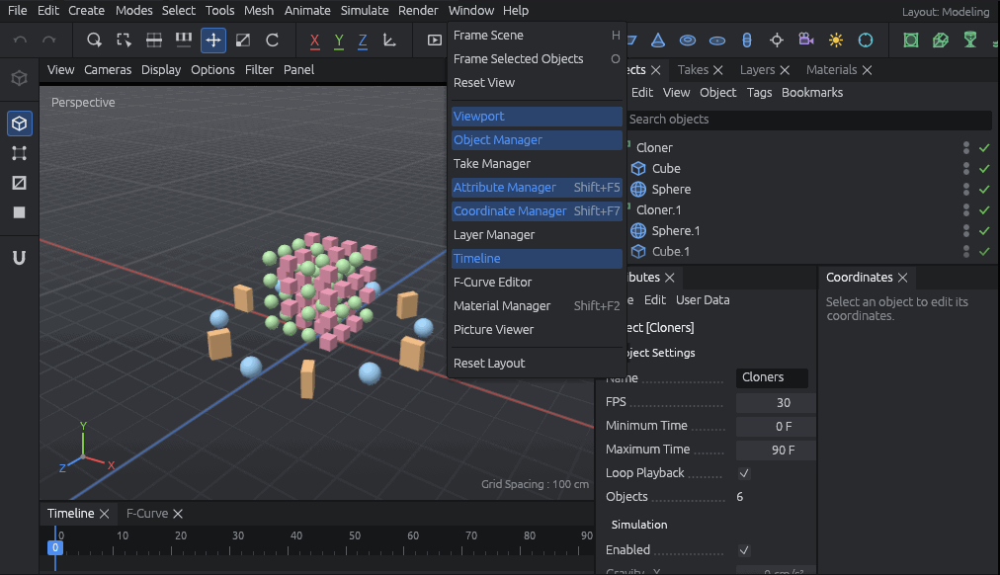

- **Move a panel:** drag its tab. Drop it on another group's tabs to add it
  there as a tab; drop it on the edge of a panel to split that panel and put it
  on that side.
- **Resize:** drag the line between two panels.
- **Close a panel:** click the **×** on its tab (the viewport cannot be closed).
- **Open a panel again:** choose it in the **Window** menu. It comes back as a
  tab beside the panels it usually sits with; if it is open, its tab comes to
  the front. The panels that are showing are highlighted in the menu.
- **Layouts:** the **Layout** menu at the right end of the menu bar switches
  the whole arrangement:
  - **Standard** — the Object Manager above the Attribute Manager on the right,
    the timeline under the viewport;
  - **Modeling** — a larger viewport, the Attribute and Coordinate Managers side
    by side, the Material and Texture Managers as tabs beside the Object Manager
    and a short timeline;
  - **Animate** — the F-Curve editor large under the viewport, with the
    timeline and the Material and Texture Managers as its tabs.
- **Window ▸ Reset Layout** puts the current layout back the way it was before
  you moved anything.

Grid4D remembers your arrangement and opens with it the next time.

The shortcuts that show a manager (**Shift+F2** Material Manager, **Shift+F5**
Attribute Manager, **Shift+F7** Coordinate Manager, **Tab** over the timeline or
the F-Curve editor) bring its tab to the front, opening it if it was closed.

### 2.2 Preferences

**Edit ▸ Preferences…** opens your settings. They are yours, not the
document's: they apply to every document and Grid4D keeps them between runs.
Changes take effect at once; close the window with its **×**.

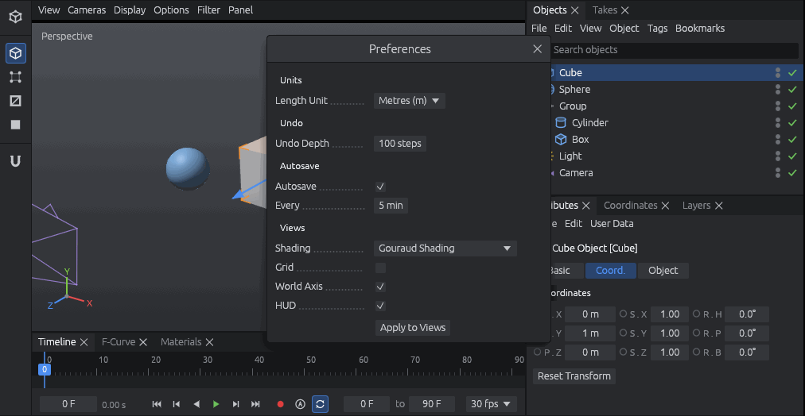

- **Interface ▸ Language** — **English** (the default) or **Ελληνικά**
  (Greek). The menus, managers, tooltips, dialogs and the status bar switch
  at once, no restart needed. Your documents do not change: object, material,
  layer and take names stay as you typed them, and a new cube is still
  called "Cube", so files read the same in either language. This manual is
  in English.

  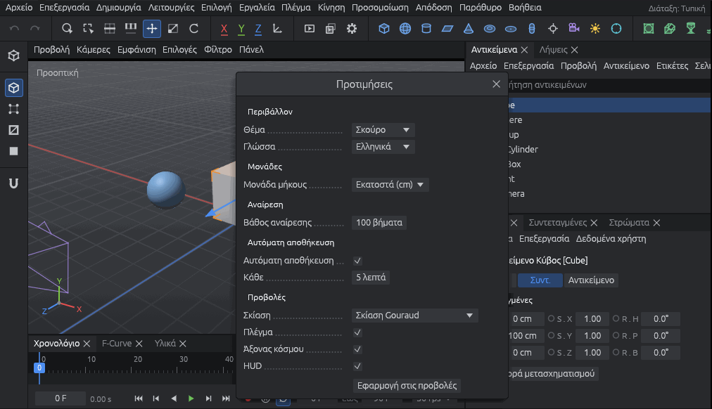
- **Interface ▸ Theme** — **Dark** (the usual look), **Darker** (deeper
  greys, for dim rooms) or **Light** (light panels and dark text). The 3D view
  keeps its grey in every theme, so objects, the grid and the handles look the
  same.

  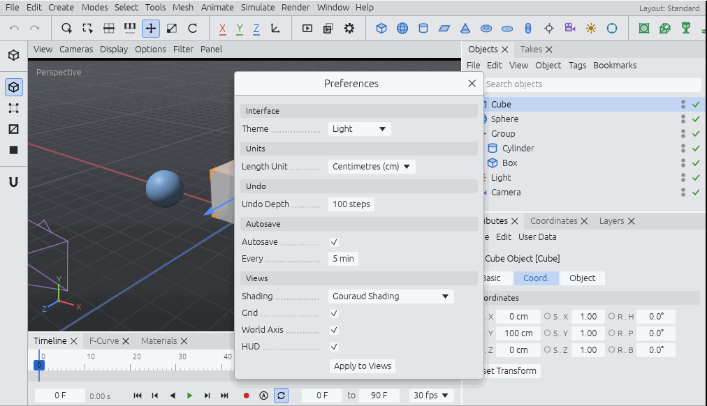
- **Units ▸ Length Unit** — Centimetres, Metres, Millimetres, Inches or Feet.
  Every length field (positions, sizes, radii, offsets, the Coordinate Manager,
  speeds and gravity) and the view's *Grid Spacing* show that unit. A number you
  type is in that unit; type a unit after it to use another one: `2 m`, `15mm`,
  `3 in`. Your documents do not change — only how their lengths read.
- **Undo ▸ Undo Depth** — how many steps **Undo** can go back (1 – 10 000,
  100 at first). Lowering it forgets the oldest steps at once.
- **Autosave** — while a document has unsaved changes, Grid4D keeps a recovery
  copy of it, renewed **Every** few minutes (5 at first). It never touches your
  own file, and it is deleted when you save or when Grid4D closes normally.
  If a copy cannot be written (a full disk, say), **Autosave Failed** tells
  you once, so you know to save your work yourself.

Settings, recovery copies, scripts and crash reports live in Grid4D's **data
folder** (on Windows `%APPDATA%\grid4d\data`, on Linux
`~/.local/share/grid4d`, on macOS `~/Library/Application Support/grid4d`).
If Grid4D cannot write there, it still starts and says so in **Data Folder
Unavailable**: in that session, nothing of those is kept.
- **Views** — the **Shading** and whether the **Grid**, **World Axis** and
  **HUD** show in the views when Grid4D starts. **Apply to Views** gives the
  open views these settings now.

## 3. Navigating the viewport

| Action | Mouse | Alternative |
|--------|-------|-------------|
| Orbit around the scene | **Alt + left drag** | Drag the circular-arrow icon at the top right of the viewport header |
| Pan | **Alt + middle drag** or **middle drag** | Drag the cross icon in the header |
| Zoom | **Alt + right drag** or **mouse wheel** | Drag the magnifier icon in the header |
| Frame the whole scene | **H** | View ▸ Frame Scene |
| Frame the selected objects | **O** | View ▸ Frame Selected Objects |
| Back to the default view | | View ▸ Reset View |

- **Filter** (viewport header) turns the grid, the axis triad (bottom left), the
  HUD and kinds of objects on or off ([§3.4](#34-the-filter-menu)). The HUD shows
  the grid spacing, which adapts to the zoom (1, 10, 100 cm …).
- Units are centimetres; Y points up.

### 3.1 Looking through a camera

The viewport has its own camera (the *default camera*). It can also look through a
camera object of the scene, or through any object. With several views
([§3.2](#32-several-views-top-front-and-side)), this is offered in View 1, the
perspective view at the top left.

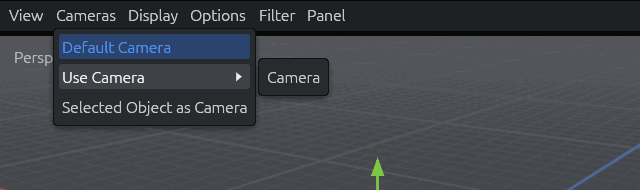

- **Cameras ▸ Use Camera ▸** *a camera*: the view looks through that camera — from
  its position, along its viewing direction, with its bank and field of view. The
  view's title shows the camera's name.
- **Double-click a camera's icon** in the Object Manager to look through it; the
  icon of the camera in use is highlighted. Double-click it again to go back.
- **Cameras ▸ Selected Object as Camera** looks along the active object's −Z axis
  (for example, to see what a light points at). The view keeps its own field of
  view.
- **Cameras ▸ Default Camera** goes back to the view's own camera, where you left
  it.

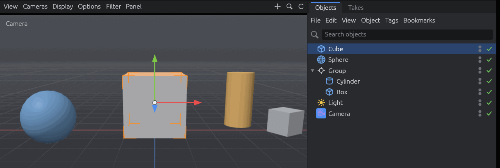

While the view looks through a camera, **navigating moves the camera**: orbit, pan,
zoom and H / O framing change its position and direction, like moving it with the
gizmo. Each gesture is one undo step. On an animated camera the change is
temporary until you record it, or becomes a key with Autokeying
([§10.2](#102-recording-keys)). A Protection tag on the camera's position or
rotation keeps it — and the view — where it is. An animated camera, or one with a
Target tag, is followed while the animation plays.

Every camera that the view is not looking through is drawn with a **wire pyramid**
showing what it sees (its field of view, at the view's proportions), with a small
triangle marking its top. Selected cameras are drawn in orange.

A **new camera** (Create ▸ Object ▸ Camera) is placed where the view is, looking
the same way, with the same bank and field of view, and focused at the point the
view orbits around.

**Depth of field and motion blur.** A camera object's Object tab also holds its
lens and shutter, which renders use (the viewport stays sharp):

| Setting | What it does |
|---------|--------------|
| Focal Length | Shown for orientation: the lens a 36 × 24 mm camera would need for this field of view. |
| Depth of Field | Renders through a lens with an opening: only what is at the focus distance is sharp. Off (the default): everything is sharp. |
| Focus Object | Focuses on this object, wherever it goes (its distance along the camera's view). |
| Focus Distance | Without a Focus Object: how far ahead the sharp plane lies. |
| F-Stop | The opening: a smaller number gives a shallower depth of field (more blur). As on a real camera, the blur depends on the scene's size: f/2.8 on a 50 mm lens blurs a lot at a few metres. It never changes the brightness. |
| Blades | The opening's shape: 0 is round; 3 or more make a polygon, which out-of-focus highlights take. **Blade Rotation** turns it. |
| Shutter | How long the shutter stays open, in frames: 0.5 (the default) is a classic 180° film shutter; longer smears more. |
| Shutter Position | **Centred** on the frame, **Opening** at it (the smear trails ahead) or **Closing** at it (the smear trails behind). |

The selected camera's pyramid shows its sharp plane as a rectangle, and a
dashed line to its Focus Object. Focus Distance, F-Stop and Blade Rotation can
be animated (a focus pull). The shutter takes effect when **Motion Blur** is
on in the Render Settings ([§20.1](#201-render-settings)); renders through the
view's own camera use a half-frame shutter, centred.

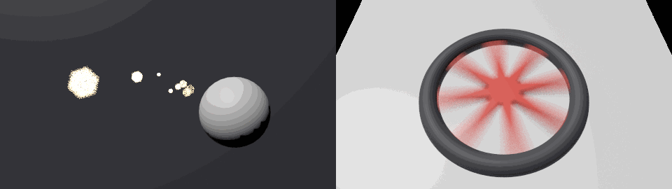

### 3.2 Several views: top, front and side

The viewport can show **four views** at once — a perspective view and exact top,
side and front views — to model from several sides.

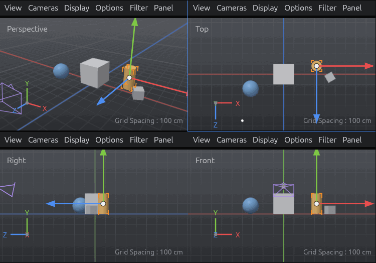

| View | Shows | Where |
|------|-------|-------|
| View 1 | Perspective | top left |
| View 2 | Top | top right |
| View 3 | Right | bottom left |
| View 4 | Front | bottom right |

- **F5** (or **Panel ▸ All Views**) shows the four views; **F1**–**F4** (Panel ▸
  View 1 … View 4) show one of them alone, filling the viewport.
- **Middle-click a view** (without dragging) to show it alone, and middle-click
  again to put it back among the others.
- **Panel** also offers *Single View*, *2 Views Stacked* (views 1 and 2, one above
  the other) and *2 Views Side-by-Side*. The viewport starts as a single
  perspective view.

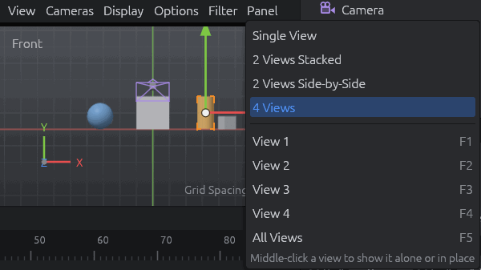

**The active view** has a thin blue frame. It is the one you last clicked or
scrolled in: just click in another view to work there — the same click already
selects, starts a drag or uses the current tool. Selection, the gizmo, the
modelling tools and snapping work in every view; H, O and View ▸ Reset View act on
the active view.

**Each view's Cameras menu** chooses what it shows: *Perspective*, or one of the
orthographic projections *Top*, *Bottom*, *Front*, *Back*, *Left* and *Right*.

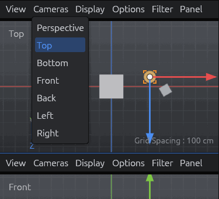

The orthographic views look straight along a world axis, without perspective, so
sizes and distances can be compared directly (a cube is a square):

- **Front** looks along −Z, with X to the right and Y up; **Back** looks the other
  way. **Right** looks along −X (Z to the left), **Left** the other way. **Top**
  looks down, with X to the right and Z towards the bottom of the view; **Bottom**
  looks up.
- They **cannot orbit**: Alt + left drag pans in them. Panning (middle drag) and
  zooming (wheel, Alt + right drag) work as usual; zooming changes how much of the
  scene is in view.
- The **grid lies in the view's plane**: the XY plane in Front and Back, ZY in
  Left and Right, the ground (XZ) in Top and Bottom. Its axis lines keep their
  colours (X red, Y green, Z blue). Grid snapping uses that plane too.

Every view keeps **its own camera, display mode and Filter** (objects, grid, axis
triad, HUD), and shows its projection — or the name of the camera it looks through — at the top left.
When a view is too narrow for its menus and navigation icons, the icons are left
out; the mouse navigation works as always.

### 3.3 Display modes

Each view's **Display** menu chooses how it draws objects: smooth shading to
judge the form, lines to see how a mesh is built, boxes to keep a heavy scene
quick. Every view has its own mode, so the perspective view can stay shaded
while the top view shows lines.

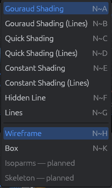

The upper part chooses the **shading**:

| Mode | Shortcut | What you see |
|------|----------|--------------|
| Gouraud Shading | N~A | Smooth surfaces lit by the scene's lights — or by the default light when there are none (the default mode; [§4.1](#41-lights)). |
| Gouraud Shading (Lines) | N~B | The same, with lines over the surfaces. |
| Quick Shading | N~C | Lit by the default light only, whatever lights the scene has. |
| Quick Shading (Lines) | N~D | The same, with lines. |
| Constant Shading | N~E | Flat, in each object's colour, without light and shade. |
| Constant Shading (Lines) | | The same, with lines. |
| Hidden Line | N~F | Only lines, and only those not hidden behind a surface. |
| Lines | N~G | Only lines, all of them — you see through the objects. |

The lower part chooses **what is drawn** of each object:

- **Wireframe** (N~H): the object itself; its lines are the edges of its
  polygons (an n-gon shows its outline, not the triangles it is drawn with).
- **Box** (N~K): each object as a box around it — its bounding box, turned with
  the object. Shaded in a shaded mode, its twelve edges in Hidden Line or Lines.
  Handy when a scene is heavy. Clicking still selects the object by its real
  shape.

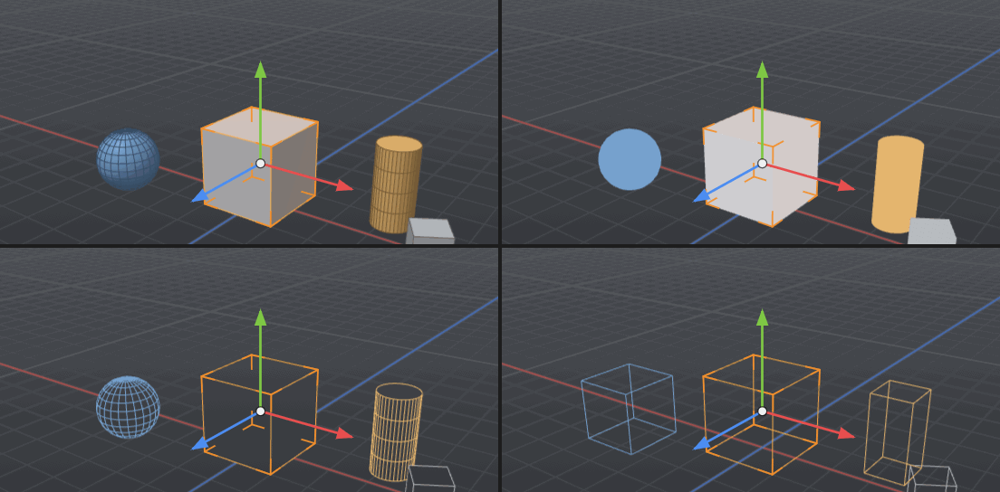

Over shaded surfaces the lines are a dark shade of the object's colour; in
Hidden Line and Lines they take the object's colour. **Selected objects' lines
are orange.**

The N~ shortcuts change the **active view** (press N, then the letter; the
status bar lists the choices while it waits). The menu changes the view it
belongs to.

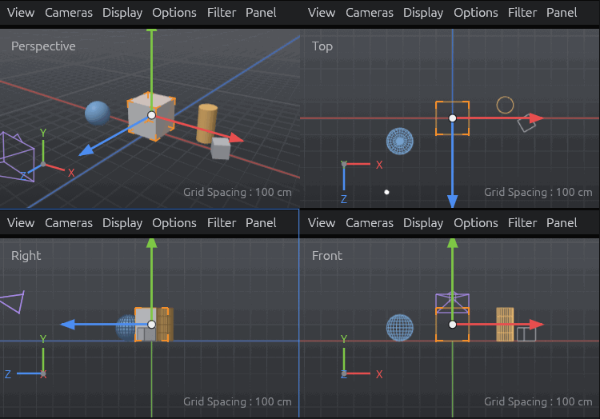

### 3.4 The Filter menu

Each view's **Filter** menu chooses what that view shows — for example, no
cameras and lights while you model, or no grid and HUD for a clean picture.
Everything is shown in a new view.

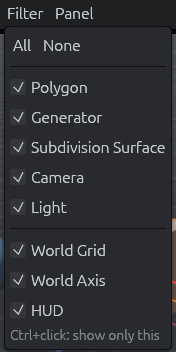

- **Object types**: *Polygon* (polygon objects), *Generator* (the parametric
  objects: Cube, Sphere, …, and the Extrude, Lathe, Sweep and Loft),
  *Subdivision Surface*, *Spline*, *Deformer* (their boxes), *Camera*, *Light*
  and *Sky* (a Sky's or Environment's background). A hidden
  type is neither drawn nor clickable in that view: clicks, rectangle selections
  and snapping go through it. Only the objects of that type are hidden, not their
  children. Hidden lights, skies and environments still light the view.
- **Elements**: *World Grid* (the grid), *World Axis* (the axis triad in the lower
  left corner) and *HUD* (the grid spacing in the lower right corner).
- Click an entry to turn it off or on. **Ctrl+click** shows only that entry and
  hides all the others. **All** shows everything again, **None** hides everything.
- An object you select in the Object Manager while its type is hidden still shows
  its gizmo, so you can move, scale or rotate it; in a component mode its points,
  edges and polygons still show.

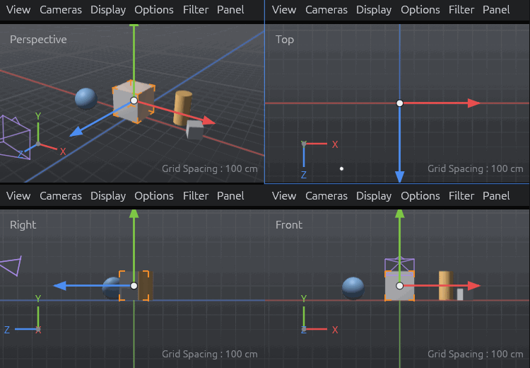

### 3.5 Shadows and ambient occlusion

Each view's **Options** menu has two effects that help judge how objects sit in
the scene. Both are off in a new view and switched per view.

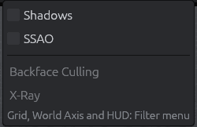

**Shadows** — the scene's key light casts shadows: the first light in the
Object Manager whose **Shadow** setting is not *None* ([§4.1](#41-lights)). Set
*Shadow Maps (Soft)* or *Area* for a soft edge, *Raytraced (Hard)* for a sharp
one.

- Every light type casts: a Spot within its cone, an Infinite light over the
  whole scene, an Omni light in every direction.
- Shadows show in **Gouraud Shading** (with or without lines) — the mode lit by
  the scene's lights. Other lights light without shadows; light and camera
  markers cast none.

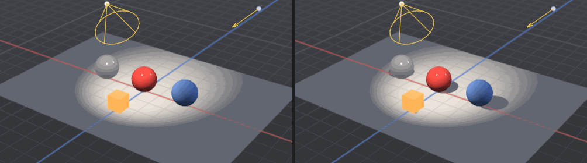

**SSAO** (ambient occlusion) — darkens the shading where surfaces come close:
where objects meet the floor, in inner corners and creases. It works in Gouraud
and Quick Shading. The grid does not count as a surface.

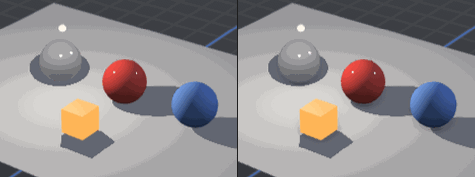

Both cost some speed in big scenes; switch them on in one view and keep the
others plain.

### 3.6 How fast the view draws

**View ▸ Frame Time** (in any view's **View** menu) shows in the top-right
corner of the active view how long frames take. Choose it again to hide it;
it is off whenever Grid4D starts.

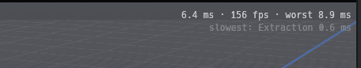

- **First line** — the time between frames and the frames per second, and
  the **worst** frame of about the last two seconds: a single slow frame (a
  hitch) shows there even when the average looks fine.
- **Second line** — which of the view's own jobs takes longest, and how
  long: **Evaluation** (animation, generators, deformers, clones),
  **Extraction** (sorting what to draw) or **Drawing** (sending it to the
  graphics card).
- The view only draws when something changes — orbiting, playing, editing.
  When nothing moves, the readout keeps its last values; pauses do not
  count. The rate cannot go above your display's refresh rate.

What to expect on a mid-range laptop (an RTX 3050): 10 000 objects playing,
or a single mesh of a million triangles, draw well above 60 frames a
second, and a 50 MB file opens in under two seconds.

## 4. Creating objects

Click a button on the right side of the command palette, or use **Create ▸ Object**:

| Object | Parameters (Attribute Manager ▸ Object) |
|--------|-------------------------------------------|
| Cube | Size X/Y/Z, Segments X/Y/Z |
| Sphere | Radius, Segments |
| Cylinder | Radius, Height, Rotation and Height segments |
| Plane | Width, Height, Width and Height segments |
| Cone | Top and Bottom radius, Height, segments |
| Torus | Ring radius, Pipe radius, Ring and Pipe segments |
| Disc | Inner and Outer radius, Disc and Rotation segments |
| Capsule | Radius, Height, Height, Cap and Rotation segments |
| Null | An empty object used to group others |
| Camera | Field of view; **created at the current view**, so it frames what you see |
| Light | Colour, Intensity, Type, cone and falloff ([§4.1](#41-lights)) |

New objects are named like Cinema 4D's (`Cube`, `Cube.1`, `Cube.2` …) and become
the selected object. These are **parametric** objects: change their parameters at
any time. To edit their points and polygons, make them editable
([§11.1](#111-make-editable)).

**Generators** (Create ▸ Generator, or the green buttons at the right end of the
command palette) build their shape from their children. The Subdivision Surface
smooths a polygon mesh ([§12](#12-generators-subdivision-surface)); the Extrude
turns a spline into a solid ([§13.4](#134-extrude-from-outline-to-solid)) and
the Lathe turns one around an axis ([§13.5](#135-lathe-turning-a-profile)) and
the Sweep moves one along another ([§13.6](#136-sweep-a-profile-along-a-path))
and the Loft stretches a skin over several ([§13.7](#137-loft-a-skin-over-sections)).
The Cloner repeats its children in a row, on a circle or in a grid
([§15](#15-the-cloner)).

**Splines** (Create ▸ Spline, or the circle button) are curves: Circle,
Rectangle, Arc, n-Side, Star, Helix and Flower ([§13](#13-splines)).

### 4.1 Lights

Light objects light the viewport in **Gouraud Shading** — where they are, which
way they point, their colour and strength. A scene without (visible) lights is lit
by the **default light**, which comes from over your shoulder and moves with the
view. **Quick Shading** always uses the default light ([§3.3](#33-display-modes)).

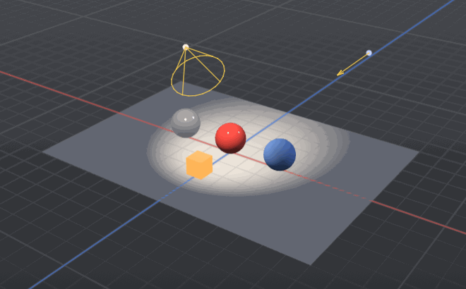

The light's settings are on the Attribute Manager's **Object** tab:

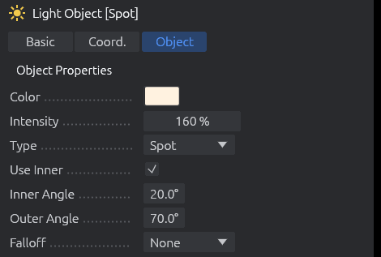

| Setting | What it does |
|---------|--------------|
| Color, Intensity | The light's colour and strength (100 % is normal; up to 10 000 %). |
| Type | **Omni**: shines in every direction, like a bulb. **Spot**: shines in a cone. **Infinite**: shines in one direction everywhere, like the sun — only its rotation matters, not its position. **Area**: shines from a shape with a size — a softbox, a window, a strip light, a frosted bulb (see below). |
| Use Inner, Inner Angle, Outer Angle (Spot) | The **Outer Angle** is the cone's opening (default 30°). Inside the **Inner Angle** the light is at full strength; it fades out towards the outer angle. With **Use Inner** off, the whole cone is at full strength and its edge is sharp. |
| Shadow | **None** (the default): no shadow. **Shadow Maps (Soft)** and **Area**: a soft-edged shadow; **Raytraced (Hard)**: a sharp one. The viewport shows the shadow of one light, the first with a shadow, when Options ▸ Shadows is on ([§3.5](#35-shadows-and-ambient-occlusion)). |
| Falloff, Radius/Decay (Omni, Spot) | **None**: as strong at any distance (the default). **Linear**: fades out to nothing at the Radius/Decay distance. **Inverse Square**: exactly the set intensity at Radius/Decay, stronger nearer and weaker farther, like real light. |
| Shape, Size X, Size Y (Area) | **Rectangle** (Size X wide, Size Y high) and **Disc** (Size X across) lie in the light's X–Y plane and shine along its −Z axis; **Sphere** (Size X across) and **Tube** (Size X thick, Size Y long, along the light's Z axis) shine all round. |
| Visible in Render (Area) | The renderer shows the light's shape itself — seen by the camera and in reflections — at its brightness. Off (the default): it lights the scene but is not seen. |
| Two-Sided (Area: Rectangle, Disc) | Shines from both faces, each at full strength; off, only along −Z (it is dark from behind). |
| Linking | **Exclude** (the default): the light lights everything except the objects listed below. **Include**: it lights only the objects listed. |
| Objects | The objects the Linking applies to, each together with its children. Pick one from **Add…**; **×** takes it off the list. A deleted object shows as *(deleted)* and no longer counts. |
| Light Group | A name: lights (and Skies or Environments) with the same name form a group, which renders will be able to output as a pass of its own (*planned*). |

**Light linking.** An object a light does not light gets none of its light
and casts no shadow of it — useful to brighten one product without
flattening the backdrop, or to keep a rim light off the floor. Exclude with
an empty list (the default) lights everything. Renders and the viewport (in
Gouraud Shading, its shadow included) both follow the links. Up to 64 lights
in a scene can be linked; a further linked light lights everything.
Glowing materials, the Sky and the Environment always light everything.

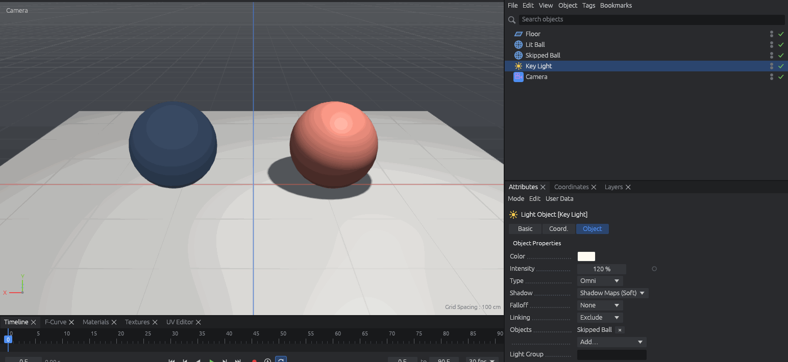

**Area lights** give soft light and soft shadows: the larger the shape, the
softer they are. The **size does not change how much light it gives**: a
larger light is softer, not brighter. It falls off with distance by itself,
like real light, so it has no Falloff setting; at 500 cm a small area light
lights a surface facing it as brightly as an Omni light of the same
Intensity with Inverse Square falloff (at its default Radius/Decay of 500
cm), so switching a light's type keeps the scene about as bright. To make
one, create a light (**Create ▸ Light**) and set its **Type** to **Area**.
In the viewport an area light is drawn as its shape (with a short arrow when
it shines one way only) and lights the scene approximately, from the point of
the shape nearest each surface; renders show it exactly.

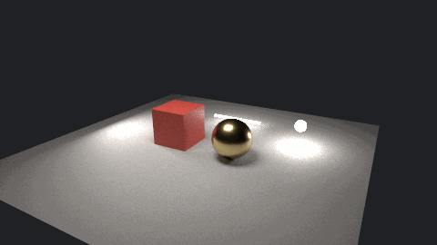

- Spot and Infinite lights shine along their **−Z axis**, like cameras look. Turn
  them with the Rotate tool or the Coordinates, or give them a **Target tag** to
  point them at an object ([§18.3](#183-target)). *Cameras ▸ Selected Object as
  Camera* shows what a light points at.
- In the viewport a **Spot** shows its cone, an **Infinite** light an arrow
  along its direction and an **Area** light its shape (orange when selected).
- A light hidden in the editor (the upper dot in the Object Manager) does not
  light the viewport.
- Sides that no light reaches keep a little soft light, so shapes stay readable.

**Materials** show in the lit viewport too ([§19](#19-materials-and-textures)): roughness sets
how sharp the highlights are, metals reflect in their own colour, and luminance
makes a surface glow whatever the light.

### 4.2 Sky and Environment

A **Sky** (**Create ▸ Sky**) surrounds the scene with an open daylight sky
and its sun; an **Environment** (**Create ▸ Environment**) surrounds it with
a photograph all round — a panorama, best an HDR or EXR file. Either one
lights the scene from every direction, shows behind it and in reflections,
and replaces the default light.

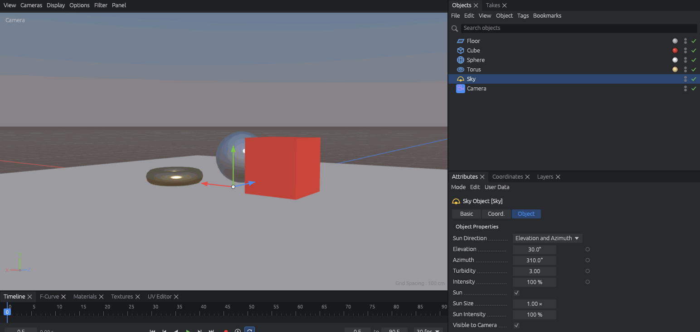

The Sky's settings (Object tab):

| Setting | What it does |
|---------|--------------|
| Sun Direction | **Elevation and Azimuth** (the default): the sun stands where the two angles below say. **From Object**: the sun shines along the Sky object's −Z axis — turn the object like an Infinite light. |
| Elevation | How high the sun stands, from −10° (just set) to 90° (straight up). |
| Azimuth | Its compass direction: 0° is along −Z, 90° along +X. |
| Turbidity | Haze, from 1.7 to 10: 2 is a clear mountain sky, 3 a clear day, 6 – 10 hazy. More haze whitens the sky and reddens and dims the sun. |
| Intensity | The brightness of sky and sun together. |
| Sun | The sun itself, as a light and as a disc in the sky. |
| Sun Size | The disc's size compared with the real sun's: larger gives softer shadows. |
| Sun Intensity | The sun's brightness on its own. |
| Visible to Camera | Renders show the sky where nothing else is. Off: the background stays transparent (for compositing); the sky still lights and reflects. |

The sun's colour follows its height and the haze: white at noon, golden low
down, red at sunset; below −2° it is gone, and the sky dims towards −10°.
Below the horizon the sky is a dim ground colour. High up, the sun lights a
white floor about as brightly as an Infinite light of 100 %.

The Environment's settings:

| Setting | What it does |
|---------|--------------|
| Texture | One of the document's textures (add the picture in the Texture Manager first, [§19.1](#191-textures-and-the-texture-manager)). It must be a **latitude-longitude** panorama, twice as wide as it is high. Without one the Environment is a plain grey. |
| Intensity | Its brightness. |
| Rotation | Turns the picture about the vertical axis; turning the Environment object turns it too. |
| Visible to Camera | As for the Sky. |
| Light Group | As for lights ([§4.1](#41-lights)); the Sky has it too. |

- **One at a time**: the first visible Sky or Environment in the Object
  Manager lights the scene; the others are ignored (their Attribute Manager
  says so). Hide one to try another.
- Where it stands and how large it is do not matter: it is infinitely far
  away.
- In the viewport, a **perspective** view shows it behind the objects in
  Gouraud and Quick Shading, and Gouraud Shading lights the objects with its
  soft light all round; the Sky's sun also lights and casts the view's
  shadow like an Infinite light. **View ▸ Filter ▸ Sky** hides the
  background in one view.
- Renders light the scene with it exactly: a bright window or sun in a
  panorama gives clean, sharp shadows even with few samples. **Auto Light**
  stays off while a Sky or Environment lights the scene.
- Elevation, Azimuth, Turbidity, Intensity and Rotation can be animated —
  a sun that sets over the frames, for instance.

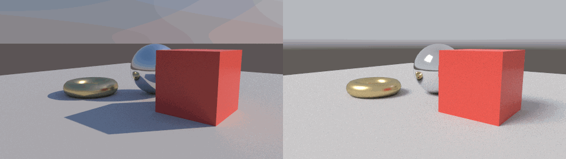

### 4.3 Plugins

**Create ▸ Plugins** lists the kinds of objects and deformers that plugins
add to Grid4D (it comes with a Gear and a Wave): see [Plugins](#21-plugins).

## 5. Selecting and transforming objects

**Selecting** (in Model mode):

- Click an object in the viewport or in the Object Manager.
- **Shift + click** adds to the selection, **Ctrl + click** toggles.
- Click empty space to deselect; **Ctrl+A** selects everything, **Ctrl+Shift+A**
  nothing.
- With the **Rectangle Selection** tool (**0**), drag a frame: objects whose origin
  is inside are selected.

The last object you selected is the **active** one: the gizmo and the Attribute
Manager work on it. Selected objects get orange corner brackets.

**Transforming:** pick **Move** (**E**), **Scale** (**T**) or **Rotate** (**R**),
then drag a handle of the gizmo.


- **Move**: drag an arrow to move along that axis. **Scale**: drag a handle with a
  square end. **Rotate**: drag a ring.
- The **X / Y / Z** buttons in the command palette lock axes. A disabled axis
  ignores the drag.
- The **World/Object** button next to them switches the gizmo between the world's
  axes and the object's own axes. Scale always uses the object's axes.
- **Alt + drag** always navigates, even over the gizmo.
- For exact values, type them in the Attribute Manager ([§7](#7-the-attribute-manager)).
- To place objects exactly on other objects or on the grid, turn on snapping
  (**Shift+S**, [§17](#17-snapping)).

Every drag is one undo step.

## 6. The Object Manager


- **Hierarchy**: click the fold arrow to open or close a group.
- **Rename**: double-click the name, type, then press Enter (Esc cancels). Or
  right-click ▸ Rename.
- **Visibility dots** (two small dots on the right): the upper one hides the object
  in the viewport, the lower one hides it in renders. A hidden parent hides its
  children.
- **Enable check mark**: turns an object off entirely (it shows a red cross).
- **Re-parent**: drag a row onto another row. The object keeps its position in the
  world. Right-click ▸ *Move to Top Level* takes it out of its group.
- **Search**: type in the search field to show only matching objects.
- **Tags** appear as icons after the name; click one to edit it ([§18](#18-tags)).
- Right-click a row for Rename, Frame Object, Move to Top Level, Add Tag and Delete.
- A small coloured square before the tags shows the object's **layer** (hover
  it for the layer's name; see §6.1).

### 6.1 Layers

Layers sort a scene into groups you can hide, lock or switch off together —
all the lights, the set, the rough proxies — without touching the objects.
Open the **Layers** tab (beside Attributes, or **Window ▸ Layer Manager**).

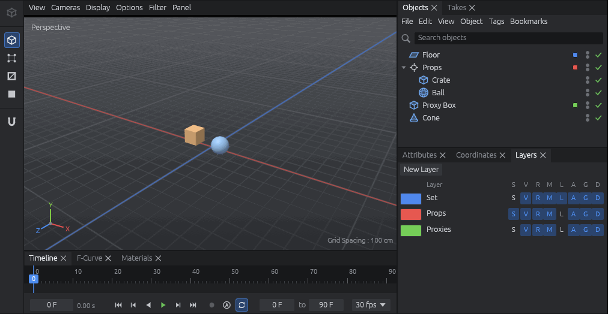

- **New Layer** adds a layer, each in a new colour. Click its colour to change
  it; double-click its name to rename it.
- **Put objects on a layer:** drag them from the Object Manager onto the
  layer, or select them and right-click the layer ▸ **Add Selected Objects**.
  An object's own layer can also be picked in the Attribute Manager's
  **Basic** tab (**Layer**). Children are on their parent's layer unless they
  have one of their own.
- **Right-click a layer** for **Add Selected Objects**, **Remove Selected
  Objects**, **Select Objects**, **Rename** and **Delete Layer** (its objects
  are then on no layer).
- **The switches** (click a letter to turn it on or off):

  | | Switch | When on |
  |---|---|---|
  | S | Solo | Only soloed layers' objects show (any layer soloed). |
  | V | View | The objects show in the views. |
  | R | Render | The objects show in renders. |
  | M | Manager | The objects are listed in the Object Manager. |
  | L | Locked | The objects cannot be picked in the views or moved by the tools (select them in the Object Manager). |
  | A | Animation | The objects are animated; off, they stay where they are without animation. |
  | G | Generators | Generators build; off, they act like groups. |
  | D | Deformers | Deformers deform; off, they do nothing. |

Every change to layers is one undo step and is saved with the document;
**File ▸ Merge** brings a file's layers along.

### 6.2 Takes

Takes keep variations of one scene side by side — another camera, a red
material instead of a blue one, an object hidden — without copies of the
file. **Main** is the scene as it is; every other take holds changes to it.
Open the **Takes** tab (beside Objects, or **Window ▸ Take Manager**).

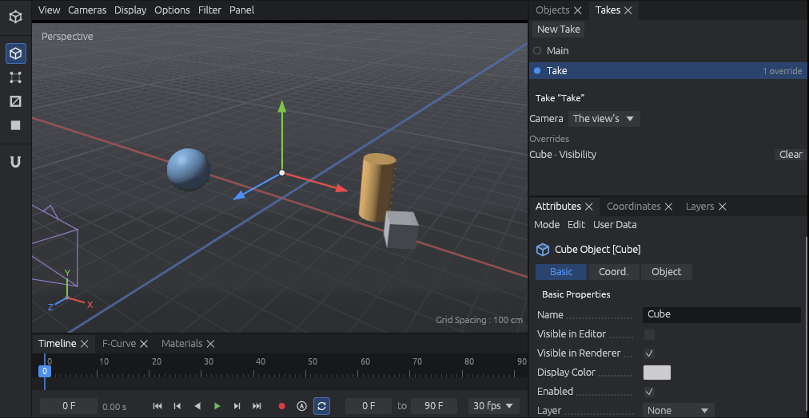

- **New Take** adds a take and makes it active (the dot marks the active
  take). Click **Main** or a take to make it active; the views, the managers
  and renders show it. Double-click a take to rename it; right-click it to
  delete it.
- **Changes are recorded automatically.** While a take other than Main is
  active, whatever you change of an object's **position, rotation and
  scale**, its **visibility** (the dots and the check mark), its
  **parameters**, its **tags** (for example which material it uses) or its
  **display colour**, and the **render settings**, belongs to that take; Main
  keeps its own values. Other changes — names, the hierarchy, new objects,
  keys, layers, the materials themselves — apply to every take.
- Under the takes, the active take's **Camera** (the one its renders look
  through; *The view's* by default) and its **overrides**, one line per object
  and group. **Clear** drops an override: the object shows Main's value again.
- **Rendering another take:** Render Settings ▸ **Take** — *Current* (the
  active take) or a take by name. That take is rendered without making it
  active.

Switching takes and every recorded change are undo steps, and takes are
saved with the document.

## 7. The Attribute Manager


With an object selected it shows three tabs:

- **Basic**: name, editor and render visibility, enabled.
- **Coord.**: position (P), scale (S) and rotation (R, as H/P/B angles in degrees),
  plus *Reset Transform*. The values are those at the current frame; the small
  circle before each field is its key button ([§10.2](#102-recording-keys)).
- **Object**: the object's own parameters (sizes, segments, field of view …).

Drag a value left or right to change it, or click it and type a number. A change
from one drag or one typing session is one undo step.

**With nothing selected** it shows the project settings: the name, the frame rate and
the frame range.

**Tool mode:** when you pick a tool that has options (the selection tools,
Extrude, Inset, Bevel, Bridge, Loop/Path Cut, Line Cut), the Attribute Manager switches to that
tool's options. Its **Mode** menu switches between *Objects* and *Tool* by hand.

### 7.1 The Coordinate Manager

The **Coordinates** tab beside **Attributes** (**Shift+F7**; **Shift+F5** goes back
to the Attribute Manager; both are also in the Window menu) is for typing exact
positions, sizes and rotations.

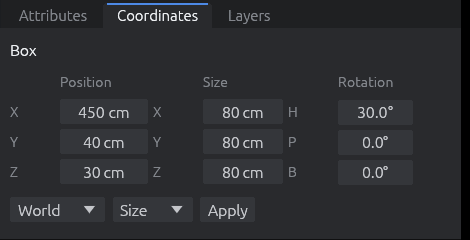

- Three columns: **Position**, the middle column, and **Rotation** (H, P, B in
  degrees).
- The list under the fields on the left chooses how values are read:
  - **Object**: in the object's parent, the same values as the Coord. tab.
  - **World**: in the world. Typing a world position puts the object there,
    wherever its parent is.
- The list in the middle chooses the middle column:
  - **Scale**: the object's scale (in World mode, including its parents').
  - **Size**: the object's extent along its own axes, in cm. Typing a size scales
    the object to it.
  - **Size+**: the same, with its children included.
- Drag a value or type one and press Enter: the object changes at once, and each
  change is one undo step. **Apply** writes all the fields as shown.
- **In Points, Edges or Polygons mode** the manager works on the selection:
  Position is the centre of the selected elements, Size the extent of their
  bounding box. Changing them moves or scales the selection around its centre.
  Rotation always shows 0: a value turns the selection by that much around its
  centre, then the field returns to 0.
- Values are those at the current frame. Changing an animated value follows the
  same rules as the gizmo: a temporary value, or a key with Autokeying
  ([§10.2](#102-recording-keys)).
- Channels locked by a Protection tag are greyed out. With several objects selected,
  the manager shows and changes the active one.

## 8. Undo and redo

- **Ctrl+Z** undoes, **Ctrl+Y** or **Ctrl+Shift+Z** redoes. The arrows at the left
  of the command palette do the same, and their tooltips name the step ("Undo Move").
- Everything that changes the document can be undone: creating, deleting and
  re-parenting objects, every drag and typed value, renames, selections of points,
  edges and polygons, and every modelling operation.
- Up to 100 steps are kept; change it in **Edit ▸ Preferences… ▸ Undo Depth**
  ([§2.2](#22-preferences)).

## 9. Files

| Command | Shortcut | Notes |
|---------|----------|-------|
| File ▸ New | Ctrl+N | An empty document. |
| File ▸ Open… | Ctrl+O | Opens `.g4d` documents (and older `.oc4d` ones), and models (`.gltf`, `.glb`, `.obj`) as new documents. |
| File ▸ Open Recent | | The last ten files. |
| File ▸ Merge… | Ctrl+Shift+O | Adds the objects of a `.g4d`, `.gltf`, `.glb` or `.obj` file to the current document. |
| File ▸ Export… | | Writes the scene as a model for other applications: glTF (`.glb`, or `.gltf` + `.bin`) or OBJ (`.obj` + `.mtl`). |
| File ▸ Save | Ctrl+S | Asks for a name the first time. |
| File ▸ Save As… | Ctrl+Shift+S | |
| File ▸ Quit | | |

- **Drag a `.g4d` file onto the window** to open it; **drag a model** (`.gltf`,
  `.glb` or `.obj`) onto it to merge it into the current document.
- The window title shows the document name and an asterisk (`*`) while there are
  unsaved changes. Undoing back to the saved state clears it again.
- Before anything would discard unsaved changes (New, Open, Quit, closing the
  window), Grid4D asks: **Save**, **Don't Save** or **Cancel**.
- Saving writes a temporary file first and then replaces the old one, so a failed
  save never leaves a broken document behind.
- **After a crash.** With Autosave on ([§2.2](#22-preferences)), Grid4D asks on
  the next start whether to **Recover** the unsaved work it kept or
  **Discard** it. Recovered work opens with unsaved changes (an asterisk in the
  title); **Save** writes it to the file it came from, **Save As** keeps both.
  Press **Esc** to decide on the next start instead.

  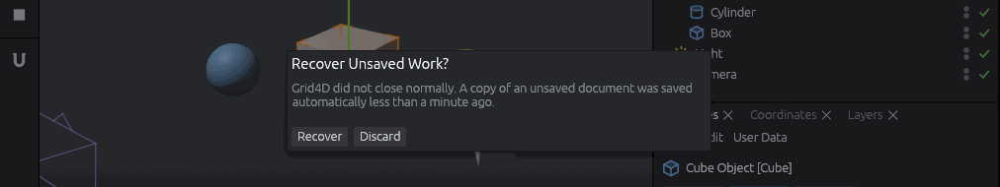
- **Crash reports.** When Grid4D runs into an internal error it writes a
  crash report, a text file in the `crashes` folder of its data folder (see
  [§2.2](#22-preferences)): the version, the system and graphics card, the
  error and where it happened, and the last lines Grid4D logged — none of
  your document. **Nothing is sent anywhere.** On the next start Grid4D
  points to the report once, in **Recover Unsaved Work?** or in its own
  window, **Grid4D Stopped Unexpectedly**; **Show Report** opens the folder
  with the report selected. If you report the problem, attach the report.
  The newest 20 reports are kept.

  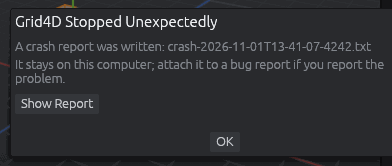
- **A full disk.** If a save cannot be completed, your file stays as it was
  before, **Could Not Save Document** gives the reason, and the document
  keeps its unsaved changes — free some space and save again.
- **Very large files.** A file that needs more memory than the computer
  has is refused with "not enough memory to read this file", and Grid4D
  carries on.
- `.g4d` files keep everything in the document: objects, hierarchy, parameters, the
  meshes of polygon objects, and their selected and hidden points, edges and
  polygons. Editor state (tool, mode, camera) is not saved.


### 9.1 glTF models

glTF 2.0 is the common format for exchanging 3D models (`.gltf` with its `.bin`
file, or a single `.glb`). Most 3D applications can export it.

- **Open** a glTF file to start a new document from it. The document is named after
  the file; **Save** then asks where to put the `.g4d`.
- **Merge** one (File ▸ Merge… or drag and drop) to add it to the scene you are
  working on. The merged objects are added at the top of the hierarchy and selected,
  and one **Undo** removes all of them.


What comes in:

| glTF | Grid4D |
|------|--------|
| Node hierarchy, names, position / rotation / scale | The same hierarchy of objects. Metres become centimetres (× 100). |
| Meshes | Polygon objects, ready for modelling. Points that the file repeats at seams are merged, so the mesh is connected. Texture coordinates are kept. |
| Materials | Materials in the Material Manager, linked to the meshes by Material tags: colour, roughness, metallic, emission, and the extensions for transmission, refraction index (IOR), emission strength, specular and clear coat; the base colour also becomes the display colour. |
| Pictures | Textures in the Texture Manager, on the material's channels: base colour, metallic and roughness (glTF keeps them in one picture: roughness in its green, metallic in its blue), normal, emission, and a cut-out from the base colour's alpha (Mask, and Blend, which Grid4D cuts at half). Pictures inside the file are **embedded**; pictures next to it are **linked**. A picture's offset and scale (`KHR_texture_transform`) become the channel's Offset and Tiling. |
| Cameras | Camera objects (field of view). |
| Lights (`KHR_lights_punctual`) | Light objects (colour, intensity): point → Omni, spot → Spot (with its cone), directional → Infinite. |
| Empty nodes | Nulls. |

Not yet: animation, skinning, morph targets and compressed meshes (Draco);
a picture's turn (`KHR_texture_transform` rotation), ambient occlusion
pictures and pictures linked by an absolute path are left out. Shading comes from Grid4D's own smoothing, not from the file's
normals. Points the file has at *almost* the same place (not exactly) stay separate;
run **Optimize** (U~O) on such an object to merge them.

### 9.2 Exporting glTF

**File ▸ Export…** writes the whole scene as a glTF model that other applications
(Blender, game engines, web viewers, …) can read. Pick the file type in the dialog:

- **glTF Binary (`.glb`)**: one file with everything in it (the default).
- **glTF (`.gltf` + `.bin`)**: a text file plus a `.bin` file of the same name next
  to it. Keep the two together.

What goes out:

- Every object in its hierarchy, with names and positions (centimetres become
  metres).
- Polygon objects as meshes, split into triangles, with the smoothing you see in
  the viewport and their UVs. **Primitives** are written in their current shape.
  Primitives and generators always have UVs (texture coordinates), so a model
  exported from Grid4D can be textured in another program straight away: round
  shapes are unrolled around their axis, a cube carries the whole picture on
  each side, flat shapes and caps are laid out as seen from the front, and
  the walls of an Extrude, Lathe, Sweep or Loft run along their splines.
  A **Subdivision Surface** is written as its smooth result at the viewport level,
  without its cage; an **Extrude**, **Lathe**, **Sweep** or **Loft** as its
  solid at the current frame, without the splines it is made from. Objects
  changed by **deformers** are written in their deformed shape. A
  switched-off generator is written as an empty object with its children as
  they are. Splines themselves are written as empty objects.
- Materials (one a mesh inherits from a parent included) with every channel glTF
  has a place for: colour, roughness, metallic, emission and its strength, the
  normal picture, a cut-out from the base colour's alpha, transmission, IOR,
  specular, clear coat and Two-Sided. Their **pictures go inside the file**
  (PNG and JPEG; glTF has no place for the other formats, so those are left
  out), with each channel's Tiling and Offset. Roughness and metallic
  pictures are written when both read one picture's green and blue (as
  pictures from glTF do). Objects without a material get a simple material in
  their display colour. Cameras and lights.

Exporting does not change the document: there is nothing to undo, and the title's
`*` stays as it was.


Opening an exported file brings back the hierarchy, names, positions, cameras and
lights. Every mesh comes back as a triangulated polygon object, since glTF stores
only triangles.

### 9.3 OBJ files

OBJ (Wavefront) is the oldest common mesh format; nearly every 3D application
reads and writes it. It stores **meshes only**, with no hierarchy, cameras or
lights. Unlike glTF, it keeps polygons with any number of corners. Open, merge
and drop `.obj` files like glTF files, and pick the `.obj` type in
**File ▸ Export…**.

- **Importing:** every object or group in the file becomes a polygon object, placed
  at the origin. Quads and n-gons stay as they are. Texture coordinates are kept,
  and the materials of the `.mtl` file named in the OBJ become materials linked
  by Material tags, their colours also the display colours: colour, emission,
  roughness and metallic (`Pr`, `Pm`, else a roughness from the shininess
  `Ns`), clear coat, IOR, and their **pictures** — colour (`map_Kd`), emission
  (`map_Ke`), cut-out (`map_d`), bump (`bump` with its `-bm` height), normal
  (`norm`), roughness and metallic (`map_Pr`, `map_Pm`), each with its `-s`
  scale and `-o` offset and the picture channel `-imfchan` names. The
  pictures are **linked**, found next to the OBJ for relative paths.
  OBJ has no units: 1 unit is read as 1 cm.
- **Exporting:** every mesh (primitives, generators and deformed shapes included,
  as for glTF) becomes one OBJ object, with its points where they are in the scene (OBJ
  has no positions or hierarchy of its own). Polygons keep all their corners.
  Normals follow the viewport's smoothing. Materials (under their names, with the
  same values and pictures), or display colours, go to a `.mtl` file of the same
  name next to the `.obj`; keep them together. Linked pictures are named by
  their path (relative when they are in the `.obj`'s folder); **embedded
  pictures are written next to the `.obj`** as files. Cameras, lights and Nulls
  are left out.

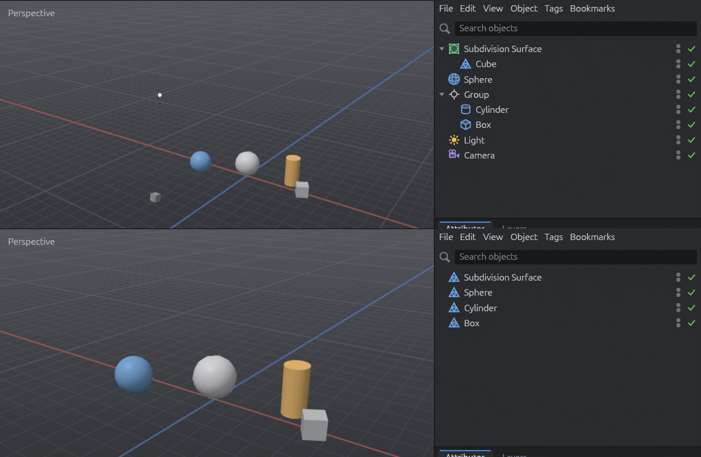

**The file format** is documented in [`FILE_FORMAT.md`](FILE_FORMAT.md), so
other programs can read and write `.g4d` files; from Grid4D 1.0 a released
version of it never changes, and every Grid4D opens the files of every
earlier version.

**Files and Grid4D versions.** Each Grid4D opens every file an earlier one
saved, unchanged, and saves in its own version of the format, which holds
what it adds: Grid4D 1.1 saves version 4, the coming Grid4D 1.2 (in
development) version 5. An older Grid4D cannot open a file saved by a newer
one: it says the file comes from a newer Grid4D. To hand a document to
someone on an older version, keep a copy saved by that version.

## 10. Timeline and playback


| Action | Shortcut |
|--------|----------|
| Play forwards / backwards | F8 / F6 |
| Stop | F7 |
| Previous / next frame | F / G |
| Previous / next key of the selected objects | Ctrl+F / Ctrl+G |
| Go to start / end | the outer transport buttons |
| Record Active Objects | F9 (the red button) |
| Autokeying on / off | Ctrl+F9 (the button with an A) |

- Click or drag on the ruler to scrub, or type a frame number.
- Under the ruler, the **key strip** shows the keys of the selected objects
  ([§10.3](#103-keys-on-the-timeline)).
- The two fields on the right set the frame range; the drop-down sets the frame
  rate. The loop button (also Animate ▸ Loop Playback) makes playback start over at
  the end.

### 10.1 Animation

Objects in a document can be **animated**: their position, rotation and scale can
change over time. While you play or step through the frames, the viewport shows
every animated object where it is at the current frame, and its children move with
it.

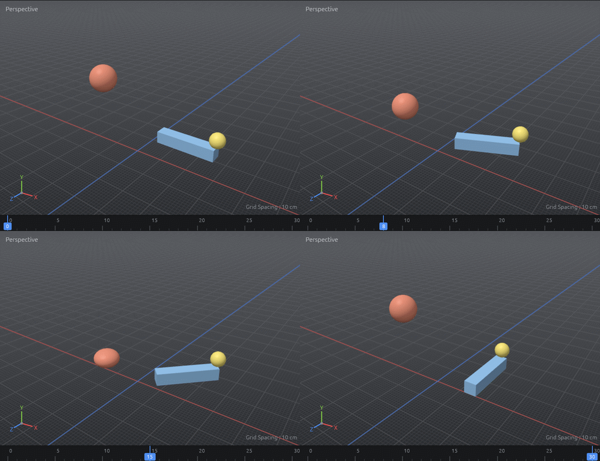

- Each animated value has **keys**: a value at a frame. Between keys the value
  changes smoothly (*Spline*, the default), in a straight line (*Linear*) or
  holds and then jumps (*Step*). Smooth curves never shoot past a highest or
  lowest key. Before the first key and after the last one, the value stays put.
- The Coordinates fields and the gizmo show and change the values **at the
  current frame**.
- Animation is saved with the document.

### 10.2 Recording keys

1. Select the objects to animate and go to a frame.
2. Place them: move, scale or rotate them with the gizmo or the Coordinates fields.
3. Press **F9** (*Record Active Objects*: the red button under the timeline, or
   Animate ▸ Record Active Objects). Every selected object gets keys for its
   position, scale and rotation at this frame.
4. Go to another frame, change them again, press F9 again, and so on.

Animate ▸ Record chooses which of **Position**, **Scale** and **Rotation** F9
records (all three by default).

**Key buttons.** In the Attribute Manager's Coord. tab, the circle before each
field tells you about that value:

| Circle | Meaning |
|--------|---------|
| grey ring | not animated |
| red ring | animated, no key at this frame |
| red dot | a key at this frame |
| yellow ring / dot | changed here but not recorded (no key / a key at this frame) |

- **Click** a circle to set a key for just that value at the current frame. Click a
  red dot to remove that key.
- **Shift+Ctrl+click** removes all the value's keys; it keeps the value it shows.

**Changes that are not recorded.** If you change an animated value without
recording, the change is temporary: the circle turns yellow, and the object stays
where you put it only at this frame. Press F9 (or click the circle) to keep it;
going to another frame drops it.

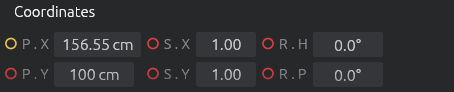

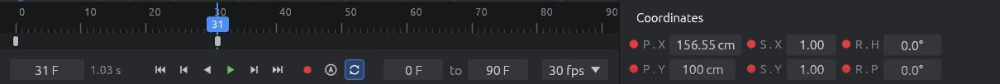

**Autokeying** (**Ctrl+F9**, the button with an A, or Animate ▸ Autokeying) records
for you: while it is on, the viewport has a red frame, and every change to an
**animated** value becomes a key at the current frame. Values that are not animated
yet change without a key, so record them once with F9 first. Switch Autokeying off
when you are done, so later edits do not overwrite your animation.

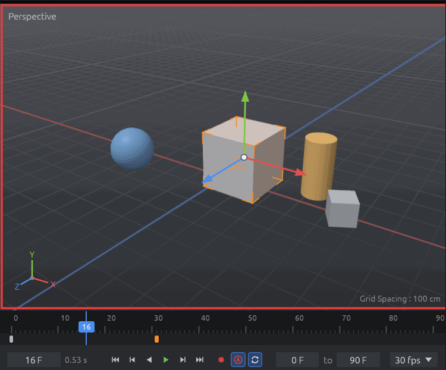

Every recording, key click and Autokeying drag is one undo step.

### 10.3 Keys on the timeline

The strip under the frame ruler shows a mark at every frame where a selected object
has keys.

- **Click** a mark to select it (orange); **Shift+click** adds or removes marks.
  **Drag across empty space** to select all the marks in that range. A click on
  empty space clears the selection.
- **Drag a mark** to move the selected keys by whole frames. Keys already at the
  frames they land on are replaced.
- **Delete** (or Backspace) right after clicking in the strip deletes the selected
  keys; so do the strip's right-click menu and Animate ▸ Delete Keys. Once you click
  elsewhere, Delete works on objects again.
- **Ctrl+click** in the strip records keys at that frame without moving the time
  (with the values shown at the current frame).
- **Ctrl+F / Ctrl+G** (Animate ▸ Go to Previous / Next Key) jump to the previous or
  next frame with a key.

### 10.4 The F-Curve editor

The **F-Curve** tab beside **Timeline** (or **Tab** with the pointer over the
timeline) shows every animated value of the selected objects as a curve: time from
left to right, the value from bottom to top. Rotations are shown in degrees. Drag
the top edge of the panel to make it taller.

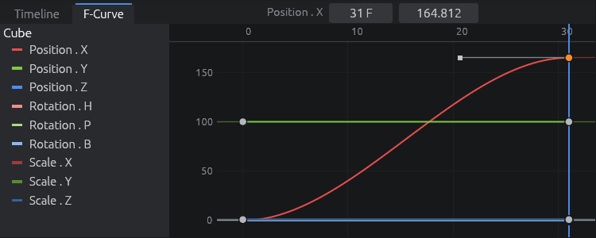

- **The track list** on the left names each animated value with its colour. Click
  one to show only its curve, Shift+click to add or remove more, and click the
  object's name to show them all again.
- **Select keys**: click a key; **Ctrl+click** adds or removes keys; drag a box
  around keys; click a curve between keys to select all of its keys. A click on
  empty space clears the selection.
- **Move keys**: drag a selected key. All selected keys move, in whole frames and
  freely in value. Hold **Shift** to keep the move horizontal or vertical.
- **Edit a key exactly**: with one key selected, the header shows its frame and
  value; drag or type them.
- **Shape the curve**: a selected key shows its **tangent handles**. Drag one to
  change the slope; the other side follows so the curve stays smooth. Hold
  **Shift** to move one side alone (a sharp corner).
- **Add a key**: **Ctrl+click** on a curve adds a key there, without changing the
  curve's shape.
- **Right-click** for **Interpolation** (Spline, Linear, Step), **Tangents** (Auto
  Tangents, Zero Angle for flat handles, Zero Length for a straight segment),
  **Delete Keys**, **Frame All** and **Frame Selected**.
- **Delete** after a click in the graph deletes the selected keys.
- **Navigate**: the wheel zooms around the pointer (Ctrl+wheel zooms time only,
  Shift+wheel values only); drag with the middle button (or Alt + left) to pan.
  **H** frames all curves, **S** the selected keys, while the pointer is over the
  graph. The view frames the curves by itself when you select other objects.
- Click or drag on the frame numbers at the top to set the current frame.

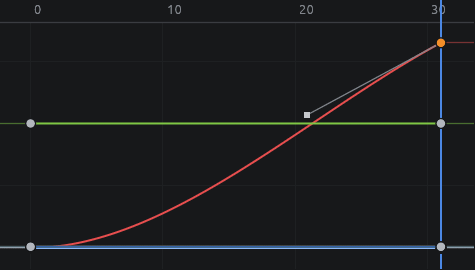

Every drag, typed value and menu command is one undo step.

### 10.5 Animating an object's parameters

Not only position, rotation and scale can change over time: an object's own
numbers can too — a sphere's radius, an Extrude's offset, a Lathe's angle, a
Sweep's growth, a light's intensity or a camera's field of view.

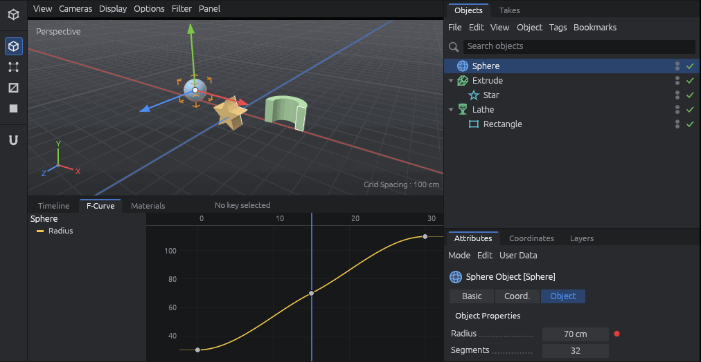

In the Attribute Manager's **Object** tab, every parameter that can be animated
has a small **key button** after its field — the same as beside the
Coordinates fields:

- **Click** it to set a key at the current frame with the value shown (or to
  remove the key that is there). **Shift+Ctrl+click** deletes the parameter's
  whole track. Each click is one undo step.
- The button shows the state: grey ring (not animated), red ring (animated, no
  key here), red disc (a key at this frame), yellow (changed but not recorded).
- With **Autokeying** on, changing an animated parameter writes a key at the
  current frame. With it off, the change is temporary: it shows only at that
  frame and is dropped when the frame changes (the yellow button) — click the
  button to keep it.

The fields always show the values at the current frame. Parameter tracks
appear in the **F-Curve editor** under the object, after its position,
rotation and scale (angles in degrees, percentages in percent), and their keys
on the timeline's key strip, where they move and delete like the others.
**Record** (F9) still records only position, scale and rotation.

Counts (segments, sides, subdivisions) and choices (types, check boxes) cannot
be animated yet. **Make Editable** bakes the shape at the current frame.

## 11. Polygon modelling

Modelling works on **polygon objects**: meshes of points, edges and polygons that
you shape directly.

### 11.1 Make Editable

Select a primitive and press **C** (or click the top button of the mode palette, or
Mesh ▸ Conversion ▸ Make Editable). It becomes a polygon object that looks exactly
the same: same name, position and place in the hierarchy. Its icon changes to a
triangle. One undo step turns it back into the parametric object. On a Subdivision
Surface, Make Editable keeps the smooth result
([§12.4](#124-switching-it-off-and-baking-it)). To keep the original and get a
polygon copy of what you see instead — deformers and animation included — use
**Current State to Object** ([§14.6](#146-current-state-to-object)).

### 11.2 Component modes

The mode palette switches between **Model** (whole objects) and the three component
modes: **Points**, **Edges** and **Polygons** (Modes menu too). In a component
mode the **active polygon object** shows its components: blue points or edges, and
selected ones in orange. A click selects what is under the cursor. Components
hidden by surfaces in front are not picked.

| Click | Effect |
|-------|--------|
| Click | Select that point / edge / polygon |
| Shift + click | Add it |
| Ctrl + click | Remove it |
| Click on empty space | Deselect all |

Each mode keeps its own selection. **Convert a selection** to another mode: Shift +
click that mode's button (tolerant, everything touched), or Ctrl + click it (strict:
only what is fully selected).

### 11.3 Selection tools and commands


| Tool | Shortcut | How |
|------|----------|-----|
| Live Selection | 9 | Paint over components. **Middle drag** changes the brush size. Esc cancels the stroke. |
| Rectangle Selection | 0 | Drag a frame. Esc cancels. |
| Loop Selection | U~L | The loop under the cursor is highlighted; click to select it. |
| Ring Selection | U~B | The same for rings (the parallel edges across a strip). |

Options (Attribute Manager, Tool mode):

- **Only Select Visible Elements**: ignore what lies behind the surface.
- **Tolerant Selection**: anything the brush or frame touches counts.
- **Stop at Selections / Non-Quads / Poles**: where loops and rings end.

**Double-click** with the Move tool: on an edge it selects its loop, on a polygon
all connected polygons.


The **Select** menu also has:

- **Invert** (U~I), **Select Connected** (U~W), **Grow** (U~Y) and **Shrink** (U~K)
  Selection, and *Grow Using Edges Only*.
- **Hide Selected / Hide Unselected / Unhide All**. Hidden polygons disappear from
  the viewport and cannot be picked or changed until you unhide them; use this to
  work on one part of a mesh.


### 11.4 Transforming components

In a component mode the Move, Scale and Rotate gizmo appears at the centre of the
selection. Drag it to move, scale or rotate the selected points, edges or polygons
together. Each drag is one undo step, and the selection stays as it was.

**Tweak Mode** (option of the Move tool): with nothing selected, drag any point,
edge or polygon to move just that one, without selecting it.

### 11.5 Extrude and Inset


- **Extrude** (**D**) pushes the selected polygons out of the surface and builds
  walls around them. In Edges mode it grows new polygons from selected **border**
  edges.
- **Inset** (**I**) shrinks the selected polygons inside their outline and fills the
  gap with a ring of polygons (Polygons mode).

**Using them:**

1. Select what to work on. With nothing selected, the tool works on everything
   visible.
2. Press D or I (or pick it from the Mesh menu).
3. **Drag left or right anywhere in the viewport.** Right is outwards (Extrude) or
   inwards (Inset). The model follows live; release to finish, Esc to cancel.

Or set the options and click **Apply** in the Attribute Manager. Every drag or Apply
is a new operation, so dragging again extrudes again. The moved polygons stay
selected.

| Option | Meaning |
|--------|---------|
| Offset | Distance (negative goes the other way). A drag writes it here. |
| Subdivision | Extra rows of polygons along the walls (Extrude) or rings (Inset). |
| Create N-gons | One polygon per wall or ring side instead of rows. |
| Create Caps | (Extrude) keeps a copy at the start, so the result encloses a volume. |
| Preserve Groups | Neighbouring polygons move as one piece. Off: each polygon on its own. |
| Maximum Angle | With Preserve Groups: neighbours bent more than this are split. |
| Rotation (Edges) | (Extrude) tilts the new edge polygons around their edge. |

Typical box modelling: select the top polygon, **I** (inset), **D** (extrude),
repeat.

### 11.6 Loop/Path Cut and Line Cut


**Loop/Path Cut** (**K~L**) adds an edge loop all the way round:

1. Pick a component mode and press K, then L.
2. Hover an edge: an orange preview shows the loop that would be cut, at the
   cursor's position along the edge.
3. Click to cut.

| Option | Meaning |
|--------|---------|
| Offset | Where the cut crosses the edge, in percent. The click sets it. |
| Number of Cuts | Several loops, evenly spaced. |
| Select Cuts | The new edges become the edge selection. |

The loop runs through quads and stops at borders and at polygons that are not quads.

**Line Cut** (**K~K**), the knife: drag a line across the object. When you release,
every polygon it crosses is cut. Esc cancels.


| Option | Meaning |
|--------|---------|
| Visible Only | Cut only what you can see, not the back of the object. |
| Infinite Cut | The cut continues beyond the line's ends. |
| Connect Cut Edges | Split the polygons. Off: only add points on the cut edges. |
| Select Cuts | The new edges become the edge selection. |

### 11.7 Connect, Melt, Dissolve and Delete

These commands work on the selection of the current mode (Mesh menu, or the
shortcuts). Each is one undo step.


| Command | Shortcut | Points | Edges | Polygons |
|---------|----------|--------|-------|----------|
| **Connect Points/Edges** | M~M | Joins selected points that share a polygon with new edges | Puts a point in the middle of each selected edge and joins them (on an edge ring: a loop through the middle) | — |
| **Melt** | U~Z, Alt+Backspace | Removes the points, merging their polygons | Merges the two polygons of each edge (points stay) | Merges each connected group into one polygon |
| **Dissolve** | M~N, Ctrl+Backspace | As Melt | As Melt, and removes the points left over in the middle of a merged side | As Melt |
| **Delete** | Delete, Backspace | Removes the points and the polygons using them | Removes the polygons using the edges | Removes the polygons |


- A merged region must have a single outline: a ring of polygons around a hole
  cannot become one polygon, so Melt leaves it alone.
- Points that no polygon uses any more are removed automatically.
- In Model mode, Delete removes the selected objects instead.

### 11.8 Bevel, Bridge, Weld and Optimize


**Bevel** (**M~S**) rounds or chamfers the selected **edges** (Edges mode), or cuts
off the selected **points** (Points mode):

1. Select the edges or points to bevel.
2. Press M, then S (or Mesh ▸ Bevel).
3. Drag left or right in the viewport (Esc cancels), or click **Apply** in the
   Attribute Manager.


| Option | Meaning |
|--------|---------|
| Offset | Width of the bevel. A drag writes it here. |
| Subdivision | 0 gives a flat chamfer; more gives rows across the bevel, along a rounded profile. |
| Depth | How round the profile is: 100 % round, 0 % flat, negative hollow. |
| Limit | Keeps the new points from passing each other (no overlapping polygons). |

- Where three bevelled edges meet (a cube's corner) a small polygon closes the
  corner.
- Border edges (edges with a single polygon) are not bevelled.
- The long edges of the new strips become the selection, so another bevel can round
  them further.

**Bridge** (**B**, or M~B) joins two components with new polygons:

- **Polygons mode**: drag from one polygon to another. A band of polygons joins
  their outlines, and the two polygons are removed, so the bridge opens through them
  (a hole through an object, a handle between two parts). They need the same number
  of points.
- **Edges mode**: drag from one border edge to another. One polygon fills the gap.
- Or select the two polygons or edges and click **Apply**.
- Options: **Subdivision** (rows along the bridge), **Spin Steps** (turns the band
  if it comes out twisted), **Delete Original Polygons**.

**Weld** (Mesh ▸ Weld) merges points:

1. Select the points (in Edges or Polygons mode, the points of the selection count).
2. With the Weld tool, **click one of the selected points** to weld everything onto
   it, or **click anywhere else** to weld at their centre.

Polygons that collapse are removed.

**Optimize** (**U~O**, Mesh ▸ Optimize…) cleans up a mesh:


- **Points** merges points closer than **Tolerance**. Use it after modelling steps
  that leave points on top of each other, or to close an editable cylinder's
  separate caps.
- **Unused Points** removes points that no polygon uses.
- It works on the selected points (or those of the selected edges or polygons), or
  on the whole object when nothing is selected.

## 12. Generators: Subdivision Surface

A **generator** is an object that builds its shape from its children. This
section covers the **Subdivision Surface**; the spline generators (Extrude,
Lathe, Sweep, Loft) are in [§13.4–13.7](#134-extrude-from-outline-to-solid).
The Subdivision Surface turns a coarse polygon mesh, the **cage**,
into a smooth, rounded surface. The result updates live while you keep modelling
the few points of the cage.


### 12.1 Creating one

- Select the object to smooth, then **Alt + click** the Subdivision Surface button
  (the green button at the right end of the command palette), or hold Alt while you
  choose **Create ▸ Generator ▸ Subdivision Surface**. The generator takes the
  object's place in the hierarchy and the object becomes its child. The object
  stays where it was. This is one undo step.
- Without Alt you get an empty generator at the top of the Object Manager. To give
  it a cage, drag an object onto it in the Object Manager.


What gets smoothed:

- The generator smooths its **first child**, the cage. The cage can be a polygon
  object or a primitive (a Cube works without Make Editable).
- If the cage has children of its own, they are merged with it and smoothed as one
  mesh.
- Further children of the generator are drawn as they are.
- Pieces of the cage that are not joined are smoothed separately, for example the
  caps of an editable cylinder. Run **Optimize** (U~O) on the cage first to merge
  them.

### 12.2 Working with the cage

- In Model mode, clicking the smooth surface selects the **generator**: move it, or
  change its parameters.
- To reshape the result, select the **cage** in the Object Manager and switch to
  Points, Edges or Polygons mode. The cage's points and edges are drawn over the
  smooth surface, every modelling tool works on them, and the surface follows each
  change at once.


### 12.3 Parameters

Select the generator and open **Attribute Manager ▸ Object**:

| Parameter | Meaning |
|-----------|---------|
| Type | **Catmull-Clark (N-Gons)**: every polygon with *n* corners becomes *n* quads, then the surface is smoothed. It is the only type for now. |
| Subdivision Viewport | How many times the viewport subdivides (0 shows the cage itself, 6 at most). Each level multiplies the polygons by about four, so keep it low (2) while modelling. |
| Subdivision Renderer | The level for final renders ([§20](#20-rendering)). |
| Linear Pre-Subdivision | Splits the cage this many times *without* smoothing before the smoothing levels, which keeps the result closer to the cage. |
| Boundary Interpolation | How open borders (the edge of a plane) are smoothed. **Edge and Corner** keeps a border's corners in place; **Edge** rounds them off as well. |

### 12.4 Switching it off and baking it

- **Q** switches the generator off and on, and so does its check mark in the Object
  Manager. While it is off, the cage shows as a normal object. If the cage (or
  anything else inside the generator) is selected, Q switches the generator above
  it.

  

- **Make Editable** (C) on the generator replaces it with one polygon object holding
  the smooth mesh, at the **Subdivision Viewport** level. The cage is removed. One
  undo step brings both back. A generator that is switched off is left as it is.

## 13. Splines

A **spline** is a curve: an outline, a path or a profile. Splines are drawn as
lines in every display mode and are not visible in a render; the generators
Extrude, Lathe, Sweep and Loft turn them into surfaces (§13.4–13.7).

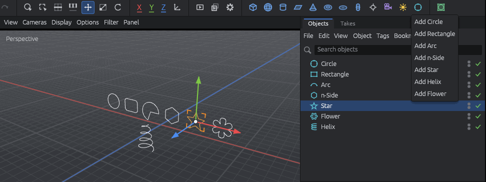

**Creating**: **Create ▸ Spline ▸ …**, or the spline button in the command
palette (the circle after the Light button), which opens the list of splines.
A new spline lies in the **XY plane** — facing the front view — at the origin,
and is selected.

| Spline | Parameters (Attribute Manager ▸ Object) |
|--------|-------------------------------------------|
| Circle | Radius; **Ellipse** (a second radius, along Y); **Ring** (an inner circle, Inner Radius) |
| Rectangle | Width, Height; **Rounding** with its Rounding Radius |
| Arc | **Type**: Arc (the open curve), Sector (closed through the centre), Segment (closed by a straight line), Ring (the band between Radius and Inner Radius); Start and End Angle (0° points along +X) |
| n-Side | Radius, Sides; Rounding with its Rounding Radius |
| Star | Inner and Outer Radius, Twist (turns the inner points), Points |
| Helix | Start and End Radius, Start and End Angle (the difference sets the turns: 720° = two), Radial Bias and Height Bias (50 % = even), Height, Subdivision (points along the coil) |
| Flower | Inner and Outer Radius, Petals |
| Text | The text itself (several lines), Align, Height, Horizontal and Vertical Spacing — see [§13.8](#138-text) |

Every spline also has:

- **Plane**: XY (facing the front), ZY (facing the side) or XZ (lying on the
  floor). A helix rises along the plane's normal.
- **Reverse**: runs the curve the other way (it looks the same; generators use
  the direction).
- **Intermediate Points**: how the curve is cut into straight pieces —
  **Adaptive** (the default: a new piece where the curve turns by more than
  Angle, 5°), **Natural** and **Uniform** (Number points between each pair of the
  spline's points: at even steps, or evenly spaced along the curve),
  **Subdivided** (Adaptive, and no piece longer than Maximum Length) or **None**
  (only the spline's own points). Smaller angles and larger numbers give
  smoother curves.

**Selecting**: click on or near the line (a few pixels away is enough); a click
inside a closed spline selects what is behind it. A selected spline is drawn in
the selection colour, with the gizmo at its axis. Splines can be moved, rotated
and scaled, framed (H, O), hidden from a view with **Filter ▸ Spline**, undone
and saved like every other object.

### 13.1 Editing a spline's points

**Make Editable** (**C**, or the top button of the mode palette) turns a spline
into an editable **Spline** object: the same curve, now made of its own points
(a circle has four, with Bezier tangents). The plane and Reverse are built into
the points; the intermediate points stay.

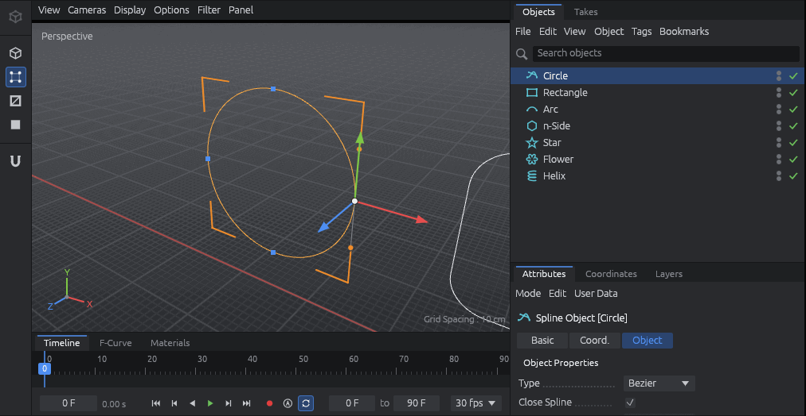

In **Points mode** the spline's points show as small squares:

- **Click** a point to select it; **Shift** adds, **Ctrl** removes, a click on
  empty space clears. The **Rectangle Selection** tool takes the points inside
  its frame; the **Live Selection** tool those its brush passes over.
  **Select ▸ Select All**, **Deselect All** and **Invert** work on the points.
- The **gizmo** sits at the centre of the selected points: **Move**, **Scale**
  and **Rotate** them; their tangents turn and scale with them.
- On a **Bezier** spline each selected point shows its two **tangent handles**
  (the small dots at the ends of the thin lines). **Drag a handle** to bend the
  curve: the opposite handle turns with it so the curve stays smooth. Hold
  **Shift** while dragging to move one handle alone and make a corner. **Esc**
  cancels a drag.
- **Delete** removes the selected points; the curve closes through the others.

The **Object** tab of an editable spline has **Type** (Linear, Cubic, Akima,
B-Spline, Bezier — changing to Bezier gives points without handles smooth ones),
**Close Spline**, the Intermediate Points, and the number of points and
segments. Every change is one undo step, and the selected points are saved with
the document.

### 13.2 Drawing splines with the Pen

**Create ▸ Spline ▸ Pen** picks the **Pen** tool. Its option, in the Attribute
Manager's **Mode ▸ Tool**, is the **Type** of the spline it starts (Bezier,
unless you choose Linear, Cubic, Akima or B-Spline).

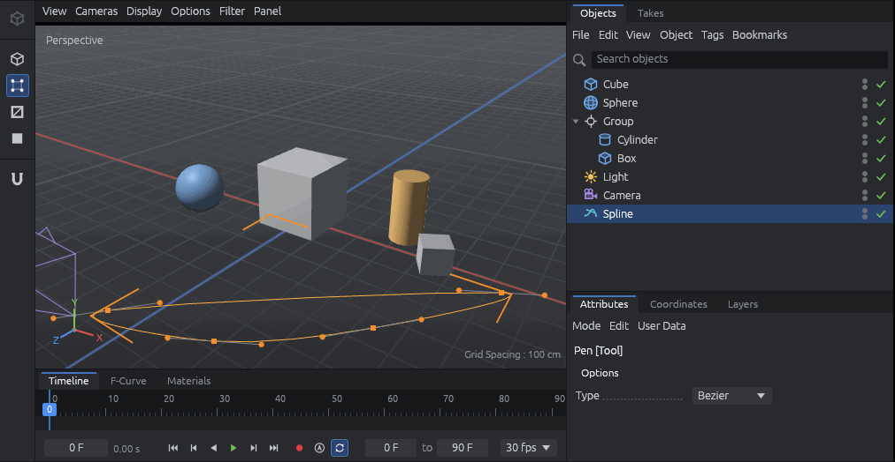

- **Click** in the viewport to add a point. The first click makes a new
  **Spline** object (selected, at the origin); every click after it adds a
  point to its end.
- **Click and drag** to add a point and pull out its tangents: the curve leaves
  the point in the direction you drag.
- Points land on the **grid**: the floor in the perspective view, the view's own
  plane in the Top, Front and Right views.
- **Click the first point** (with at least three points drawn) to close the
  spline. **Esc** or **Enter** finishes an open spline; so does choosing another
  tool. The next click then starts a new spline.
- With an editable spline selected, the Pen adds to it: a new segment if it is
  closed.
- Each point is one undo step (**Ctrl+Z** removes the last one).

### 13.3 Spline commands

**Mesh ▸ Spline** works on the selected editable spline, on the points selected
in Points mode:

- **Hard Interpolation** removes the points' tangents: sharp corners.
- **Soft Interpolation** gives the points smooth tangents, following their
  neighbours.
- **Reverse Sequence** runs the spline the other way (only the segments with
  selected points, or all of them when no point is selected). The curve looks
  the same; its direction matters to generators such as Sweep.
- **Set First Point** makes the selected point the first of its closed segment.

The selection stays on the same points, and each command is one undo step.

### 13.4 Extrude: from outline to solid

The **Extrude** generator pushes a spline along a direction and closes it with
lids, so a flat outline becomes a solid: a Circle becomes a disc, a Circle with
a Ring a tube, a Star a star-shaped block.

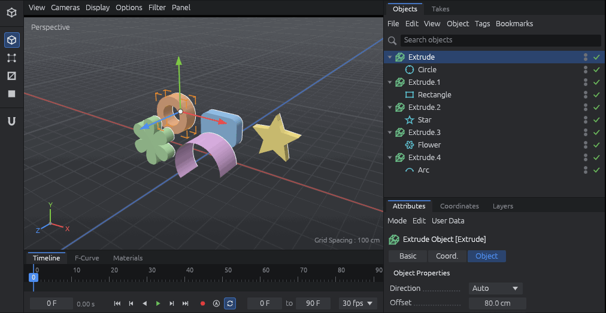

1. Select the spline and hold **Alt** while you choose **Create ▸ Generator ▸
   Extrude** (or the Extrude button in the toolbar). The Extrude takes the
   spline's place and the spline becomes its child. Without Alt you get an
   empty Extrude: drag a spline onto it in the Object Manager.
2. The spline stays visible as a line: click it to select it, edit its points
   or change its parameters, and the solid follows.

The Attribute Manager's **Object** tab:

- **Direction**: **Auto** pushes the spline straight out of its plane (a spline
  in the XY plane goes along Z). **X**, **Y** and **Z** push along that axis of
  the Extrude. **Custom** pushes along the **Movement** vector's direction;
  **Absolute** moves the spline by exactly the **Movement** vector.
- **Offset**: how far (20 cm by default). A negative offset goes the other way.
- **Subdivision**: how many rings of polygons the walls have along the way.
- **Reverse Normals**: turns the walls inside out (for open splines, whose
  outside the Extrude cannot know). The lids are not affected.
- **Hierarchical**: off, only the Extrude's first child is extruded; on, every
  spline under it is, each on its own (put several splines under a Null).
- **Start Cap** / **End Cap**: the lids at the start and at the end. Only closed
  splines get lids; an open one (an Arc) gives just a wall.
- **Caps Type**: **N-Gons** makes each lid one polygon, **Triangles** cuts it into
  triangles.

**Holes**: a spline with an outline inside another (a Circle with **Ring**, a
Rectangle and a smaller one in one editable spline) gets lids with the inner
outline cut out; an outline inside a hole is filled again. Whichever way the
outlines were drawn, the solid faces outwards.

As with every generator, **Q** switches it on and off, and **Make Editable** (C)
turns the solid into one polygon object (the spline goes with it). Renders show
the solid; the spline itself is never rendered.

### 13.5 Lathe: turning a profile

The **Lathe** generator spins a spline around its own **Y axis**, the way a
lathe turns wood: draw half the outline of a vase, a glass or a bottle and get
the whole object.

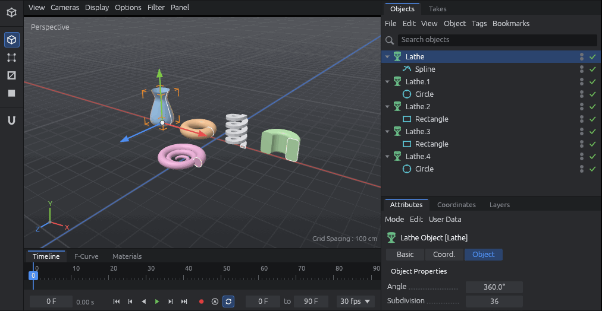

1. Draw the profile in the **XY** plane (the Front view), to the right of the Y
   axis. A profile that starts on the axis closes the bottom.
2. Select it and hold **Alt** while you choose **Create ▸ Generator ▸ Lathe**
   (or the Lathe button in the toolbar). The profile becomes the Lathe's child
   and stays visible as a line, so you can keep editing it.
3. To move the profile away from the axis (a ring, a torus), move the spline
   under the Lathe, not the Lathe itself: the axis goes where the Lathe goes.

The Attribute Manager's **Object** tab:

- **Angle**: how far the profile turns (360° is a full turn; 180° half). Angles
  over 360° wind round again.
- **Subdivision**: steps along the turn: more steps, rounder result.
- **Movement**: how far the profile rises along Y from start to end. With an
  angle of several turns this makes a screw thread or a spring.
- **Scaling**: the profile's size at the end, in percent. Less than 100 %
  shrinks it as it turns (a snail's shell); it grows and shrinks around the
  Lathe's centre.
- **Reverse Normals**: turns the surface inside out (caps unaffected).
- **Start Cap** / **End Cap** and **Caps Type**: when a closed profile does not
  come back to where it started (less than a full turn, a Movement or a
  Scaling), its two ends get lids, as with the Extrude.

A full turn closes on itself and shares the points on the axis, so a vase's
bottom has one centre point. Q, Make Editable and rendering work as for the
Extrude.

### 13.6 Sweep: a profile along a path

The **Sweep** generator moves a cross-section (the **profile**) along a
**path**: a small circle along a helix becomes a spring, a rectangle along a
larger rectangle a picture frame, a star along an arc a twisted horn.

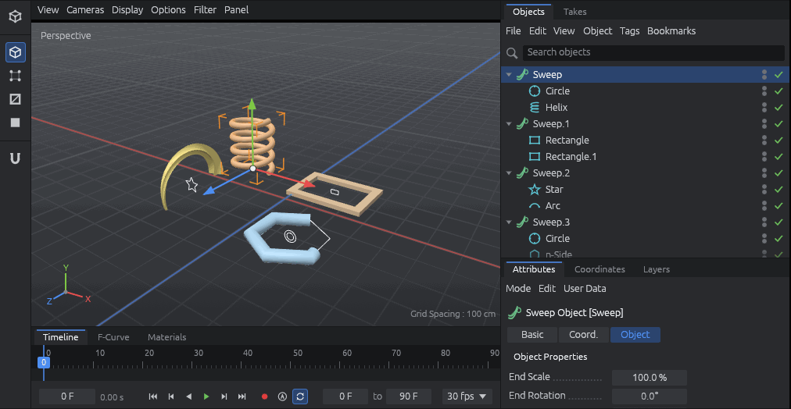

1. Draw the profile in the **XY** plane (the Front view), centred on its own
   origin, and the path anywhere.
2. Select the **profile first**, then **Shift+click** the path, and hold **Alt**
   while you choose **Create ▸ Generator ▸ Sweep** (or the Sweep button in the
   toolbar). Both become the Sweep's children: the **first child is the
   profile, the second the path**. You can also drag them onto an empty Sweep in
   that order.
3. Both stay visible as lines. Editing or moving the path reshapes the result;
   moving the profile object does not (only its shape counts).

The Attribute Manager's **Object** tab:

- **End Scale**: the profile's size at the end of the path (it changes evenly
  from 100 % at the start). Use it to make the shape taper.
- **End Rotation**: how far the profile has turned about the path by its end:
  a twist.
- **Start Growth** / **End Growth**: sweep only part of the path, by length.
  Animate End Growth from 0 % to 100 % to "draw" a tube along its path.
- **Parallel Movement**: the profile keeps its orientation and is only moved.
- **Constant Cross Section**: at sharp corners of the path the profile is
  stretched so the walls keep their thickness (on by default).
- **Banking**: on, the profile turns with the path as little as possible from
  point to point, starting in the path's own plane; off, it stays level (its X
  axis horizontal), which can twist it where the path rises steeply.
- **Reverse Normals** and the **Caps**: as for the Extrude. A closed path makes
  a closed ring without caps (unless only part of it is swept).

Q, Make Editable (the profile and path go with it) and rendering work as for
the other generators.

### 13.7 Loft: a skin over sections

The **Loft** generator stretches a skin over a row of splines, its
**sections**: circles of different sizes make a vase, a circle and a square a
transition piece, open arcs a curved sheet.

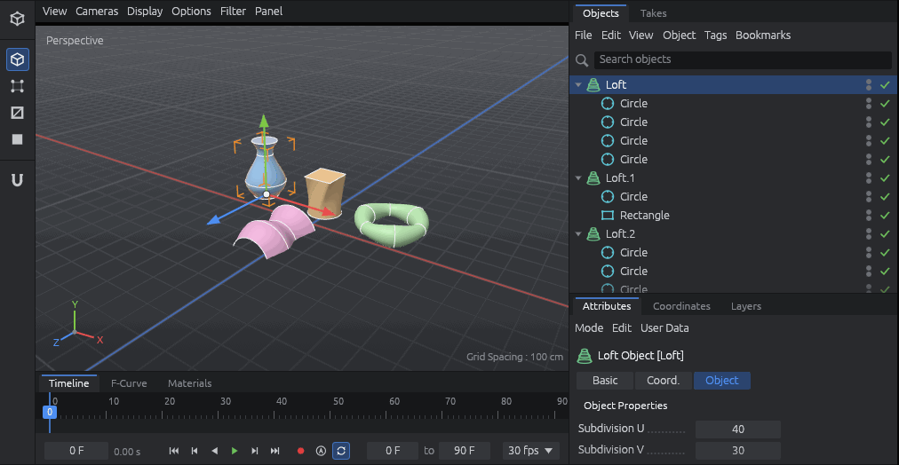

1. Draw the sections and place them where the skin should pass (for a vase:
   circles in the **XZ** plane, one above the other).
2. Select them **in the order the skin should pass through them** (click the
   first, Shift+click the others) and hold **Alt** while you choose **Create ▸
   Generator ▸ Loft**. They become the Loft's children in that order. You can
   also drag splines onto a Loft; their order in the Object Manager is the
   order of the skin.
3. The sections stay visible: move, scale or edit one and the skin follows.

The Attribute Manager's **Object** tab:

- **Subdivision U**: points around each section (a closed section gets one
  fewer, since its last point would be its first). Sections are spaced
  evenly by length from their **first point**: if the skin twists, line the
  first points up with **Mesh ▸ Spline ▸ Set First Point**.
- **Subdivision V**: rings along the skin, spread by the distance between
  sections; every section gets a ring. **Per Segment** spreads them evenly
  between each pair of sections instead.
- **Organic Form**: off, the skin passes exactly through every section; on,
  it becomes looser and smoother and only touches the first and last.
- **Loop**: joins the last section back to the first, for a closed ring.
- **Linear Interpolation**: straight lines between sections instead of curves.
- **Reverse Normals** and the **Caps**: as for the Extrude; the first and last
  sections get caps when they are closed and the skin is not looped.

A Loft with a single closed section covers it with a flat cap. Q, Make Editable
(every section goes with it) and rendering work as for the other generators.

### 13.8 Text

**Create ▸ Spline ▸ Text** (or Text in the toolbar's spline list) writes text as
splines: the outline of every letter, with the holes of letters such as *o*,
*a* and *B*. Put it under an **Extrude** for solid 3D letters.

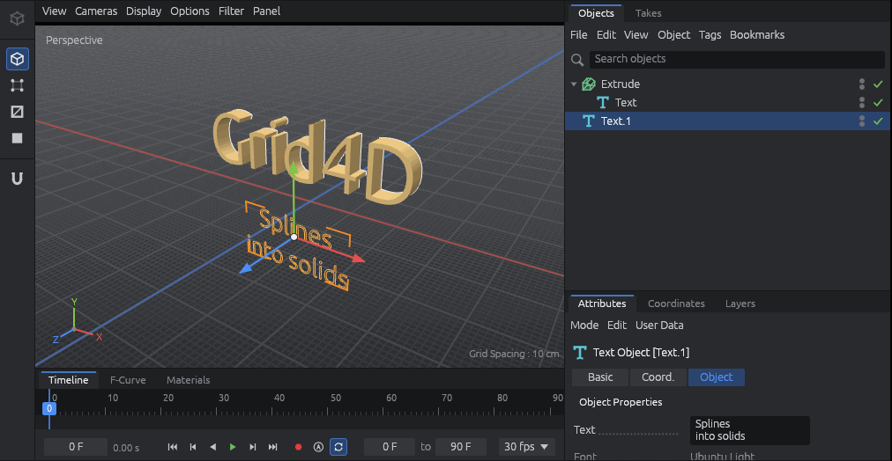

The Attribute Manager's **Object** tab:

- **Text**: type the text; **Enter** starts a new line. The splines change as
  you type.
- **Font**: Ubuntu Light, the typeface of Grid4D's own interface (other fonts
  are planned).
- **Align**: **Left** (lines start at the object's origin), **Center** (lines are
  centred on it) or **Right** (lines end at it).
- **Height**: the font size, in centimetres (200 cm by default).
- **Horizontal Spacing**: extra space between letters (negative values pull
  them together). **Vertical Spacing**: extra space between lines.
- **Plane**, **Reverse** and **Intermediate Points**: as for the other splines.

The first line sits on the object's X axis (its baseline), further lines go
downwards. **Make Editable** (C) turns the text into an editable spline with
one closed segment per contour, so single letters can be edited point by
point.

## 14. Deformers

A **deformer** changes the shape of other objects without touching their
points: bend a tube into an arch, curl a column into an S — and keep editing the
original or animate the deformer. There are five: **Bend**, **Twist**,
**Taper**, **Bulge** and **FFD**.

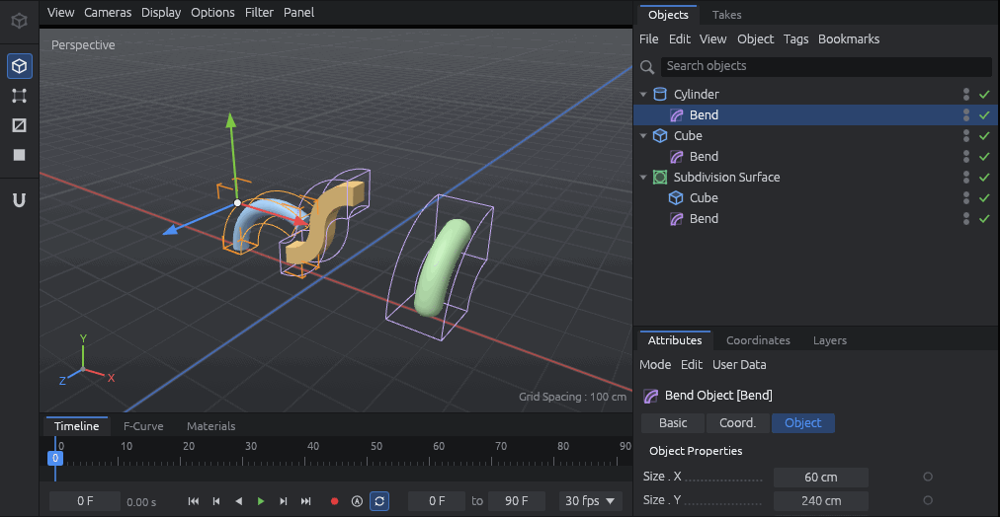

### 14.1 How deformers work

- A deformer changes its **parent** and **everything below the parent**. To
  bend one object, put the deformer under it; to bend several together, put
  them and the deformer under one Null.
- **Creating:** **Create ▸ Deformer ▸ …** or a deformer button in the
  toolbar adds a deformer at the top of the Object Manager. Hold **Shift** to add
  it **under the selected object, sized to it** — the quickest way to bend one
  object.
- The deformer's **box** is drawn as lines (violet, orange when selected),
  bent the way it bends. Click near its lines to select it. Move, rotate and
  scale the deformer to place its effect; the box is never rendered.
- Several deformers apply one after another: the ones under the object first,
  then those further up.
- With a **Subdivision Surface**, a deformer under the cage bends the cage
  before it is smoothed; a deformer under the Subdivision Surface itself,
  beside the cage, bends the smooth result.
- The check mark in the Object Manager switches a deformer off; hiding it only
  hides its box. The deformed object's own points never change: Make Editable
  keeps the undeformed shape.
- **Filter ▸ Deformer** hides the boxes in a view (the deformation stays).

### 14.2 Bend

The Attribute Manager's **Object** tab:

- **Size**: the box. Its height (Y) is the part that bends.
- **Mode**: **Limited** bends what is inside the box and carries the rest along
  straight; **Within Box** bends only what is inside the box and leaves the rest
  where it is; **Unlimited** bends the whole object.
- **Strength**: how far the box's height bends round, in degrees: 90° is a
  quarter circle, 360° a full ring; negative values bend the other way.
- **Angle**: the direction of the bend around the deformer's Y axis (0° towards
  its X axis).
- **Keep Y-Axis Length**: on, the bent part keeps its length; off, its two ends
  stay the box's height apart, so it stretches as it bends.
- **Origin**: where the bend starts — **Bottom** (the top bends over), **Top**
  (the bottom bends), **Center C-Shape** (both halves curl the same way) or
  **Center S-Shape** (they curl opposite ways).
- **Fit to Parent**: sizes the box to the parent and centres it there.

Strength, Angle and Size have key buttons: animate Strength to make an object
bend over time. Objects need enough segments along the bend to look smooth (a
Cube with one height segment cannot bend).

### 14.3 Twist, Taper and Bulge

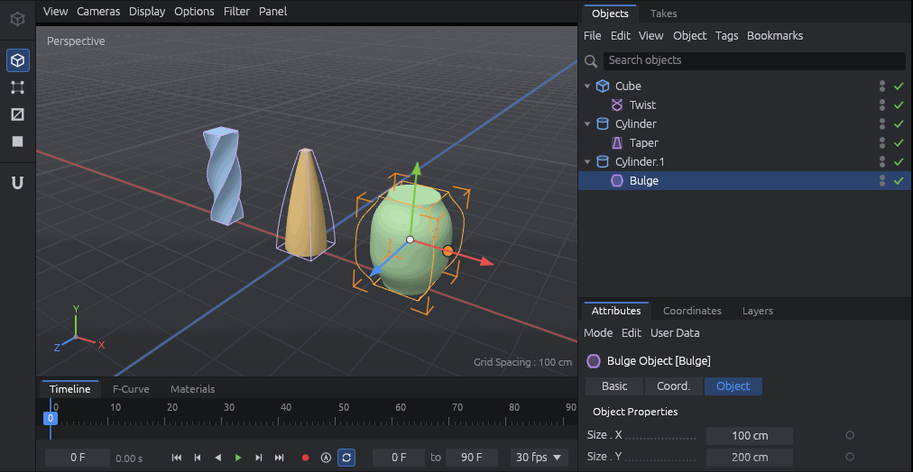

All three work along the deformer's Y axis, through the box's height, and have
the same **Size**, **Mode** and **Fit to Parent** as the Bend.

- **Twist** turns the object about Y, more and more towards the top of the box:
  **Angle** is how far the top turns relative to the bottom (720° = two turns).
- **Taper** narrows the object towards the top of the box: **Strength** 100 %
  brings the top to a point, negative values widen it. **Curvature** makes the
  narrowing curve (slow at the bottom, fast at the top); **Fillet** eases it in
  and out at both ends.
- **Bulge** swells the middle of the box: **Strength** 100 % doubles the width
  in the middle, negative values pinch it. **Curvature** makes the swell flatter
  and wider; **Fillet** softens it where it meets the top and bottom.

Size, Angle, Strength and Curvature have key buttons.

### 14.4 The strength handle

With a deformer selected (Model mode), an **orange handle** sits on its box —
at the bent end of a Bend, at the top of a Twist or Taper, at the middle of a
Bulge. **Drag it** to change the strength in the view: the Bend follows the
pointer along its arc, the Twist turns with it around the axis (winding on past
a full turn), Taper and Bulge follow its distance from the axis. Hold **Shift**
to step the value (5° or 5 %). Each drag is one undo step; **Esc** while
dragging puts it back. The handle wins over the move arrows when it sits on
one.

### 14.5 FFD

The **FFD** surrounds the object with a **lattice** of points; moving its points
reshapes the object smoothly, like pushing soft clay — lift the middle of the
top to make an egg, push one side out, pinch a waist.

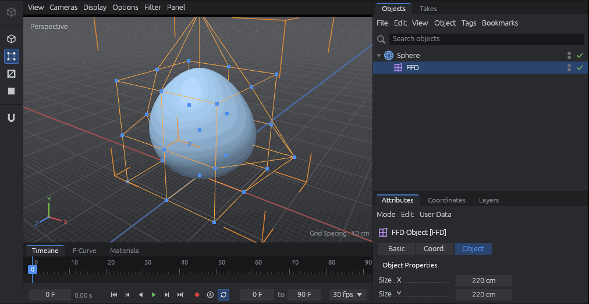

1. Add an FFD under the object (**Shift** + **Create ▸ Deformer ▸ FFD** with the
   object selected): its box and lattice fit around it.
2. Select the FFD and switch to **Points** mode. The lattice points appear;
   select them as you select a spline's points (click, Shift / Ctrl, rectangle
   or Live Selection, Select All) and move, scale or rotate them with the
   gizmo. The object follows, most strongly near the points you move.

The Attribute Manager's **Object** tab:

- **Size** and **Mode**: as for every deformer. Changing Size scales the lattice
  with the box.
- **Grid Points X / Y / Z** (2 – 20): how many lattice points along each axis.
  Changing them starts a new, regular lattice.
- **Reset Lattice**: puts every point back on its grid.
- **Fit to Parent**: as for every deformer (the lattice is scaled to the new
  box).

Lattice points cannot be deleted, and the lattice is edited rather than
animated.

### 14.6 Current State to Object

A deformed object stays editable: its own points never change. When you want
the deformed shape itself — to model it further, or to keep it while you change
the deformer — select the object and choose **Mesh ▸ Conversion ▸ Current State
to Object**.

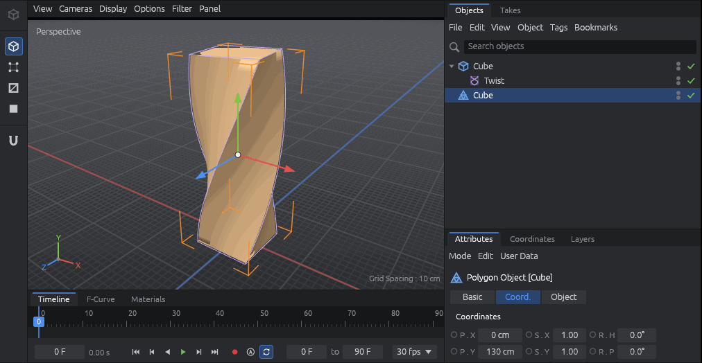

A copy of the object appears right below it in the Object Manager, selected,
with the same name: a polygon object of exactly what the viewport shows at the
current frame. The original, its deformers and their settings are left as they
were. **Ctrl+Z** removes the copy.

- **Children** are copied too, as a hierarchy: each in its shown shape.
- **Deformers** are not copied — their effect is in the shapes.
- A **generator** (Subdivision Surface, Extrude, Lathe, Sweep, Loft) becomes one
  polygon object of its result; the cage or splines it is made from are not
  copied. A switched-off generator becomes a Null holding its children's copies.
- **Primitives** become polygon objects; spline primitives and Texts editable
  splines; Nulls, cameras and lights are copied as they are.
- **Animation** is frozen: the copies stand where the objects are at the
  current frame and have no keys.
- Objects hidden in the viewport are left out.

Unlike **Make Editable** (C), which converts the object itself, this always
adds a copy.

## 15. The Cloner

The **Cloner** repeats objects: put objects under it and it shows copies of
them — **clones** — in a row, on a circle or in a grid. Change one value and
every clone follows; edit a child and all its clones change with it.


1. Select an object and hold **Alt** while you choose **Create ▸ Generator ▸
   Cloner** (or Alt + click the Cloner button at the end of the generator
   buttons): the object goes under a new Cloner. Without Alt you get an empty
   Cloner; drag objects onto it in the Object Manager.
2. The objects under the Cloner are no longer drawn themselves — the clones
   are. Select a child in the Object Manager to edit it: its clones follow.

### 15.1 Modes

Choose the layout in the Object tab's **Mode**:

- **Linear**: a row starting at the Cloner. **Count** clones; **P**, **S**
  and **R** are the position, scale and rotation change from one clone to the
  next (**Spacing: Per Step**) or from the first to the last (**End Point**).
  **Offset** starts the row further along. A scale below 100 % per step makes
  each clone smaller than the one before; a rotation curls the row.
- **Radial**: a circle around the Cloner. **Count**, **Radius**, the **Plane**
  it lies in (XZ: on the floor), **Align** (each clone turned to face the same
  way relative to the centre), **Start / End Angle** for a part of the circle
  and **Offset** to turn them all along it.
- **Grid Array**: a box-shaped grid centred on the Cloner. **Count** along X,
  Y and Z, and **Size**: the distance between neighbours (Per Step) or the
  whole grid's size (End Point).
- **Object**: on another object's surface. Choose the object in **Object** (a
  list of the document's objects), then the **Distribution**: a clone on every
  point (**Vertex**) or on every polygon's centre (**Polygon Center**). With
  **Align Clone** on, each clone stands up along the surface — a cone's tip
  points outwards like a spike. The clones follow the object as it moves or
  changes, even while it is hidden.


### 15.2 Which child, and where

- **Clones**: with several children, **Iterate** uses them in turn (cube,
  sphere, cube, …); **Random** picks one for each clone — change the **Seed**
  for another mix.
- **Reset Coordinates** (on): every clone sits exactly where the layout puts
  it. Switch it off to keep the child's own position, rotation and scale on top
  — move a child up and all its clones rise.
- **Groups**: a child with children of its own is cloned whole — put a cube
  and a sphere under a Null, the Null under the Cloner, and every clone is the
  pair.
- **Cloners inside Cloners**: put a Cloner under another one and the outer
  Cloner repeats all of the inner one's clones — a row of four cubes inside a
  ring of ten makes ten towers.

### 15.3 Working with clones

- **Clicking a clone** selects the Cloner. Its selection box surrounds all the
  clones, and **H** / **O** frame them.
- **Q** or the check mark switches the Cloner off: its children then show as
  they are.
- Radius, Start / End Angle and Size have key buttons: animate them like other
  parameters.
- **Make Editable** (C) turns the Cloner into a Null holding one polygon object
  per clone (`Cube.0`, `Cube.1`, …); **Current State to Object**
  ([§14.6](#146-current-state-to-object)) adds the same as a copy.
- Clones are rendered, and glTF and OBJ export write the Cloner as a group of
  its clones.
- A Cloner makes at most 10 000 clones.

### 15.4 Effectors

**Effectors** change a Cloner's clones: lift them, scale them, turn them,
colour them — everywhere, or only near the effector.


1. Select the Cloner and choose **Create ▸ Effector ▸ Plain** (or **Random**,
   or the orange buttons after the Cloner's): the effector is created and
   added to the Cloner's **Effectors** list. (Created with no Cloner
   selected, add it later from the Cloner's Object tab: **Effectors ▸ Add…**;
   **✕** removes one.)
2. Set what it does in its Object tab:
   - **Strength**: how much of it applies (animatable).
   - **Position**, **Scale** and **Rotation**, each switched on with its
     check box: the move (along each clone's own axes), size change (+50 %
     makes it half as large again; **Uniform Scale** uses one value) and turn.
   - **Color**: blends the clones towards the **Effector Color** (Random:
     towards a random colour each).
   - **Seed** (Random only): another set of random values.
3. **Falloff** limits where it works: **Infinite** (everywhere), **Sphere** or
   **Box** (inside the shape of the **Size**, fading across the **Soft Edge**)
   or **Linear** (nothing behind, everything in front, along the effector's
   Z axis). Move the effector to move the falloff — the clones near it react.

The **Plain** effector applies its values as they are; the **Random** effector
applies a different random part of them (between minus and plus the value) to
each clone — always the same for the same seed. Effectors apply in the list's
order. The viewport shows each effector as a small cross with its falloff's
outline; **Filter ▸ Effector** hides them. Switch an effector off (its check
mark) to stop it.

## 16. Simulation

Objects can fall, collide, bounce and come to rest. Give an object a **Rigid
Body** tag and it moves under gravity; give one a **Collider Body** tag and
rigid bodies hit it. Nothing else is needed: play the animation.

### 16.1 Rigid Body and Collider Body

A **Rigid Body** falls under
gravity, collides, bounces and comes to rest; a **Collider Body** is something
rigid bodies hit — a floor, a bowl, a moving paddle — and is never pushed
itself. Both are the same tag (*Dynamics*; one per object): choose **Rigid
Body Tag** or **Collider Body Tag** in the Tags menu, or switch **Dynamic**
between *Dynamic* and *Collider* later.


- **Enabled**: off, the object takes no part.
- **Inherit Tag**: *Compound* makes the object and its visible children one
  body.
- **Shape**: what collides — *Automatic* (a convex hull for a rigid body, the
  exact mesh for a collider), *Box*, *Sphere*, *Convex Hull* or *Static Mesh*
  (colliders only). Shapes come from the object as it is shown, deformers and
  generators included.
- **Bounce** and **Friction**: how much speed survives a hit, and how much
  sliding is resisted.
- **Mass** (rigid bodies): *Global Density* (a 100 cm cube weighs 1 kg),
  *Custom Density* or *Custom Mass*; **Rotational Mass** makes it harder or
  easier to set spinning; **Linear / Angular Damping** slow it down as air
  would.
- **Velocity** and **Spin**: how it is moving at the start frame.

### 16.2 Simulation settings

The document's **Simulation** settings are in the Project settings (click an
empty spot in the Object Manager): **Enabled**, **Gravity** (cm/s², 981 down
by default), **Steps per Frame** (more for fast or small objects), **Solver
Iterations** (steadier stacks), **Time Scale** (below 1: slow motion) and
**Cache Memory** (how much memory the simulated frames may take, 256 MB by
default; when it is reached the status bar says so and no more frames are
simulated — raise it to go on).

### 16.3 Playing, baking and saving

Set the scene up at the start frame (Minimum Time) — that is where every body
starts. Then play, or drag the time slider
forward: the bodies fall, collide and settle, simulated as you go. Simulated
frames are kept (a green bar under the timeline's ruler shows them), so going
back or playing again shows them at once.


- Changing anything that affects the motion — a body's place, size, shape,
  tag or animation, or the Simulation settings — starts the simulation over.
  Selecting, renaming, or editing objects that are not bodies keeps it.
- **Simulate ▸ Bake Simulation** simulates the whole range now; the status bar
  shows how far it is, **Esc** stops it. **Simulate ▸ Clear Simulation Cache**
  forgets the simulated frames.
- The **Render View**, **Render to Picture Viewer** (every frame of an
  animation), **Current State to Object** and **File ▸ Export** all show the
  bodies where the simulation has them at their frame.
- Editing a body while the time slider is past the start frame changes its
  start: the viewport shows the simulation again from there.
- **Saving:** the simulated frames are saved with the document (**File ▸
  Save**), so a baked simulation plays at once when the file is opened again.
  If the file was changed elsewhere so that the bodies no longer start where
  they did, the saved frames are left out and the simulation runs again.

### 16.4 Clones as bodies

Put the Rigid Body tag on a **Cloner** (not on its children), and every clone becomes a body of its own — a grid of cubes
collapses, a ring of spheres rolls apart. Each clone keeps its shape (a cloned
group moves as one piece), clones collide with each other and with every other
body, and they start where the Cloner and its effectors place them at the
start frame. A Collider Body tag on a Cloner makes every clone an obstacle.
Changing the Cloner, its children or its effectors starts the simulation over.


## 17. Snapping

With snapping on, a moved object or selection jumps onto nearby geometry or onto
the floor grid, so you can place things exactly: an object's axis level with a
corner, a point onto another point, a selection onto a grid crossing.

**Switching it on:** press **Shift+S**, or click the magnet button at the bottom of
the mode palette (it stays highlighted while snapping is on).

**Using it:**

1. Drag a **Move** handle (an arrow of the gizmo), or with **Tweak Mode** drag a
   point, edge or polygon directly ([§11.4](#114-transforming-components)).
2. Move the **cursor** over what you want to snap to: a corner, an edge, the middle
   of an edge, the centre of a polygon, an object's axis or a grid crossing. The
   target is highlighted with its name next to it.
3. Release the mouse button. The move is one undo step, as always.


How the element is placed:

- **Along a gizmo arrow** the move stays on that axis. The object (or the centre of
  the selection) lines up with the target along the axis.
- **With Tweak** the move is free: the grabbed element lands right on the target.
- Nothing that moves with the drag is a target: the moved object and its children,
  or the moved points and the edges and polygons that use them. So you can put a
  point onto another point of the same object.
- Scale and Rotate do not snap.

**Settings:** right-click the magnet button, open **Tools ▸ Snap**, or select the
Move tool and look at the **Snap** group in the Attribute Manager's Tool mode
(Attribute Manager ▸ Mode ▸ Tool). All three show the same settings.

 

| Setting | Meaning |
|---------|---------|
| Auto / 2D / 3D Snapping | **3D** moves the element onto the target in space. **2D** only lines it up on screen and keeps its depth. **Auto** is 3D in the perspective view, the only view so far. |
| Vertex, Edge, Edge Mid Point, Polygon Center, Polygon | Points, the nearest point along an edge, the middle of an edge, a polygon's centre, the surface under the cursor. All but Polygon are on at first. |
| Axis | Objects' origins (on at first). |
| Grid Point, Grid Line | Crossings or lines of the floor grid, at the spacing shown in the corner of the view. Grid Point is on at first. |
| Snap Radius | How close the cursor must be to a target, in screen points (10 at first). |

Within the radius, points win over edges and grid lines, which win over surfaces,
so a corner can be caught right next to its edges.

## 18. Tags

Tags add a property or a behaviour to an object without changing what kind of
object it is. They show as small icons to the right of the object's name in the
Object Manager.


**Adding a tag:** select the objects, then choose a tag in the Object Manager's
**Tags** menu (or right-click an object ▸ *Add Tag*). Every selected object gets
the tag, in one undo step. An object has at most one tag of each kind, except
Material tags: it can carry several, one over the other ([§19.2](#192-placing-a-material-projections-and-layers)).


**Editing:** click a tag icon. The Attribute Manager shows the tag's settings
instead of the object's (click the object's name to get back to the object). Every
change can be undone and is saved with the document.

**Removing:** click the tag icon, then press **Delete** (or right-click the icon ▸
*Delete Tag*). With a tag selected, Delete removes only the tag, not its object.

### 18.1 Phong

Controls how smooth the object looks.

- **Angle Limit** on: edges between polygons that meet at more than the **Phong
  Angle** stay hard, flatter ones are shaded smooth. 0° gives faceted, flat shading.
- **Angle Limit** off: everything connected is shaded smooth.
- The setting also decides the normals written by glTF and OBJ export.
- Objects without a Phong tag are smoothed up to 80°. (Cinema 4D instead shades
  objects without a Phong tag flat.)


### 18.2 Protection

Guards an object against accidental changes. Tick **Position**, **Scale** and/or
**Rotation**. A protected channel cannot be changed with the gizmo (the Move, Scale
or Rotate gizmo does not appear for the object) or in the Coordinates fields of the
Attribute Manager, which turn grey. The object's points, edges and polygons can still
be edited in the component modes.

### 18.3 Target

Turns the object to face another object.

- **Target Object:** the object to face. The object's forward axis (−Z, the
  direction Grid4D's cameras look) turns towards it, and its children turn along
  with it.
- **Up Vector:** optionally, an object the object's top turns towards (otherwise
  it keeps world up).
- **Pitch** off: the object only turns around the vertical axis and stays level.
- The object's own rotation values are not changed; the tag overrides them while
  it has a target. A target that is the object itself, one of its children, or
  hidden has no effect.


### 18.4 Material

Links a material to the object and says how it lies on the surface; see
[§19](#19-materials-and-textures) and [§19.2](#192-placing-a-material-projections-and-layers).

### 18.5 Rigid Body and Collider Body

Make an object part of the simulation; see [§16](#16-simulation).

## 19. Materials and textures

A **material** gives objects their surface; **textures** (pictures) vary it
across the surface; **UVs** say where each point of a surface lies on a
picture. This chapter covers them in order: materials and their channels
(below), textures and the Texture Manager ([§19.1](#191-textures-and-the-texture-manager)),
placing a material with projections and layers
([§19.2](#192-placing-a-material-projections-and-layers)), the UV tools
([§19.3](#193-uv-tools)) and the UV Editor ([§19.4](#194-the-uv-editor)), and a
walk through from a model to a render ([§19.5](#195-a-walk-through-from-a-model-to-a-render)).

A **material** gives objects their surface. Materials live in the **Material
Manager**, the **Materials** tab at the bottom (beside Timeline and F-Curve;
**Shift+F2**, or Window ▸ Material Manager). An object shows a material through a
**Material tag**.


**Making materials**

- **Create ▸ New Material** in the Material Manager, **Ctrl+N** with the pointer
  over it, a **double-click on its empty space**, or the main menu's
  **Create ▸ Material**. New materials are called Mat, Mat.1, …
- **Click** a material to select it: the Attribute Manager shows its settings.
  Selecting an object shows the object again.

**Previews.** Each material shows as a small ball rendered with Grid4D's own
renderer, in the Material Manager and at the top of its settings, its
textures included. The balls are made in the background, one after the
other, and made again a moment after you change a material or one of its
pictures arrives or changes — Grid4D never waits for them. Until a ball is
ready, a plain ball in the material's colour stands in.


**Settings** (Attribute Manager)


A material is one set of **channels**, the same everywhere in Grid4D. Each
channel has a value and can take a **texture** (a picture, [§19.1](#191-textures-and-the-texture-manager))
that replaces the value across the surface.

| Group | Setting | Meaning |
|-------|---------|---------|
| Material | Name | shown under the preview |
| | Two-Sided | both sides of each polygon look alike |
| Base | Base Color | the surface colour (a metal's reflection colour); the viewport shows it |
| Reflection | Metallic | 0 % plastic, stone, wood … 100 % metal |
| | Roughness | 0 % mirror-like … 100 % matte |
| | Specular | how strongly a non-metal reflects (50 % is the usual) |
| Normal and Bump | Normal Texture, Strength | a normal map: fine relief without more polygons |
| | Bump Texture, Height | a height map, used when there is no normal map |
| Emission | Emission, Strength | light the surface gives off, and how much |
| Opacity | Opacity, Threshold | cut-out: where opacity is below the threshold the surface is not there (leaves, fences) |
| Transmission | Transmission, IOR | light passing through (glass, water); IOR bends it (1.5 for glass, 1.33 for water) |
| Coat | Clearcoat, Coat Roughness | a thin varnish over the base (car paint, lacquered wood) |

**A channel's texture.** Under each channel, choose a texture of the
document in the list, or click **Load…** to pick a picture file (it is added
to the Texture Manager; pictures for data channels — everything but Base
Color and Emission — are read as Linear). With a texture set:

| Setting | Meaning |
|---------|---------|
| Tiling | how many times the picture repeats across the surface (U, V) |
| Offset | shifts the picture (U, V), in picture widths |
| Range | the picture's black and white become these values (number channels only) |
| Texture Strength | 0 % shows the channel's value, 100 % the texture |
| Picture Channel | which of the picture's channels a number reads: Red (the usual), Green, Blue or Alpha (number channels only; pictures from glTF keep roughness in green, metallic in blue, cut-outs in alpha) |

In the viewport ([§4.1](#41-lights)) the colour is the surface's colour,
**Roughness** the size of its highlights (sharp and bright near 0 %, wide and faint
near 100 %), **Metallic** makes highlights and reflections take the colour (a metal
has no colour of its own otherwise) and **Emission** adds glow that no light
needs. Constant Shading shows the colour and the emission only.

**Textures in the viewport.** The viewport shows the pictures on Base Color,
Metallic, Roughness, Specular, Emission, Normal and Bump, and cuts out what
Opacity says, through the object's Material tags (their projections, tiling,
offset and rotation, one over the other;
[§19.2](#192-placing-a-material-projections-and-layers)). A picture that is
still loading shows the channel's value meanwhile; a missing one shows as a
magenta and black checker.


Renders show every channel, Transmission and the coat included
([§20](#20-rendering)); the viewport draws glass and coats as an opaque
surface.

**Giving an object a material**

- **Drag** the material from the Material Manager onto the object's row in the
  Object Manager, or onto the object in the viewport.
- Or select the objects and choose **Material ▸ Apply** in the Material Manager
  (or right-click the material ▸ *Apply to Selected Objects*).
- The object gets a **Material tag** (its icon shows the material's colour); if it
  has one already, its last Material tag gets the new material and keeps its
  projection. Hold **Shift** while dropping to add a new tag on top instead
  ([§19.2](#192-placing-a-material-projections-and-layers)). Dropping a material
  on a Material tag's icon changes just that tag. In the Attribute Manager the tag
  has a **Material** list to pick another one. **Double-click** the tag icon to see
  its material.
- **Children inherit**: an object without its own Material tag shows the material
  of its nearest parent that has one. A Subdivision Surface shows its own material,
  else its cage's.

**Deleting**: click a material, then press **Delete** (or Edit ▸ Delete, or
right-click ▸ *Delete*). Material tags that used it stay, without a material, and
their objects show their display colour again; undo brings everything back.

Every change is one undo step. Materials are saved with the document, travel with
glTF and OBJ files ([§9](#9-files)), and come along when you merge a document.

### 19.1 Textures and the Texture Manager

A **texture** is a picture a document uses — a photo of wood, a pattern, a
sky. The **Texture Manager** (the **Textures** tab beside the Material
Manager, or **Window ▸ Texture Manager**) lists every texture of the
document. Grid4D reads **PNG, JPEG, TIFF, WebP, HDR** and **OpenEXR**
pictures.

> A material's channels take textures (§19 above); the viewport, renders
> and preview balls show them.


**Adding pictures**

- **Add…** at the top of the Texture Manager chooses one or more pictures.
- Or **drop** picture files anywhere on the window. (A dropped document is
  opened and a dropped model merged first; pictures are added when neither is
  in the drop.)
- Each picture becomes a texture named after its file. A picture that is
  already in the list is selected instead of being added twice.

**The list** shows each texture's thumbnail, name, size in pixels and where it
comes from. Pictures load in the background, so a large one never makes
Grid4D wait. Click a texture to select it; its **Name** and **Colour Space**
can then be changed at the bottom of the manager:

| Colour space | Use it for |
|--------------|------------|
| sRGB | colour pictures: photos, paintings, patterns (the usual setting) |
| Linear | data: roughness, metallic, height or normal maps; HDR and OpenEXR pictures are linear when added |

**Linked or embedded.** A texture is normally **linked**: the document
remembers where the file is, and changes to the file show up in Grid4D when
you next work in it. Pictures inside the document's folder (or a folder
below it, such as `maps`) are remembered relative to it, so you can move or
send the whole folder. An **embedded** texture keeps a copy of the picture
inside the `.g4d` file instead — handy for sending a single file.

| Button (or right-click a texture) | What it does |
|--------|--------------|
| **Relink…** | chooses another picture for the selected texture |
| **Relink Folder…** | looks in a folder you choose for every missing picture, by its file name, and links the ones it finds |
| **Embed** | keeps a copy of the picture inside the document |
| **Unembed…** | writes an embedded picture to a file you choose and links it |
| **Reveal** | shows the picture's file in Explorer, Finder or your file manager |
| **Delete** | removes the texture |
| **Remove Unused** | removes every texture no material uses |

**Missing pictures.** A document whose pictures were moved or deleted still
opens. Missing textures show a magenta and black checker and the path that
was looked for, in orange, and the status bar says **Missing textures: n**.
Put the files back, or use **Relink…** / **Relink Folder…**.

Every change in the Texture Manager is one undo step; textures are saved with
the document (Grid4D 1.1's file format, [§9](#9-files)).

### 19.2 Placing a material: projections and layers

A Material tag says how its material's textures lie on the object. Click the
tag's icon in the Object Manager to see its settings in the Attribute Manager.


| Setting | Meaning |
|---------|---------|
| Material | the material the tag applies |
| Projection | how the picture is laid on the surface (below) |
| Offset | shifts the picture (U, V), in picture widths |
| Tiling | how many times the picture repeats (U, V) |
| Rotation | turns the picture about its centre |
| Camera | Camera projection only: the camera it is seen from (or the view's camera) |
| Fit to Object | on: the projection's shape follows the object's size; off: set its **Position**, **Rotation** and **Size** yourself (in the object's own space) |

| Projection | Best for |
|------------|----------|
| **UV** | the object's own UVs: every primitive and generator makes good ones (the usual setting) |
| **Box** | crates, walls, anything boxy: each side of a box shows the whole picture |
| **Spherical** | planets, balls: the picture wraps round once, top to bottom |
| **Cylindrical** | cans, columns: the picture wraps round the Y axis; the ends get a plan |
| **Flat** | decals and labels: the picture straight on, along the shape's −Z |
| **Camera** | matching a backplate: the picture where the camera sees it |

**Several tags.** An object can carry several Material tags; each one lies
over the ones before it (to its left in the Object Manager) wherever its
material is opaque — a label over paint, dirt over a wall. Add one with
**Shift** + drop, or Tags ▸ Material. The last tag's material is the one its
children take when they have no Material tag of their own.

**Bake to UVs** (on a polygon object's tag with a Box, Spherical, Cylindrical
or Flat projection) writes the projection into the object's UVs and switches
the tag to UV — one undo step. The picture stays where it was, and later
edits to the object keep it in place.

> The viewport and renders show every Material tag of an object, each over
> the ones before it where its Opacity lets it. A Camera projection uses its
> camera object in renders; in the viewport it always uses the view's camera.

### 19.3 UV tools

A polygon object's **UVs** say where each point of its surface lies on a
picture. **Mesh ▸ UV** changes them on the active polygon object: on its
selected polygons, or on all its visible ones when none is selected. Each
command is one undo step.

| Command | What it does |
|---------|--------------|
| **Unwrap** | flattens the polygons as if cut along the **seams** and laid out flat, keeping their angles as well as it can; each piece is as large on the picture as on the surface, and the pieces are laid into the square. In Edges mode the selected edges are cut too. With no seams and no edges selected it cuts where polygons meet at more than 60° (a cube falls apart into its six sides) |
| **Relax** | evens out how much the picture stretches: the inner points of each piece move so its edges take the lengths they have on the surface. The outline of each piece stays where it is, and no polygon is ever turned over |
| **Pack Islands** | lays the pieces (islands) the polygons belong to into the square without overlapping, all at the same scale, with a small gap between them; a piece may be turned a quarter to fit better |
| **Project ▸ Box, Spherical, Cylindrical, Flat** | gives the polygons the UVs of that projection, its shape fitted to the object ([§19.2](#192-placing-a-material-projections-and-layers)) |
| **Flip U / Flip V** | mirrors the polygons' UVs left to right, or top to bottom |
| **Mark Seams** | the selected edges become seams: later Unwraps cut there |
| **Clear Seams** | the selected edges stop being seams; with no edge selected, every seam goes |

**Seams** are kept with the object and saved with the document. Modelling
keeps them where their edges survive (an Extrude, a cut, a deletion).

A good habit: select edges where a cut will hide well (along the back, an
inner corner), **Mark Seams**, then **Unwrap**. A sphere or a closed shape
with no seams at all is cut by the directions its polygons face, so it
always lies flat.

### 19.4 The UV Editor

The **UV Editor** shows the active object's UVs as a flat mesh over its
material's Base Color picture. Open it with **Window ▸ UV Editor**; in the
**Modeling** layout it is a tab beside the viewport, in the others a tab
beside the Timeline.


- The square is the picture (0 to 1 each way), shown with the tiling and
  offset of the material's Base Color texture; the lines around it mark the
  repeats. **View ▸ Show Texture** hides the picture.
- **View ▸ Show Stretch** colours each polygon by how its picture is
  stretched: **blue** where it is squeezed, **red** where it is stretched,
  clear where it is even.
- **Seams** are drawn in red.
- **Navigate**: the mouse wheel zooms about the pointer; drag with the
  middle button (or Alt + drag) to pan; **H** shows everything, **S** the
  selection (with the pointer over the editor; also in the View menu).

**Selecting** works in the current mode (Points, Edges or Polygons; Polygons
in Model mode) and is the object's own selection: what you select here is
selected in the viewport, and the other way round. Click a component; Shift
adds, Ctrl removes; drag a frame around components; **double-click** a
polygon to select its whole **island** (the polygons joined to it in UV).
Hidden polygons are not shown.

**Moving UVs**: with the **Move**, **Scale** or **Rotate** tool, a handle
sits at the middle of the selection. Drag its centre to move freely (or to
scale evenly), its red arrow along U, its green arrow along V; with Rotate,
drag the ring. Every drag is one undo step; Esc during a drag puts the UVs
back. UVs joined to the selection move with it, so an island stretches
rather than tears; a selected point moves at every place it has on the
picture.

The **UV** menu holds the UV tools of [§19.3](#193-uv-tools); **Options**
sets them: Seam Angle (Unwrap without seams), Margin and Texture Size (the
gap Pack Islands leaves, in pixels of a picture that size), Rotate Islands,
Relax Iterations and Pin Borders.

Primitives show their UVs read only: make the object editable (**C**) to
change them.

### 19.5 A walk through: from a model to a render

A short tour of everything above, in the order a project usually goes.

1. **Bring a model in.** File ▸ Merge… (or drop the file on the window) a
   glTF or OBJ model with pictures: its materials arrive in the Material
   Manager, its pictures in the Texture Manager, and its objects carry
   Material tags. Pictures inside the file are embedded; pictures next to it
   are linked ([§9](#9-files)).
2. **A photo on a box.** Create a Cube, make a material, and click
   **Load…** beside **Base Color Texture** to pick a photo. Drag the material
   onto the cube; in the Material tag choose **Box**: each side shows the
   whole photo.
3. **Unwrap a figure.** Make a Capsule editable (**C**), go to Edges mode
   and select a line of edges from pole to pole along its back, then
   **Mesh ▸ UV ▸ Mark Seams**. Back in Polygons mode, **Mesh ▸ UV ▸ Unwrap**
   lays it out flat in one piece; open the **UV Editor** to see it, turn on
   **View ▸ Show Stretch**, and move or scale islands with the Move and Scale
   tools. **Pack Islands** tidies them into the square.
4. **Glass and metal.** Give a sphere a material with **Transmission** 100 %
   and a low Roughness: it renders as glass, bending what is behind it. Give
   a plane a material with **Metallic** 100 % and a fine stripe picture on
   **Normal Texture** (tiled many times one way): brushed metal.
5. **Render.** Ctrl+R shows the Render View; Shift+R renders to the Picture
   Viewer ([§20](#20-rendering)). The pictures, cut-outs, normal maps, glass
   and clear coats all show.
6. **Save and share.** Save as `.g4d` (version 4: older Grid4D 1.0 cannot
   open it, but Grid4D 1.1 opens every 1.0 file unchanged), or File ▸
   Export… as glTF — materials and pictures go with it.

## 20. Rendering

A **render** is the finished picture of the scene: materials and lights as
they look for real — soft shadows, light bouncing between surfaces, reflections —
where the viewport only approximates them. **Render Settings** say how the
document is rendered; the **Picture Viewer** renders it and shows the result;
the **Render View** renders the view you work in, in place.

**Materials in renders.** Renders read every channel of a material
([§19](#19-materials-and-textures)), through its Material tags and their projections:

- the **pictures** on each channel, at full size and smoothly blended between
  their pixels;
- **Normal** and **Bump** pictures, which bend the light on the surface;
- **Opacity** cut-outs: where a surface is cut out, both the view and the
  light pass through, so the shadow has the same holes;
- **Transmission**: glass bends the light by its **IOR**, reflects more at
  grazing angles and tints what is seen through it with its Base Color; its
  shadow is lighter and tinted;
- **Clearcoat**: a sharp, white reflection over the rest;
- **Camera** projections through the tag's camera object (else through the
  camera the render looks through).

A picture that is still loading, missing or unreadable when the render starts
renders as its channel's value.


### 20.1 Render Settings

**Render ▸ Edit Render Settings…**, **Ctrl+B** or the gear button in the
toolbar opens the **Render Settings** window. It stays open while you work;
close it with its **×**, Ctrl+B or the gear button again. Pick a page on its
left: **Output**, **Save**, **Sampling**, **Passes** or **Options**.


**Output**

| Setting | Meaning |
|---------|---------|
| Preset | common picture sizes (HD 720, HD 1080, 4K UHD, square, portrait, …); *Custom* when the size matches none |
| Width, Height | the picture's size in pixels (1 to 16384); 1280 × 720 for a new document |
| Lock Ratio | changing Width changes Height with it, and the other way round, keeping the proportions |
| Aspect | the proportions, e.g. 16:9 |
| Frame Range | **Current Frame** (the frame at the time slider), **All Frames** (the document's range, Project Settings ▸ Minimum to Maximum Time) or **Manual** (From to To). Typing a From or To frame switches to Manual |
| Frame Step | renders every n-th frame of the range |
| Render Region | the region drawn in the view, in pixels ([§20.4](#204-the-render-region)); **Use for Final Render**: Render to Picture Viewer renders only the region too |
| Frames | how many pictures the range gives |

**Render to Picture Viewer** renders every frame of the range at the Frame
Step and saves each as its own numbered file ([§20.2](#202-the-picture-viewer));
the Render View always shows the current frame.


**Save**

| Setting | Meaning |
|---------|---------|
| Save | a finished render is saved to File |
| File | where: type a path, or click **…** to choose one. A name without a folder, or a path like `renders/shot`, is taken from the document's folder (the document must be saved first); the Format's extension is added (a typed `.png` or `.exr` is replaced) |
| Format | **PNG (8 bit)**: ordinary pictures. **OpenEXR (16-bit float)**: the light as the renderer computed it — linear, with highlights brighter than white kept — for compositing and grading |
| Name | how an animation's frame numbers join the file name: **Name0000** (`shot0012.png`), **Name.0000** (`shot.0012.png`) or **Name_0000** (`shot_0012.png`) |
| Alpha Channel | keep the transparency of the background and of the objects' edges; off: the background is black |

The line under the settings says where the picture will go — for an animation,
how many frames and the first file's name.


**Sampling**

| Setting | Meaning |
|---------|---------|
| Samples | samples per pixel (up to 4096): more give smoother edges and less noise in soft shadows and reflections, and take longer. With **Adaptive** on, the most any pixel gets |
| Adaptive | on (for new documents): samples go where the picture is still noisy. Every pixel gets Minimum Samples; after that, pixels whose noise is below the Noise Threshold stop, and only the rest get more, up to Samples. Plain walls and the empty background finish early; soft shadows, glossy reflections and edges get the samples. Off: every pixel gets Samples |
| Minimum Samples | with Adaptive: what every pixel gets before any stops (16 by default) |
| Noise Threshold | with Adaptive: how much noise a pixel may keep (0.010 by default). Smaller is cleaner and slower; 0.02 – 0.05 for quick previews |
| Denoise | **Off**; **Final Picture** (for new documents): each finished render (every frame of an animation) is cleaned of the noise that is left, keeping edges, textures and the shapes of shadows; **Final and Render View**: the Render View too, once each pixel has 4 samples. The picture before denoising is kept as a pass, *Before Denoising* in the Picture Viewer's Pass menu, saved with the other passes |
| Denoise Strength | how much of the cleaned picture is used, 0 – 100 % (100 % by default); lower keeps some of the original grain |
| Bounces | how often light bounces between surfaces (2 by default; 0: direct light only) |
| Clamp Indirect | on (the default): light that arrives after a bounce is capped, which keeps bright specks out of the picture at the cost of slightly darker reflections of very bright things; off: exact, but noisier |
| Emissive Surfaces Light the Scene | on (the default): surfaces whose material has **Emission** light the scene like lights — a glowing panel, a neon tube, a screen; off: they still glow, but light other surfaces only when a bounce happens to meet them, which is much noisier |
| Motion Blur | off (the default); on: each frame is rendered over the camera's shutter time, so what moves — objects, deforming or simulated surfaces, clones, the camera itself — smears ([§3.1](#31-looking-through-a-camera)) |
| Segments | with Motion Blur: how many moments of the shutter time are worked out (2 – 8, default 3). Movement between them is straight, so a spinning wheel wants more; each one costs about one more scene preparation, not more samples |

With the denoiser, few samples go a long way: 16 – 64 samples denoised are
often as clean as hundreds without. It cannot invent detail the samples
did not find, though: very noisy renders come out smooth but blotchy, and
reflections in mirrors and what is seen through glass are softened. Raise
Samples (or lower the Noise Threshold) when that shows.


Glowing surfaces are real light sources in renders: a large panel with
Emission gives soft light and soft shadows, and the brighter or larger it is,
the more of the scene's light it gives.


**Passes**

Passes are pieces of the picture saved beside it for compositing: how much
of the light is direct or bounced, matte or glossy, which light group it
came from, how far each pixel is, which object it shows. Tick the ones you
want; nothing is gathered for the others.

| Pass | What it holds |
|------|---------------|
| Alpha | how much of each pixel objects cover |
| Depth | the distance from the camera along its view, in cm |
| Normal | which way the surface faces, in world space |
| Position | where the surface is, in world space (cm) |
| Albedo | the surface's own colour, without light |
| Emission | light from glowing surfaces and from lights seen in the render |
| Background | the Sky or Environment seen directly |
| Diffuse Direct, Diffuse Indirect | matte reflection of light straight from the lights, and of light that has bounced |
| Specular Direct, Specular Indirect | glossy reflection and clear coat, likewise |
| Transmission | light seen through glass |
| Object ID, Material ID | a number per object (clones take their Cloner's) or per material; 0 where there is none |
| Light Groups | one pass per light group ([§4.1](#41-lights)), and **Default** for lights in none |

The seven lighting passes, from Emission to Transmission, **add up to the
picture**, and so do the light-group passes: brighten one in a compositor
and only that part of the light changes.

Where they go depends on the Save page's Format:

- **OpenEXR**: every pass goes into the same file, after the picture's own
  R, G, B (and A): `Depth.Z`, `Normal.X`, `DiffuseDirect.R`,
  `Group.Key.R`, … The file also lists which number is which object and
  material (`3 = Cube`), for compositors that read it.
- **PNG**: with **PNG Passes** on **One File per Pass**, each pass is saved
  beside the picture as `<name>_<pass>.png` (`shot0012_Depth.png`); data
  passes become colours — depth from near white to far dark, normals as
  colours, each ID its own colour. **Picture Only** (the default) saves no
  passes.


**Options**

| Setting | Meaning |
|---------|---------|
| Auto Light | a scene without lights (and without a Sky or Environment) is lit by an automatic light over the camera's shoulder; off, such a scene renders dark (only glowing materials show) |

Every change is one undo step, and the settings are saved with the document.

### 20.2 The Picture Viewer

**Render ▸ Render to Picture Viewer**, **Shift+R** or the toolbar button next to
the gear renders the scene and opens the **Picture Viewer**. It renders:

- the scene **at the current frame** — or, with a Frame Range of several frames
  in the Render Settings, **every frame of the range** in turn (an
  **animation**) — as it is when you start (later edits do not change a render
  that runs);
- through the **active view's camera** — the view's own camera, or the camera
  object it looks through (Cameras menu), which in an animation follows that
  camera's movement — in the picture size of the Render Settings;
- with the Render Settings' samples, bounces and Auto Light.


The picture appears after a moment and **sharpens** as more samples arrive; the
bar at the bottom shows how far it is. You can keep working meanwhile. **Stop**
ends the render and keeps the picture so far (marked *stopped*). Starting a new
render while one runs stops the old one. Closing the window does not stop a
render; **Window ▸ Picture Viewer** opens it again.

**When a render finishes** it is saved where Render Settings ▸ Save says (its
folder is made if needed), as PNG or OpenEXR, with transparency if Alpha Channel
is on. The line at the bottom says where it went, or why it was not saved — Save
off, no file, or a file next to a document that was never saved. Stopped renders
are not saved. **Save As…** saves the shown picture anywhere, as PNG.

**Passes**: a render with passes ([§20.1](#201-render-settings)) gets a
**Pass** menu in the viewer's toolbar: pick a pass to see it in place of the
picture (data passes shown as colours, as in PNG passes), **Picture** to go
back. Save As… saves what is shown. The Render View shows the picture only.

**Animations**: each frame is saved the moment it is finished, as a numbered
file (`shot0000.png`, `shot0001.png`, … by the Name setting), so a stopped
animation keeps the frames it completed. The History has one entry for the whole
animation; it shows the frame being rendered, and the line at the bottom counts
the frames ("frame 4 (3 of 3 done)") and the files saved.


**History**: every render of the session is listed on the right, newest first,
with its size, samples and render time. Click one to show it again. The history
lasts until you close Grid4D; when the pictures take more than 512 MB together,
the oldest go.

**Adaptive sampling**: the line at the bottom also says how many samples a
pixel got on average and how many got all of them, and the Pass menu gets
**Samples per Pixel**, a map of where the samples went: dark blue few,
red and yellow many.


**Zoom**: **Fit** shows the whole picture (the default), **100 %** one picture
pixel per screen pixel, **−** and **+** halve and double. The **mouse wheel**
zooms about the pointer and **dragging** moves the picture. A picture with
transparency shows over a grey checkerboard.

### 20.3 The Render View

**Render ▸ Render View**, **Ctrl+R** or the leftmost render button in the
toolbar renders the **active view** right where it is: at the view's own size,
through its camera, at the current frame, with the Render Settings' samples,
bounces and Auto Light. The picture sharpens like in the Picture Viewer; a line
in the view's bottom-left corner shows the progress, then the samples and the
time. The toolbar button stays lit while a Render View shows.


It is a quick look, so it goes away as soon as it would no longer be true:
when you move the view, edit the scene (or undo), change the Render Settings or
the frame, resize the view or switch views — a render that runs then stops.
**Esc** clears it too. Selecting objects keeps it, and the gizmo and the other
overlays stay on top, so you can carry on working. **Ctrl+R** again renders
afresh. The Render View is never saved and does not appear in the Picture
Viewer's history; use **Shift+R** for a picture to keep.

### 20.4 The render region

To look at one part of the picture without waiting for the rest, render
only a region of it.

1. **Render ▸ Render Region**, then drag a rectangle in the active view.
   A dashed orange frame shows the region.
2. **Ctrl+R**: the Render View renders only inside the frame; the rest of
   the view stays as you work in it.

Drag the frame's edges or corners to change it (the pointer shows the
direction); **Esc** during a drag puts it back. Each drawing or reshaping
is one undo step. **Render ▸ Clear Render Region** removes it.

The region is saved with the document (with each take's render settings).
Final renders ignore it unless **Use for Final Render** is on (Render
Settings ▸ Output, under *Render Region*): then Shift+R renders only the
region too, the rest of the picture transparent. The region is a part of
the view's width and height; a final render takes the same part of its
picture, so it matches the view when the Render Settings' proportions do.


## 21. Plugins

Plugins add to Grid4D things it does not have itself — kinds of objects,
deformers and commands — and they work like its own: their parameters are in
the Attribute Manager, their changes undo, their objects save with the
document. Plugins are built into Grid4D; Grid4D comes with three as
examples: the Gear, the Wave and Scatter. (Writing one is explained in
[`plugins.md`](plugins.md).)

### 21.1 Plugin objects and deformers

**Create ▸ Plugins** lists the plugins that make objects — then, after a
line, the deformers; hover one to see what it does, click it to create one
(at the top of the Object Manager, selected).

| Plugin | Parameters (Attribute Manager ▸ Object) |
|--------|-------------------------------------------|
| Gear (an object) | Teeth, Radius (to the tips), Tooth Depth, Tooth Width (share of the space between teeth), Thickness, Hole Radius (0: no hole) |
| Wave (a deformer) | Size (its box), Amplitude (how far points move up and down), Wavelength (crest to crest), Phase (shifts the wave along), Direction (Along X, Along Z or Radial), Within Box (only points inside the box move) |


A plugin's object works like any other: move and scale it, give it a
material, put it on a layer, bend it with a deformer, change its parameters
in a take, render and export it; **Make Editable** (C) turns it into a
polygon object.

**A plugin deformer** works like the built-in ones (see [Deformers](#14-deformers)): it
reshapes the object it is under and everything below that object. Hold
**Shift** while you choose it in Create ▸ Plugins to put it under the
selected object with its box fitted around it; **Fit to Parent** on its
Object tab does the same later. Its box is drawn in the views, and the Wave's
orange handle above the box sets its Amplitude: drag it up and down (Shift:
whole centimetres).


**Animating plugin parameters:** every number of a plugin (not the choices,
check boxes or vectors) has a key button on the Object tab, and records keys
with Autokeying like any parameter. Its curve appears in the F-Curve editor
under the plugin's name for it. Key the Wave's Phase from 0° to −360° over a
second or two, and the ripples run outwards.

### 21.2 Plugin commands

**Plugin commands** do a job once, like a menu command. The **Plugins** menu
(between Render and Window) lists them; one whose name ends in "…" first
asks for its options in a small window — click **OK** to run it, **Cancel**
to leave things as they are. The options you set are kept until you quit.
Whatever a command does is one step: **Ctrl+Z** takes all of it back. When
it cannot run (nothing suitable selected, say), it tells you why and
changes nothing. Grid4D comes with one command as an example:

**Plugins ▸ Scatter…** spreads copies of objects over the surface of
another. Select the objects to copy, then the surface **last** (Shift +
click in the Object Manager), and choose Scatter….

| Option | What it does |
|--------|--------------|
| Count | How many copies (each one picks one of the selected objects at random) |
| Seed | Which random arrangement: the same seed always gives the same result |
| Align to Surface | Each copy stands up along the surface where it lands |
| Random Rotation | Turns each copy about its up axis by up to this much either way |
| Scale Variation | Makes each copy bigger or smaller by up to this much |


The copies (each with everything under it) go under a new Null named
"Scatter", which is selected afterwards; the originals stay as they are.
The surface is used as its own shape at the current frame — a primitive, a
polygon object, a generator's result or a plugin object — without its
deformers.


### 21.3 Documents with a missing plugin

**If a document uses a plugin this Grid4D does not have**, it still opens:
the object keeps its place and its values but shows nothing, and its Object
tab names the missing plugin and lists the values. Saving keeps them, so the
file works again where the plugin is installed.

## 22. Scripts

A script is a short program that does a job on the open document for you —
build a row of objects, rename or recolour many at once. Scripts are text
files ending in `.rhai`, written in [Rhai](https://rhai.rs), a small
language that reads much like Rust or JavaScript. The complete guide to
writing them, with every function and many examples, is
[`scripting.md`](scripting.md).

**Your script library.** Grid4D keeps your scripts in a folder of its own
(in its data folder, beside its settings: on Windows
`%APPDATA%\grid4d\data\scripts`). The first time Grid4D starts it puts some
examples there: Grid of Cubes, Number Selected Objects, Random Colours,
Scatter on the Last Selected and Spread Selected Objects. The **Script**
menu lists the library's scripts — click one to run it — then **Script
Manager…** and **Run Script File…**, which runs any `.rhai` file you pick.

**The Script Manager** (Script ▸ Script Manager…) is where you write and
try scripts:

- **New** starts an empty script; **Open** lists the library's scripts;
  **Save** stores the script in the library under the name typed in the
  **Name** field (not containing `\ / : * ? " < > |`). The window's title
  shows the name, and `*` while there are unsaved changes.
- The editor shows line numbers beside the text. **Run**, or **Ctrl+Enter**
  while you type, runs the script on the document.
- The **console** below shows what scripts print and, in orange, their
  errors with the line and column. **Clear** empties it. While the Script
  Manager is open, every script you run — also from the Script menu — writes
  there instead of showing a message.


How a script runs:

- **One undo step.** Everything a script changes is undone with one
  **Ctrl+Z** ("Run Script").
- **If it fails**, nothing is changed at all, and a message says what went
  wrong and where: "Line 3, column 9: there is no kind of object called
  "Teapot"".
- **If it never ends** (an endless loop), Grid4D stops it after a few
  seconds and changes nothing.
- **What it prints** with `print(…)` is shown when it ends.
- A script can only change the document: it cannot open, write or delete
  files, or reach the network.
- Keep an object in a variable before you set its properties: write
  `let c = find("Cube"); c.name = "Box";` — Rhai does not accept
  `find("Cube").name = "Box"`.

This script builds the grid below:

```rust
// A 5 × 5 grid of cubes, coloured from corner to corner.
let group = create("Null");
group.name = "Grid";
for x in 0..5 {
    for z in 0..5 {
        let cube = create("Cube", group);
        cube.name = `Cube ${x}-${z}`;
        cube.position = [(x - 2) * 60, 0, (z - 2) * 60];
        cube.set("Size . X", 40);
        cube.set("Size . Y", 20 + 15 * (x + z));
        cube.set("Size . Z", 40);
        cube.color = [x / 4.0, 0.4, z / 4.0];
    }
}
select(group);
print(`made ${group.children.len()} cubes`);
```


**What a script can use.** Numbers are as the Attribute Manager shows them:
lengths in centimetres, angles in degrees, percentages as 0 – 100; positions,
rotations (H, P, B), scales and colours are lists of three numbers, colours
from 0 to 1.

| In a script | What it does |
|-------------|--------------|
| `objects()`, `roots()` | every object (parents before children), the top-level ones |
| `find("Cube")` | the first object with that name, or `()` if there is none |
| `selection()`, `select(object)`, `select([a, b])` | the selection; what to select when the script ends |
| `frame()` | the current frame |
| `create("Cube")`, `create("Cube", parent)` | a new object of a kind from the Create menu or a plugin ("Gear") |
| `delete(object)` | deletes it and everything under it |
| `run_command("Scatter", #{ Count: 50, Seed: 2 })` | runs a plugin command on the script's selection (see [Plugins](#21-plugins)) |
| `print(…)` | a line of output |
| `o.name`, `o.kind`, `o.position`, `o.rotation`, `o.scale`, `o.color` | an object's name, kind and placement (set them with `=`) |
| `o.visible`, `o.visible_in_render`, `o.enabled` | its switches |
| `o.parent`, `o.children` | its place in the hierarchy (setting `parent` keeps it where it is in the world) |
| `o.material`, `o.layer` | the name of its material or layer; set them by name |
| `o.get("Radius")`, `o.set("Radius", 50)` | a parameter by its name on the Object tab |

## 23. Keyboard shortcuts

Shortcuts follow Cinema 4D. **Chords** like `U~L` mean: press U, release it, then
press L. The status bar shows the pending first key and its choices. Any other key or
Esc cancels a chord.

| Keys | Action |
|------|--------|
| Alt + left drag | Orbit |
| Alt + middle drag, middle drag | Pan |
| Alt + right drag, wheel | Zoom |
| H / O | Frame scene / frame selected objects |
| F1–F4 / F5 | View 1–4 alone / all four views |
| Middle click | Show the view under the pointer alone / back among the others |
| N~A / N~B / N~C / N~D | Gouraud Shading / Gouraud Shading (Lines) / Quick Shading / Quick Shading (Lines) |
| N~E / N~F / N~G | Constant Shading / Hidden Line / Lines |
| N~H / N~K | Wireframe / Box |
| E / T / R | Move / Scale / Rotate tool |
| 9 / 0 | Live / Rectangle Selection tool |
| U~L / U~B | Loop / Ring Selection tool |
| U~I / U~W / U~Y / U~K | Invert / Select Connected / Grow / Shrink selection |
| Click / Shift+click / Ctrl+click | Select / add / toggle (in a component mode: remove) |
| C | Make Editable |
| Q | Switch the selected generator (or the one above the selection) off / on |
| Shift+S | Snapping on / off (right-click the snap button: settings) |
| Alt+click | Create a generator around the selected object (on a generator button) |
| D / I | Extrude / Inset tool (drag left or right) |
| M~T / M~W | Extrude / Inset tool (alternatives) |
| K~L (M~L) / K~K (M~K) | Loop/Path Cut / Line Cut tool |
| M~S | Bevel tool |
| B (M~B) | Bridge tool |
| M~M | Connect Points/Edges |
| M~N or Ctrl+Backspace | Dissolve |
| U~Z or Alt+Backspace | Melt |
| U~O | Optimize… |
| Delete / Backspace | Delete (objects in Model mode, components otherwise; keys after a click in the timeline's key strip) |
| Ctrl+A / Ctrl+Shift+A | Select all / deselect all |
| Ctrl+Z / Ctrl+Y (Ctrl+Shift+Z) | Undo / redo |
| Ctrl+N / Ctrl+O / Ctrl+S / Ctrl+Shift+S | New / open / save / save as |
| Ctrl+Shift+O | Merge a file into the document |
| F8 / F6 / F7 | Play / play backwards / stop |
| F / G | Previous / next frame |
| Ctrl+F / Ctrl+G | Previous / next key |
| F9 | Record Active Objects |
| Ctrl+F9 | Autokeying on / off |
| Shift+F5 / Shift+F7 | Attribute Manager / Coordinate Manager |
| Shift+F2 | Material Manager |
| Ctrl+N | New material (pointer over the Material Manager) |
| Ctrl+B | Render Settings |
| Shift+R | Render to Picture Viewer |
| Ctrl+R / Esc | Render View / clear it |
| Ctrl+Enter | Run the script (in the Script Manager's editor) |
| Tab | Timeline / F-Curve tab (pointer over the timeline) |
| H / S | Frame all curves / the selected keys (pointer over the F-Curve graph) |
| H / S | Frame all UVs / the selection (pointer over the UV Editor) |
| Double-click | Rename (a name in the Object Manager) |
| Drag | Re-parent (a row onto another in the Object Manager) |

**Help ▸ Keyboard Shortcuts & About** shows this list inside the application.
Its first line is the version and the build — the version number, then the
source commit and its date, e.g. "Version 1.0.0 (f030cc8, 2026-11-02)":
mention it when you report a problem.


Its **Licences** page says how Grid4D is licensed (MIT or Apache-2.0, at your
option) and lists the third-party software it is built from, each licence
with its full text; the same list comes with Grid4D as
`THIRD_PARTY_LICENSES.txt`.


## 24. Limitations and what is planned

The roadmap is in [`IMPLEMENTATION_PLAN.md`](IMPLEMENTATION_PLAN.md). Not there yet:

- **Snapping**: Quantize (stepped moves, Shift+Q), per-tool settings, the workplane,
  guides and snapping for tools other than Move.
- **Modelling**:
  Extrude on points; Path mode for Loop/Path Cut; Bevel in Polygons mode and its
  Solid, Proportional and Radial modes; Bridge point by point.
- **Simulation**: a body per part of a cloned group (Individual Elements),
  Ghost bodies, triggers (On Collision), Follow Position springs and joints; soft bodies, cloth, particles,
  forces and connectors are not planned for the first simulation release.
- **Deformers**: splines are not deformed; component modes show the
  undeformed points; no handles for size and angle (only strength has one);
  an FFD's lattice cannot be animated.
- **Generators**: the Subdivision Surface has one type (Catmull-Clark) and no
  edge weights (creases) or UV options (its UVs are smoothed with the
  surface). The Extrude has no bevels (fillets), Delaunay or grid caps, or
  selections for its caps; neither have the Lathe and the Sweep (no Isoparm
  display either). The Sweep has no rail spline, no Scale and Rotation graphs
  and no Keep Segments. The Loft has no Adapt UV (its UVs follow its
  subdivision) and uses only the first segment of each section (no holes).
- **Cloner**: Honeycomb, Blend and Sort, Step Rotation, Amount, Offset
  Variation, grid forms and Fill, Object mode on edges, along splines or by
  surface area, and the Up Vector.
- **Effectors**: Fields (modular falloffs), the Shader, Step, Delay, Formula
  and other effectors, Remap and Min / Max, the Random modes other than
  uniform (Gaussian, Noise, Turbulence), effectors on polygon objects and
  splines; animating Position, Scale and Rotation values (Strength and the
  falloff Size animate).
- **Splines**: other fonts for Text, kerning and Separate Letters; hiding
  points, Grow/Shrink on points,
  snapping to spline points and the Pen snapping to objects; editing points
  inside the Pen (moving them while drawing); the Cissoid, Cogwheel, Cycloid, Formula, Profile,
  4-Side and Spiral primitives; splines in glTF and OBJ files; drawing splines in
  renders.
- **Tags**: Protection limits, Phong edge breaks, copying tags between objects.
- **Plugins and scripts**: plugins are built into Grid4D (none can be added
  without building it); scripts cannot set keys, create materials or layers,
  or run every frame; the Script Manager's editor has no syntax colouring or
  completion, and the library no sub-folders.
- **Materials**: the viewport shows no Transmission or coat, and its
  shadows ignore cut-outs; light through glass is tinted but not focused (no
  caustics); no per-polygon-selection limit on a tag.
- **UVs**: no separate UV point selection, pins, soft selection, UV tiles
  past the first, or Align / Straighten tools; seams show in the UV Editor,
  not yet in the viewport; unwrapping one very large curved piece takes
  seconds (mark seams to keep pieces smaller).
- **Animation**: Ease presets, mirroring and quantizing keys, keeping a handle's
  angle or length while dragging it (Ctrl / Alt), normalised curves, copying and
  pasting keys, animating counts (segments, sides) and choices, Frame
  Scene/Selected following the animation.
- **Coordinate Manager**: frozen coordinates (Object Abs), changing primitives'
  size parameters rather than their scale, editing several objects at once.
- **Viewport**: the Isoparms and Skeleton display styles, separate display
  settings for selected objects, backface culling, X-Ray and textures; lines are
  one pixel wide; three-view and the other four-view arrangements; the parallel
  and axonometric projections; the views and their arrangement are not saved with
  the document, and only View 1 can look through a camera; shadows from one light
  only, without settings (map size, attenuation, transparency); fixed SSAO
  settings; no render resolution (camera pyramids use the view's proportions) and
  no depth-of-field handles.
- **Filter**: entries for kinds of objects Grid4D does not have yet (splines,
  deformers, …) and for the axes, handles, guides, SDS cage, n-gon lines and
  horizon; Default, Geometry Only and presets; the filter is not saved with the
  document.
- **Lights**: the Square Spot, Parallel and IES types, visible light (fog),
  and the per-light switches (no illumination, ambient, diffuse or specular
  only); an Area light's viewport shadow is not softened by its size;
  linking objects by dragging them from the Object Manager, separate lists
  for light and shadow, and the light groups' render passes.
- **Lens and shutter**: no exposure from the F-Stop or shutter, ISO, lens
  distortion, vignetting or a custom aperture picture; the viewport shows no
  blur; an object whose shape changes its number of polygons during the
  shutter (a growing generator, a Cloner whose count changes) is not motion
  blurred; lights do not move during the shutter (their light on moving
  objects does); the camera moves straight from the shutter's opening to its
  closing.
- **Sky and Environment**: no date, time and place for the sun, no clouds,
  fog, rainbows, moon or stars; only latitude-longitude panoramas (no cube
  maps); one surround at a time; parallel views keep their gradient.
- **Interchange and rendering**: animation in glTF, import
  and export dialogs (scale, axis flips, visible or selected objects only); the
  Render Region (Alt+R) and a Render View that updates while you edit; several
  render settings per document, Preview Range, a render frame rate of its own,
  DPI and film aspect; movie files, multi-pass and layered files, 32-bit
  OpenEXR, OpenEXR from Save As; a render queue, and the Picture Viewer's
  filters, channels, comparison and animation playback.
- **Workspace**: panels in windows of their own, saving your own layouts.
- **Preferences**: a shortcut for the window; the F-Curve editor's values and
  the status bar in the chosen unit; a scale per document.
- **Layers**: folders of layers, the Expressions and XRef switches, layer
  colours in the views.
- **Takes**: takes inside takes, override groups shared by several objects,
  rendering several takes at once; a Cloner's object links are not part of a
  take's saved parameters.
- **Language**: other languages than English and Greek; egui's own small
  texts (inside the colour picker) stay in English; a Greek manual.
- The Filter panel is a placeholder.

See [`progress.md`](progress.md) for what changed in each step.
